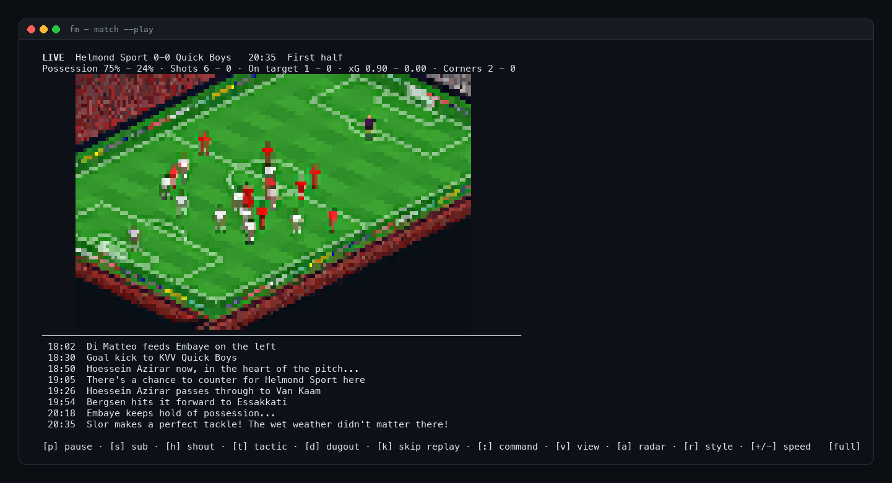
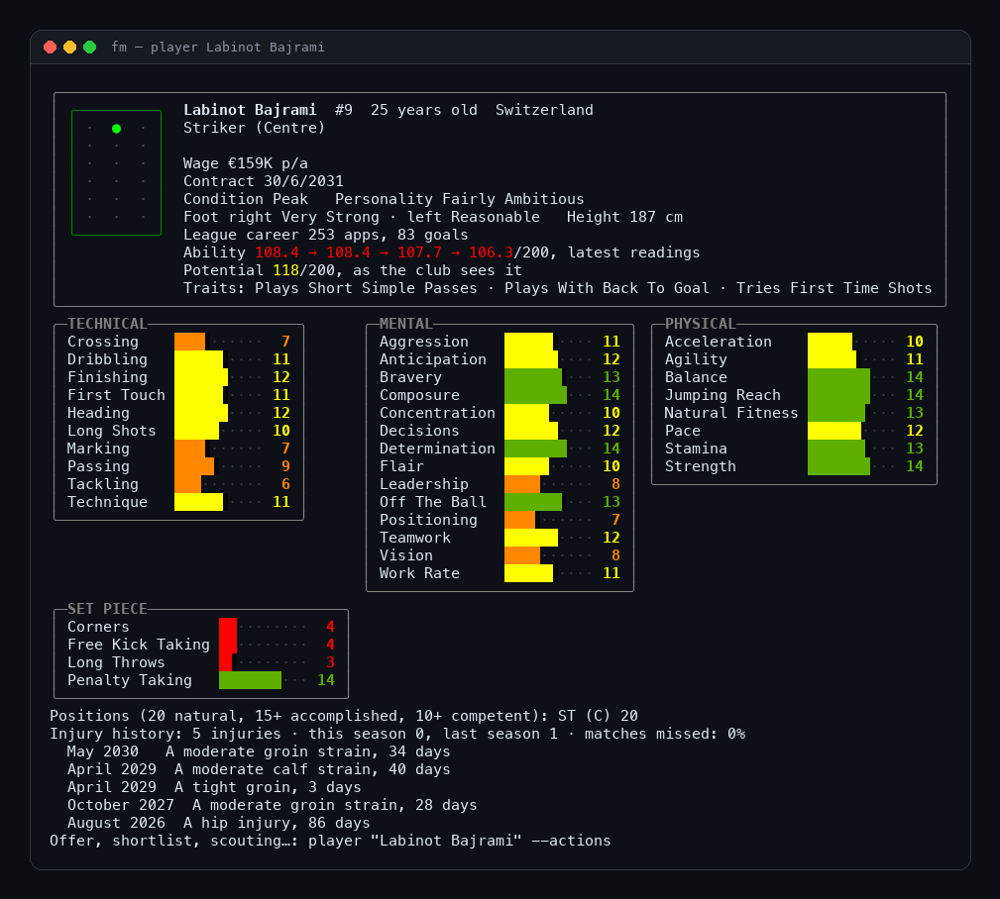
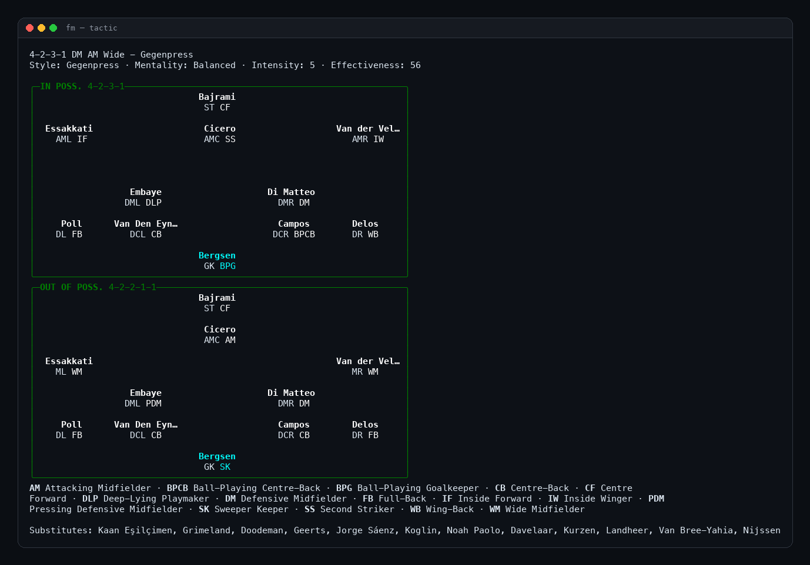
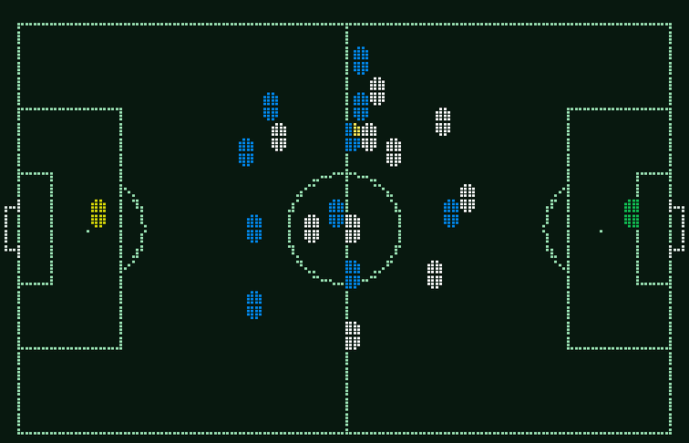
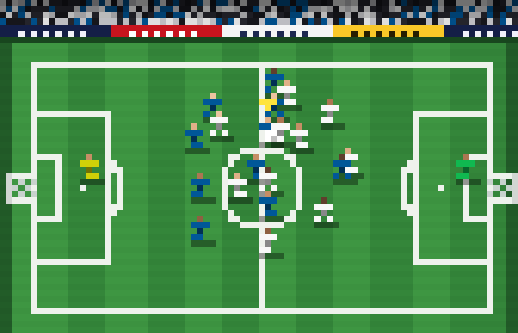
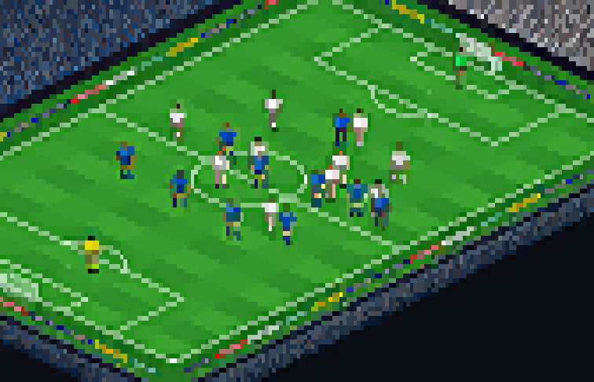

# fm-cli

Play the real **Football Manager 27** from a terminal.

- A BepInEx plugin inside the game shares its data and events over local HTTP.
- The `fm` CLI turns them into commands. An MCP server gives AI clients the same commands.
- The game stays open in the background. No screen capture, no mouse.

<p align="center">
  
</p>

```
$ fm status
FM is open, save loaded. 25 September 2038 Saturday 13:00
Next match: FC Den Bosch · away · Keuken Kampioen Divisie · 1 October Friday 20:00 (in 6 days)
Transfers: window closed
Ready to continue: next
```

## What it does

- Squad, players, tactics, training, transfers, contracts, scouting, staff, club, saves.
- Match day with a live panel and radar; press conferences and talks.
- Output in the game's language. `fm lang english|turkish|auto` changes only the CLI.
- Sentences instead of commands (Turkish or English). Anything that changes the game asks first.

<table>
  <tr>
    <td width="50%"></td>
    <td width="50%"></td>
  </tr>
  <tr>
    <td align="center"><code>fm player "&lt;name&gt;"</code></td>
    <td align="center"><code>fm tactic</code></td>
  </tr>
</table>

<table>
  <tr>
    <td width="33%"></td>
    <td width="33%"></td>
    <td width="33%"></td>
  </tr>
  <tr>
    <td align="center" colspan="3">The match radar in three of its seven styles, drawn from the game's own positions: <code>r</code> during a match</td>
  </tr>
</table>

More in the [illustrated manual](docs/MANUAL.md).

## Requirements

- macOS on Apple Silicon, Football Manager 27 from Steam.
- Development: .NET SDK 10. The packaged `fm` needs nothing else.

## Install

Needs a Mac with Apple Silicon and Football Manager 27 from Steam. Open the game once by hand, start a career and save it:
`fm start` loads the last save; it does not make a new career. Steam has to be open and signed in for `fm start`.

Then one of:

- **One line** (nothing else needed):

  ```bash
  curl -fsSL https://raw.githubusercontent.com/farukkavlak/fm-cli/main/install.sh | zsh
  ```

- **Homebrew:**

  ```bash
  brew tap farukkavlak/fm-cli https://github.com/farukkavlak/fm-cli
  brew trust --formula farukkavlak/fm-cli/fm-cli   # Homebrew asks this for a formula outside its own
  brew install fm-cli
  fm doctor --install   # puts BepInEx and the plugin beside the game; again after each brew upgrade, game closed
  ```

- **By hand:** download `fm-cli-osx-arm64.zip` from [Releases](https://github.com/farukkavlak/fm-cli/releases), unpack it and run
  `zsh install.sh` in the folder (not `./install.sh`: macOS may refuse a downloaded script run directly).

`zsh` comes with every macOS, whatever shell you use. The one line and the zip put `fm` in `~/.local/bin`;
if that is not on your PATH, the install prints the line for your shell (zsh, bash or fish).

`fm doctor --install` downloads the language model (~290 MB) and checks 8 steps. Before the first `fm start`, "Shadow bundle" is ✗: the first start builds it.
The first start takes longer: BepInEx reads the game once.

- Game in another folder: `FM_HOME=/path/to/Football Manager 27`.
- From source (.NET SDK 10, BepInEx 6 IL2CPP arm64 unpacked in `~/fm27_bep/game`): `tools/install.sh`.

## First steps

```bash
fm start          # open the game hidden, load the last save
fm status         # date, next match, what is waiting
fm inbox          # messages, numbered; fm reply 3 to open one
fm next           # continue; stops at anything that needs an answer
fm go             # on to match day, with what came in on the way
fm match          # play match day (--instant for a quick result)
fm save --yes     # save the game
fm stop           # close the game (asks to save first: --save / --no-save)
fm help           # the command groups; fm help squad: one group; fm help --all: every command
```

During a match: `s` sub, `h` shout, `t` tactic, `v` view, `a` radar, `r` radar style, `+/-` speed, `:` any command.
Scripts: `--json` on reads, `--dry` on writes, `--yes` where a command would ask.

## MCP (AI clients)

`fm mcp` serves the commands as MCP tools over stdio. Start the game with `fm start` first.

```bash
claude mcp add fm -- ~/.local/bin/fm mcp          # Claude Code
```

Other clients:

```json
{ "mcpServers": { "fm": { "command": "/Users/<you>/.local/bin/fm", "args": ["mcp"] } } }
```

## Layout

```
plugin/FmCliProbe/   the plugin inside the game (C#, BepInEx 6 IL2CPP)
cli/fm/              the fm command (.NET)
tests/               unit tests, sentence tests, live test lists
tools/               install, package, tests, dumps
docs/reference/      data dumped from the game
```

## Docs

- [MANUAL.md](docs/MANUAL.md): illustrated manual
- [TASKS.md](docs/TASKS.md): open work
- [PORTING.md](docs/PORTING.md): how the bridge works, FM27 notes
- [CODE-LAYOUT.md](docs/CODE-LAYOUT.md): which file holds what
- [AI.md](docs/AI.md): sentences and the assistant

## Checks

```bash
tools/ci.sh                  # build and tests, no game needed
tools/sweep.sh               # every read command against the running game
python3 tools/mcp-check.py   # a real MCP client, read only
```

## License

MIT, see [LICENSE](LICENSE). The sentence model is fine-tuned from `paraphrase-multilingual-mpnet-base-v2` (Apache-2.0).

Not affiliated with Sports Interactive or SEGA. Football Manager is their trademark; you need your own copy of the game.
