# fm-cli manual

A terminal client for Football Manager 26. The game stays open in the background; `fm` reads its
data and sends its own events. This guide shows the main workflows with screenshots. The full
command list is in [USAGE.md](USAGE.md) or `fm help`.

Screenshots come from real games, mostly with the game in Turkish: labels follow the language the
game is set to. Names and numbers are illustrative. The current English wording of every command is
in [USAGE.md](USAGE.md).

## 1. Start and status

```bash
fm start          # launch the game, load the last save, enter a session
fm status         # date, next match, what is waiting
fm next           # continue; stops at a real blocker
```

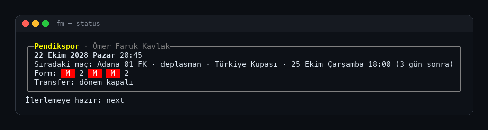

`status` names injured players when the next match is today or tomorrow, and says when the game is
on the post-match results screen. `next` stops for an unanswered message, a press conference, match
day, or a question left after a match.

### Language

The CLI follows the game's language. To use another language for the CLI alone:

```bash
fm lang english    # CLI text in English; the game's data keeps its own language
fm lang turkish
fm lang auto       # follow the game
FM_LANG=english fm status
```

The choice is kept in `~/.config/fm-cli/language-choice`; `fm lang auto` removes it.

## 2. Inbox, replies and talks

```bash
fm inbox              # numbered messages
fm inbox --tasks      # offers and registration messages on the Tasks tab
fm reply 4            # read message 4 and list its answers
fm reply 4 2          # answer it with choice 2
fm talk               # the open conversation: what was said and what can be said
```

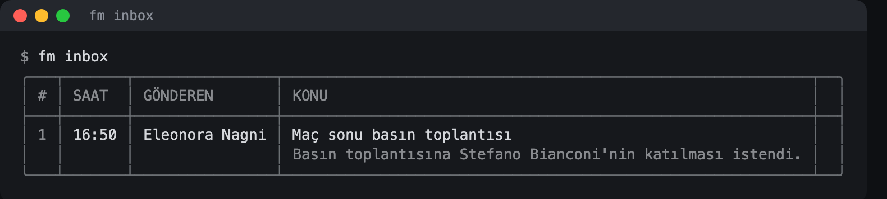

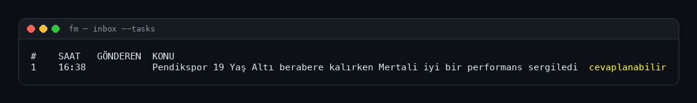

Messages that need an answer block `next`. A message with no answer is read and closed.

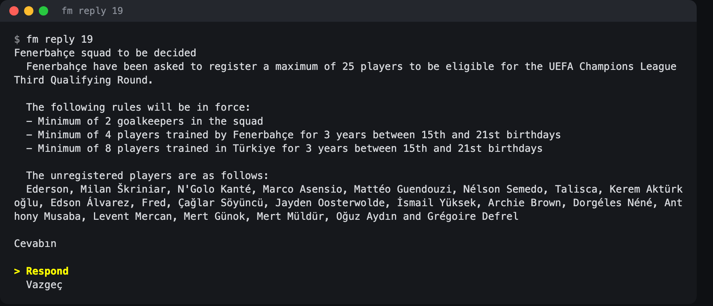


## 3. Squad

```bash
fm squad                 # position, age, status, wage, value
fm squad --fitness       # condition and match sharpness, most tired first
fm squad --morale        # morale, hierarchy and social groups
fm squad --stats         # apps, minutes, goals, assists, average rating, cards
fm squad --u19           # the youth sides
fm squad --views         # the table's own views
```

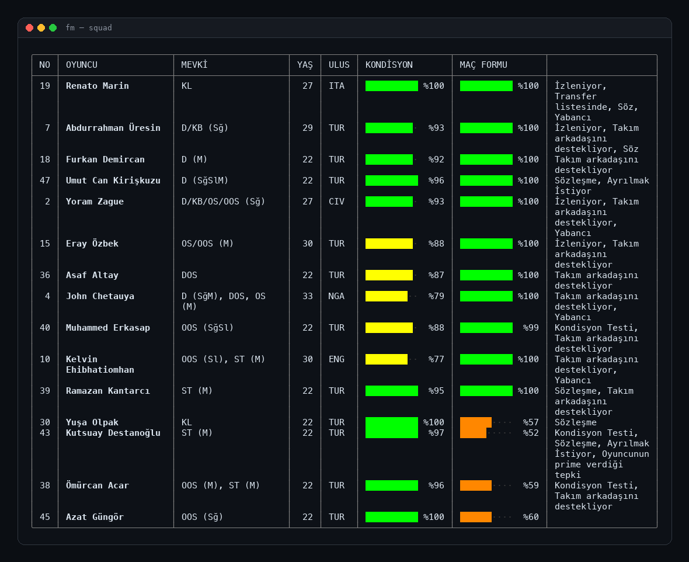

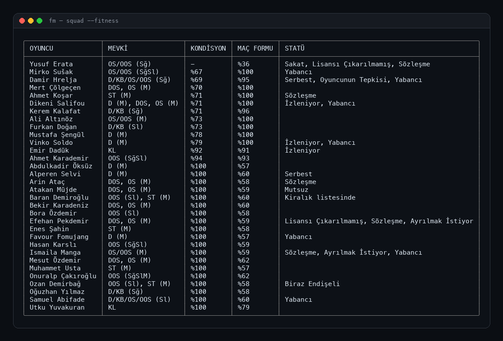

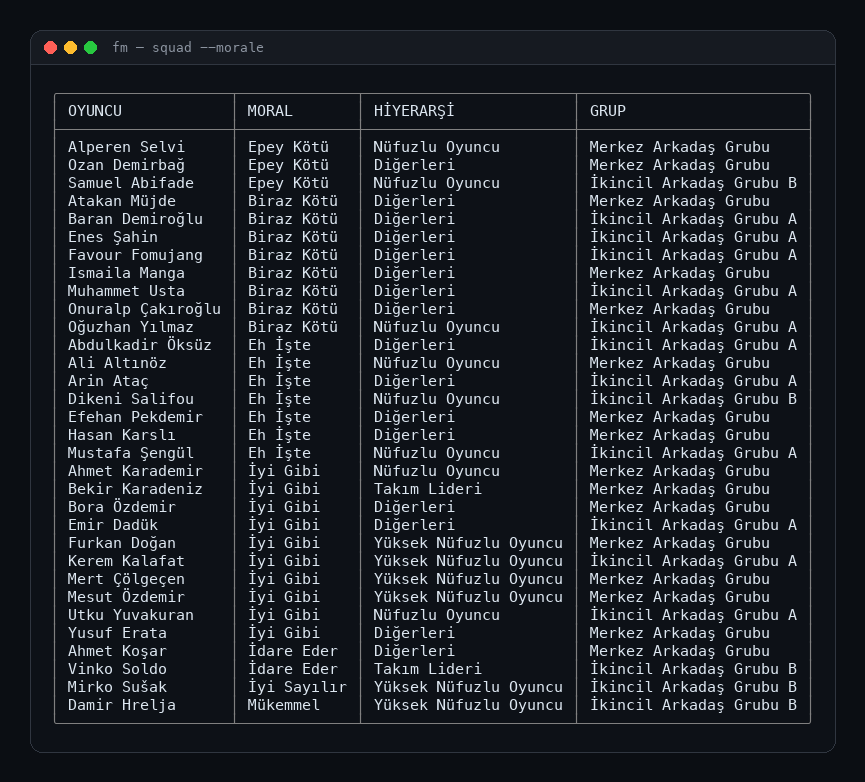


### Contracts, health and depth

```bash
fm contracts             # whose contract ends when, soonest first
fm contracts "A Player"
fm health                # injured, tired, low sharpness, highest injury risk
fm doctor                # what is wrong, with the command for each finding
fm depth                 # who can play each position, age profile
fm happiness             # morale and the reasons
fm progress              # who is improving or declining
```


## 4. Players

```bash
fm player "A Player"          # page: identity, contract, traits, attributes, positions
fm player "A Player" --report # scout report
fm player "A Player" --career # season by season
fm player "A Player" --matches
fm search "text"              # the game's search
fm compare "A Player" "B Player"
fm query "age<23 and potential>140" [--sort field] [--asc]
```

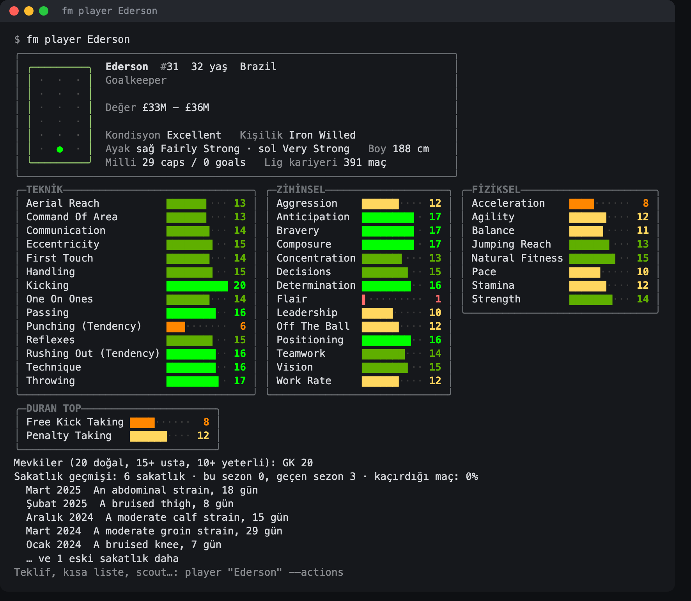


## 5. Tactics and training

```bash
fm tactic                    # shape, style, mentality, roles, familiarity
fm tactic pick               # let the game pick the eleven
fm tactic role <position> [<role>] [--oop]
fm tactic player <position> <player>    # anyone in the squad; the one there goes to the bench
fm tactic player <substitute> <player>  # swap a substitute (an injured one) for another
fm tactic instructions ["<instruction>" [<value>]]
fm tactic pi <position|player> ["<instruction>" [<value>]]
fm opposition [<player> <instruction>=<value>]
```

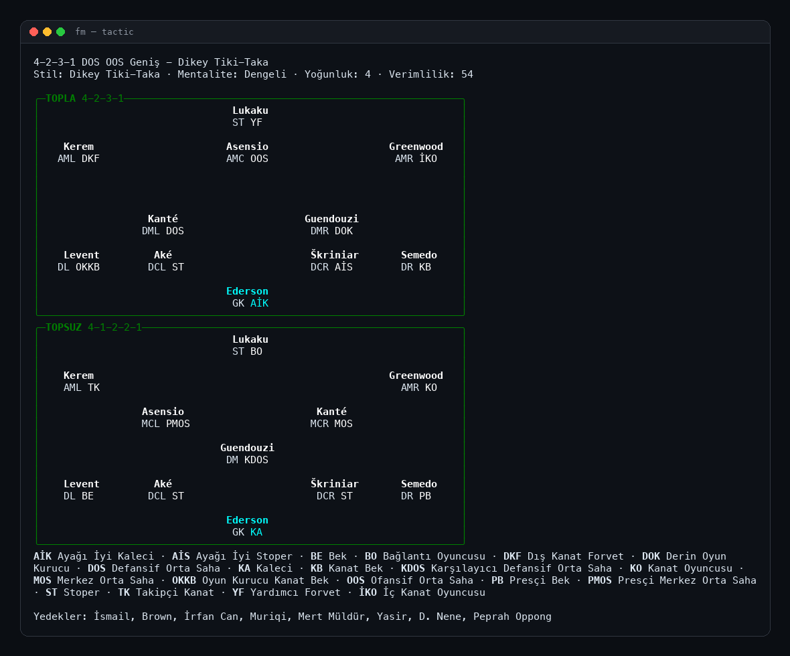

```bash
fm training [<player>] [--focus ...] [--position ...] [--role ...]
fm training <player> --report [--coach <name>]
fm training <player> --trait ["<trait>"]
fm schedule                  # this week and next, three sessions a day
fm intensity                 # per-player intensity
fm coaches                   # coaching assignments
fm prep                      # match preparation focuses
fm setpieces new             # set-piece routines
fm takers                    # set-piece takers
fm penalties                 # penalty order and rules
```

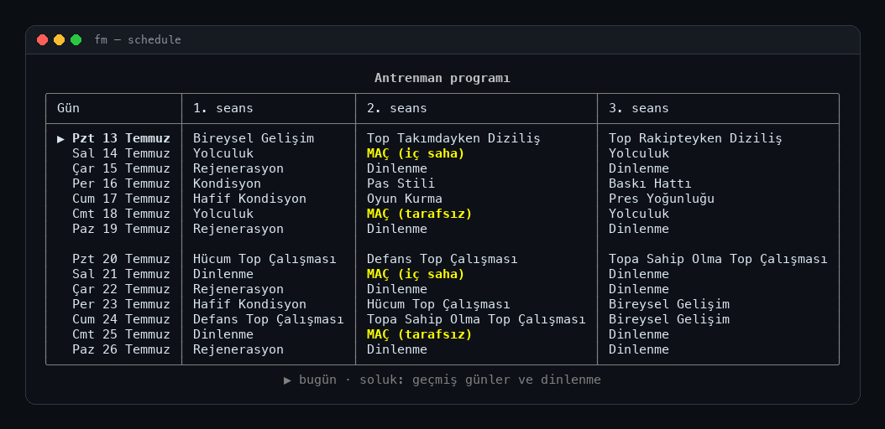

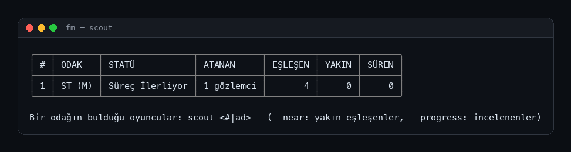


## 6. Match day

```bash
fm match             # asks: watch in the terminal or instant result
fm match --play      # watch: commentary, goals, talks
fm match --instant   # leave it to the assistants
fm sub               # during a match: on the pitch and the bench
fm sub <off> <on>
fm shout [<x>]
fm dugout [<no> <apply|dismiss>]
fm report            # the last match: score, scorers, player of the match, stats
fm opponent          # the next opponent: form, formation, key players, news
```

At a terminal, `match --play` draws a live panel: score, clock, period, the radar (or the shape pitch
when the radar is off), the last events and the commands that work during the match. A redirected
run or an MCP call keeps the plain line-by-line output. Keys during play: `s` substitution, `h` shout, `t` tactic
(mentality or role), `v` view (full, key moments, score only), `a` radar on/off, `r` radar style, `+`/`-` speed (when the match screen offers it; otherwise it points to settings). The pitch
refreshes after a substitution; at an injury stop it names the player and asks who comes on. The
radar draws the ball and every player from the game's own match simulation, so it shows the real
shape rather than a sketch. It comes in seven styles, `r` cycling through them: `pixel` (a retro
pitch with little players in their kits; needs 24-bit colour), three 3D scenes that need 24-bit
colour and follow the ball — `iso` (isometric stadium), `raycast` (a low camera on the pitch) and
`voxel` (little cubes) — then `braille` (fine dots, any terminal), `colour` (coloured ASCII on mown
stripes) and `ascii` (plain). The 3D scenes use sextant blocks (six pixels a cell) in Ghostty, kitty,
WezTerm, iTerm2 and VS Code and half blocks elsewhere (`FM_SEXTANTS=0` or `1` overrides); without
24-bit colour they say so and show braille. `auto`, the default, is `pixel` where
the terminal has 24-bit colour and `braille` otherwise. The radar takes the panel's width (up to 86
columns); when the window is too small for the chosen style it says how much room it needs, and
pressing `r` turns colour on if it was off and the next style needs it. Live possession/shots are not in the game's bindings during
a match, so they appear in `report` after the whistle.

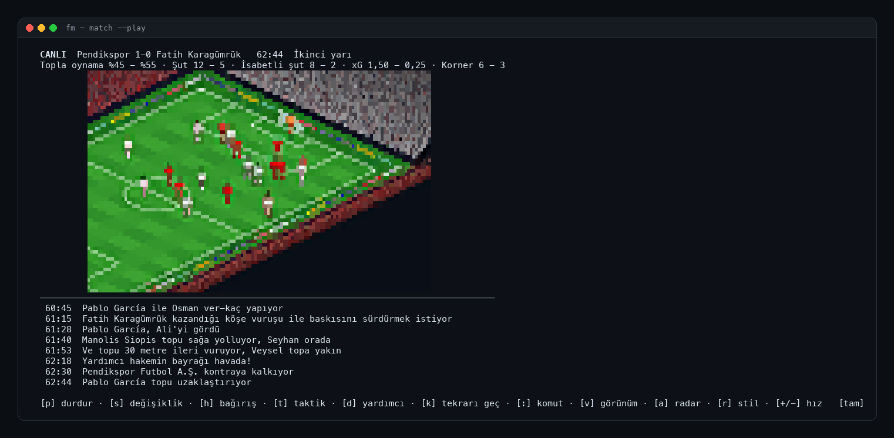

*The live panel with the `iso` radar (Empoli – Avellino, 4 March 2029).* The seven radar styles, each
from `fm settings panel radar <style>`, which previews a frame from a real match:

| | |
|---|---|
| `pixel` 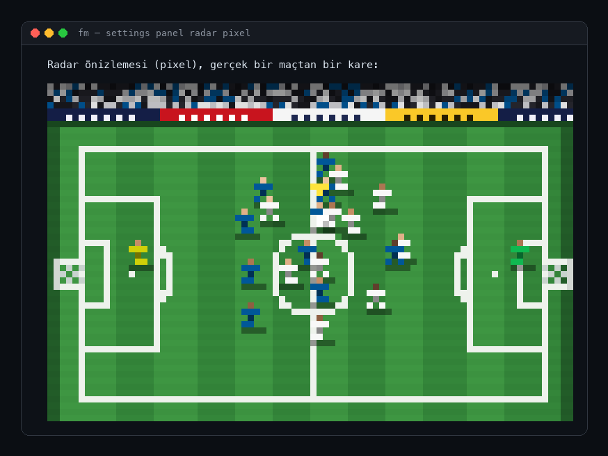 | `iso`  |
| `raycast`  | `voxel` 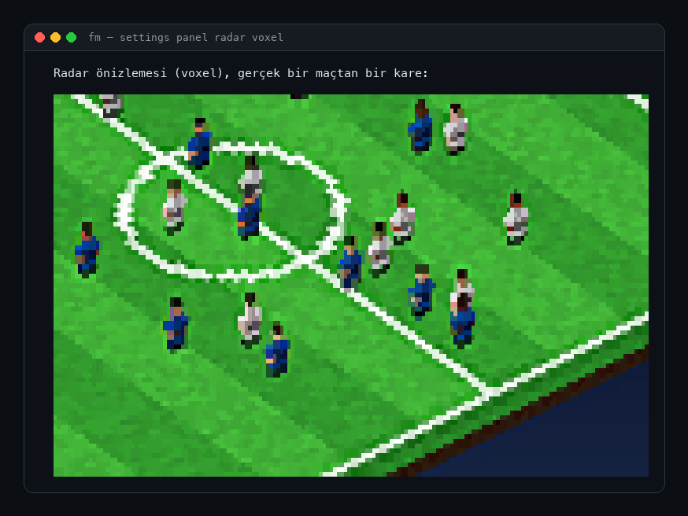 |
| `braille`  | `colour`  |
| `ascii` 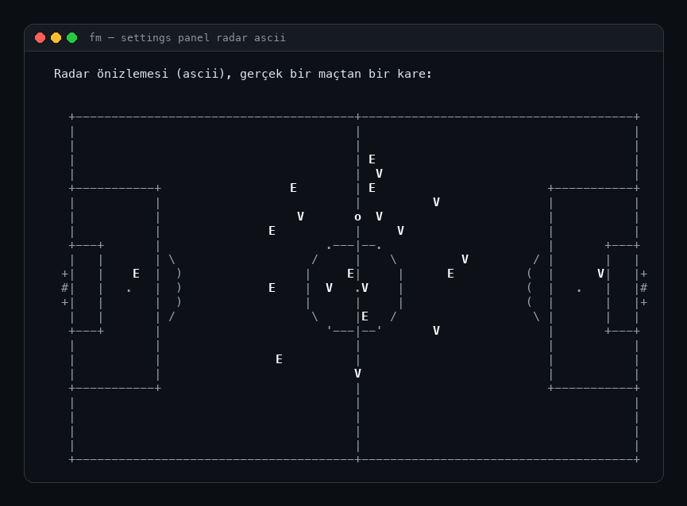 | |

Moving versions from real matches are in `docs/experiments/live-gifs/`. Screenshots are drawn with
`tools/manual-shot.py` (a command in a 24-bit colour pty, or a frame from `tools/live-capture.py`).

The panel's own settings live in `~/.config/fm-cli/panel.json`; change them with `fm settings`:

```bash
fm settings panel                              # show them
fm settings panel view key                     # full, key or score
fm settings panel pitch off events 5 colour off radar on
fm settings panel radar braille                # pixel, iso, raycast, voxel, braille, colour, ascii or auto; shows a preview
fm settings panel reset
```

`view` sets the first view of the `v` cycle; the keys still cycle for the session.


## 7. League, fixtures and cups

```bash
fm table [competition]
fm fixtures [--all]
fm calendar [month] [--u19]
fm league [competition] [--stat <name>] [--teams] [--top <n>]
fm stages [competition] [stage] [--all] [--list]
```


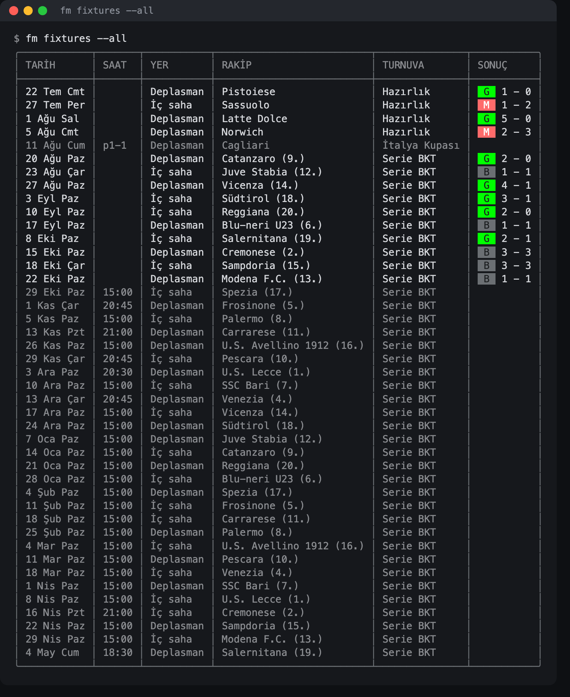


## 8. Transfers and contracts

```bash
fm targets [<position>] [--max-value <money>] [--age <range>]
fm players [--filter ...] [--view ...]
fm offer "<player>" [fee] [--term "Label=value"] [--loan] [--dry]
fm offer "<player>" --send --yes
fm offers                    # offers for our players
fm propose "<player>" [fee] [--loan] [--yes]
fm release "<player>" [--free|--mutual] [--yes]
fm contract ["<player>"]     # talks: promises, then terms
fm contract "<player>" --next
fm contract "<player>" --sign --yes
fm contract "<player>" --agent
```

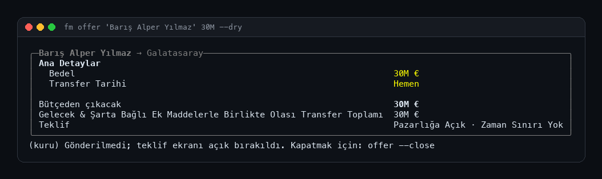


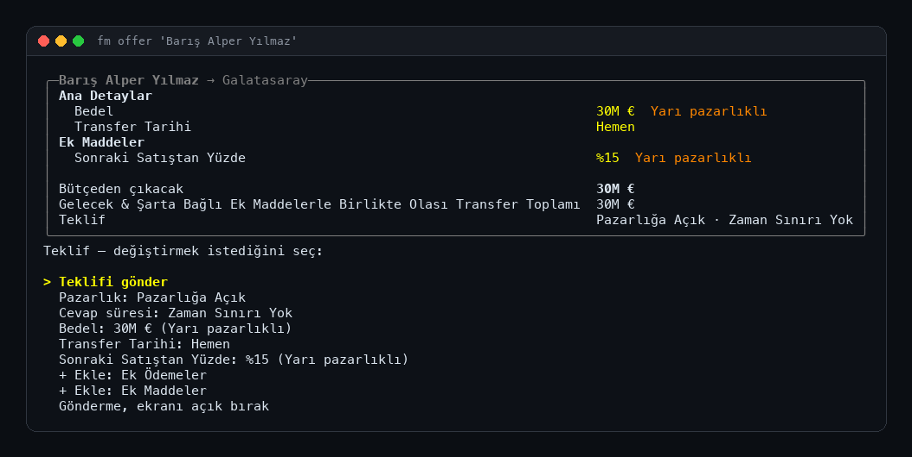

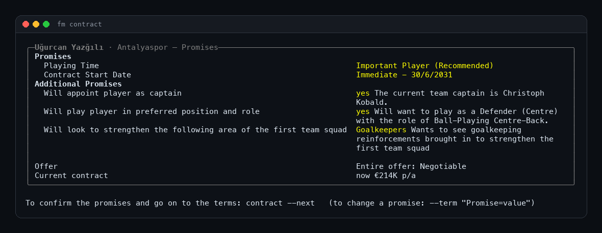


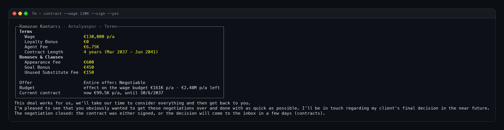

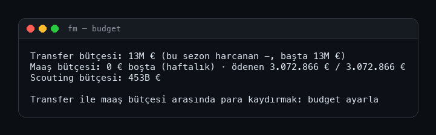

### Registration and numbers

```bash
fm register [--in <player>] [--out <player>] [--auto] [--send]
fm numbers [<player> <no>] [--auto] [--send]
```


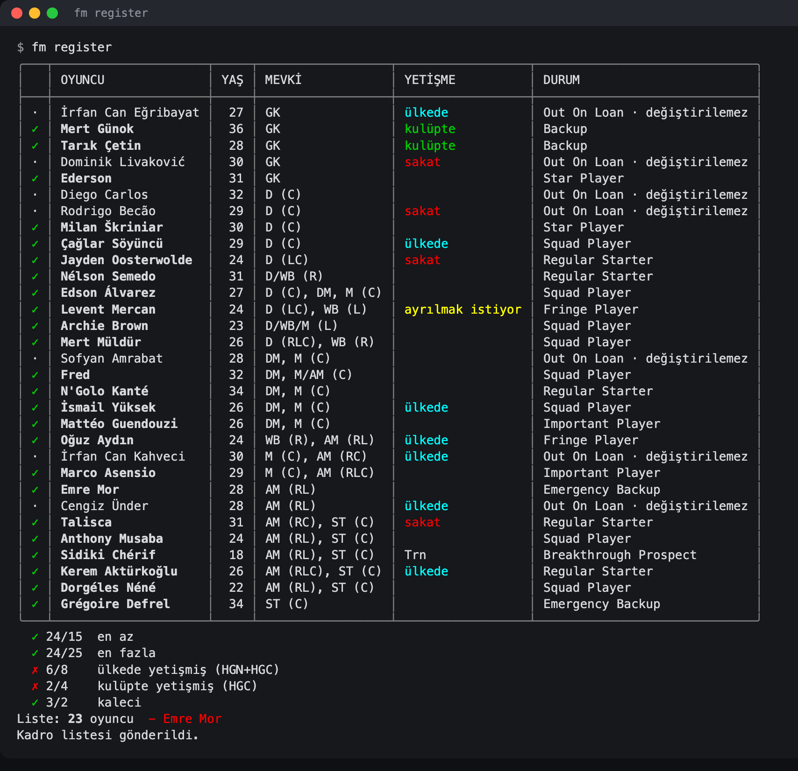

## 9. Club

```bash
fm club           # board, vision, supporters, money, facilities, staff gaps
fm board          # the board's and supporters' view
fm finances [income|expenditure] [period]
fm supporters
fm staff
fm facilities
fm responsibilities [<duty>]
fm world          # loaded save, date, nations, leagues, players
```


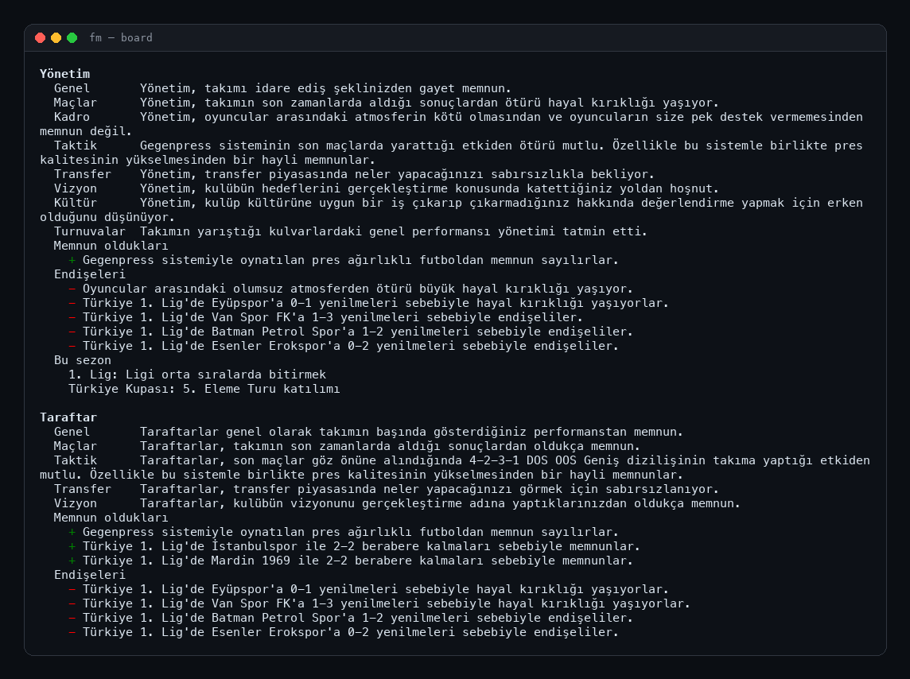

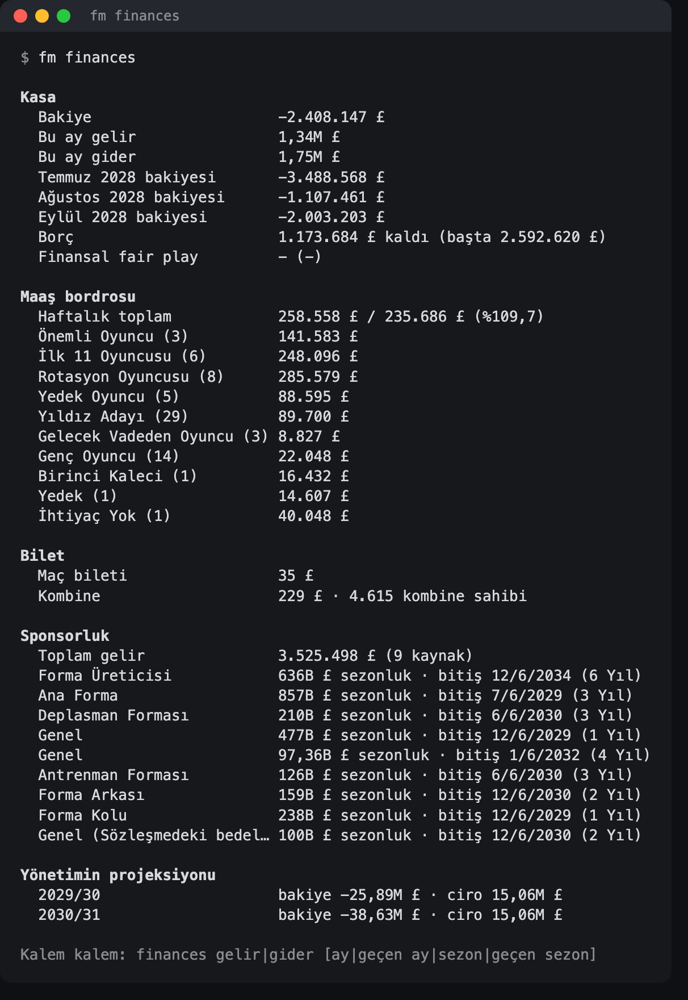


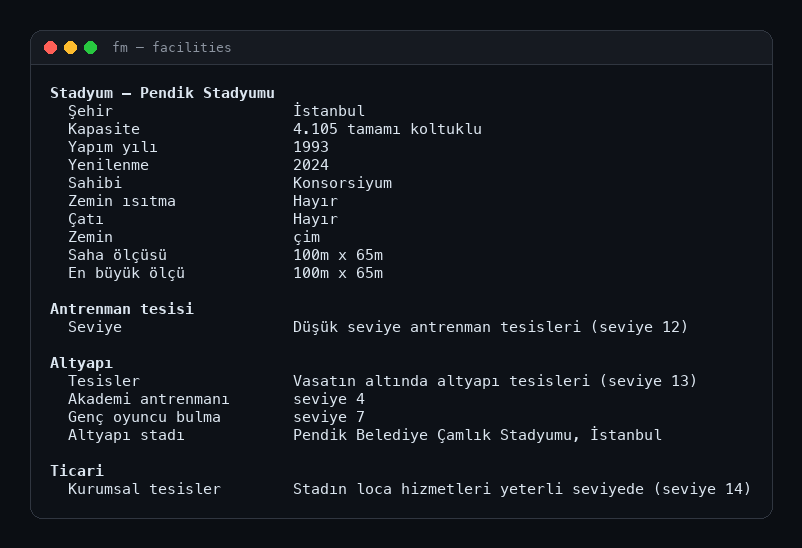


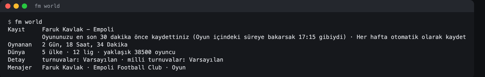

## 10. Saves and settings

```bash
fm saves
fm save --yes
fm save --as "<name>" --yes
fm load "<name>" [--save|--no-save]
fm settings                    # the game's preferences
fm settings "<setting>" [<value>]
```

Settings change the game itself. The CLI's own language is set with `fm lang` (see above), not by
`fm settings`.

## 11. MCP and scripts

```bash
fm mcp                     # the commands as MCP tools over stdio
python3 tools/mcp-check.py # a real MCP client check (needs: pip install mcp)
tools/sweep.sh             # run every read-only command against the game
```

Every command has `--json` (and often `--csv` / `--md`) for scripts. Writes that cannot be undone
ask at a terminal and need `--yes` in a script.

## 12. More commands

```bash
fm news [#]                 # the press: headlines, or one story in full
fm shortlist [add|remove <player> --for <length>]
fm interest "<player>" --top|--transfer|--loan [--yes]
fm enquire "<player>"       # ask the club what it wants
fm trial "<player>" --for <1-4 weeks> [--yes]
fm diff [--keep|--reset]    # what changed since the last look
fm export <file.md|csv> [commands…]
fm internationals           # our players' national teams
fm mentoring [--auto|new|remove]
fm dynamics                 # dressing room: atmosphere, support, hierarchy
fm captains [--captain|--vice <player>]
fm actions "<person>" ["<option>"]   # the game's right-click menu
fm vision [confirm|remove|suggest|undo|reset|end]
fm jobs [<club>] [apply|interest] [--yes]
fm resign [--yes]
fm saves · fm save · fm load
```

`fm help` lists every command and flag; [USAGE.md](USAGE.md) has the full text.

## 13. Everything else

```bash
fm pages                    # the game's pages
fm open "<page>" [--tab <tab>]
fm buttons [text] [--all]
fm press "<label>" [--name <name>] [--dry]
fm dropdowns [text]
fm select <list> "<option>" [--dry]
fm dialog [answer]
fm tour [--skip]
fm news [#]
fm inbox --all
```

A command that is not here: `fm help <command>` or [USAGE.md](USAGE.md). If a screen is missing a
command, `pages` / `buttons` / `press` reach it.
