# fm — Kullanım Kılavuzu

Gerçek Football Manager 26'yı terminalden oynamak için. Oyun arka planda açık durur,
sen her şeyi `fm` komutlarıyla yaparsın.

> Ekran görüntüleri gerçek oyundan alınıyor. Yenilemek için oyun açıkken:
> `tools/manual/shots.sh` (hepsi) ya da `tools/manual/shots.sh squad` (adında "squad" geçenler).
> Okla seçilen, oyunu değiştiren komutlar (`reply`, `register`, `match`…) oynanarak çekilir:
> `uv run --with pyte tools/manual/drive.py docs/manual/img <sahne>` — sahneler `drive.py`'nin
> başında, hangi tuşa basılacağı ve ne zaman fotoğraf çekileceğiyle. Bunlar oyunu ilerletir.
> Bir komut eklenince ya da değişince: görüntüsünü ilgili listeye ekle, buraya bölümünü yaz.

**İçindekiler**
1. [Başlarken](#1-başlarken)
2. [Neredeyim? — `status`](#2-neredeyim--status)
3. [Gelen kutusu ve cevaplar — `inbox`, `reply`](#3-gelen-kutusu-ve-cevaplar--inbox-reply)
4. [Zamanı ilerletmek — `next`](#4-zamanı-ilerletmek--next)
5. [Kadro — `squad`](#5-kadro--squad)
6. [Oyuncu kartı — `player`, `search`](#6-oyuncu-kartı--player-search)
7. [Taktik — `tactic`](#7-taktik--tactic)
8. [Maç günü — `match`, `sub`, `talk`, `report`](#8-maç-günü--match-sub-talk-report)
9. [Lig ve fikstür — `table`, `fixtures`](#9-lig-ve-fikstür--table-fixtures)
10. [Transfer ve sözleşme — `players`, `offer`, `contract`](#10-transfer-ve-sözleşme--players-offer-contract)
11. [Kaydetmek ve oyun ayarları — `save`, `settings`](#11-kaydetmek-ve-oyun-ayarları--save-settings)
12. [Kulüp — `club`, `staff`, `finances`, `supporters`, `board`, `facilities`](#12-kulüp--club-staff-finances-supporters-board-facilities)
13. [Her şeye erişim — `pages`, `buttons`, `press`](#13-her-şeye-erişim--pages-buttons-press)
14. [Claude'dan oynamak — MCP](#14-claudedan-oynamak--mcp)

---

## 1. Başlarken

```
$ fm start
FM başlatılıyor…
Son kayıt yükleniyor…
Hazır.
fm›
```

`fm start` oyunu açar, son kaydı yükler ve seni `fm›` oturumuna sokar. Oyun zaten açıksa
ona bağlanır. Oturumun içinde komutları `fm` yazmadan verirsin (`squad`, `next`…); oturum
dışında her komutun başına `fm` eklenir (`fm squad`). Bu kılavuz ikinci yazımı kullanıyor.

Oyun ekranda ve Dock'ta görünmez. Pencereyi görmek istersen: `fm start --debug`.

### Dil

Çıktı oyunun dilindedir. Oyun Türkçeyse `fm` Türkçe, İngilizceyse İngilizce yazar. Bu hem oyunun
kendi yazıları (mevki, rol, maç türü, mesajlar) hem de `fm`'in kendi etiketleri (tablo başlıkları, yardım,
sorular) için geçerli. Türkçe ve İngilizce dışındaki dillerde `fm`'in etiketleri İngilizce kalır, oyunun
yazıları yine oyunun dilinde gelir. Dili değiştirmek için: `fm settings dil English --yes` (İngilizce oyunda
`fm settings language Türkçe --yes`). `fm` bir sonraki komutta kendiliğinden uyar. Bu kılavuzdaki örnekler Türkçe oyundan.

Kayda oyunun kurulduğu dilde yazılan adlar (ülke adları, eski sakatlıklar, hazırlık maçı turnuvasının adı)
dil sonradan değişince oyunun kendi ekranında da eski dilde kalır; `fm` de oyunun gösterdiğini yazar.

Komut adları ve seçenekler her dilde aynıdır. Cevap ya da seçim yazarken oyunun gösterdiği kelimeyi
kullanırsın: İngilizce oyunda `reply 2 Reject`, `talk "worth more"`, Türkçe oyunda oyunun Türkçesi. Numara
her dilde çalışır.

### Kısaltmalar ve tab tamamlama

Komutun tamamını yazmak gerekmez:

- Başı yeter, tek bir komuta uyuyorsa: `fm sq` → `squad`, `fm fix` → `fixtures`. Birden çok komuta
  uyuyorsa (`fm re`) adaylar listelenir.
- Kısa adlar: `s` status · `n` next · `i` inbox · `t` table · `fx` fixtures · `m` match · `p` player · `tc` tactic.
- Türkçe adlar, aksanlı ya da aksansız: `kadro`, `taktik`, `maç`/`mac`, `tablo`, `fikstür`, `gelen`, `ileri`,
  `sağlık`, `yönetim`, `doktor`… Oyuncu bırakan ya da teklif gönderen komutların kısa adı yok.

Bir komutun ne aldığını unuttuysan sonuna `--help` yaz; komut çalışmaz, yalnızca kendi yardım
satırlarını basar: `fm scout --help`, `fm match --help`. Hepsi için `fm help`.

Tab tamamlama için kabuğuna bir satır ekle:

```
# ~/.zshrc
source <(fm completion zsh)
# ~/.bashrc (macOS'un bash'i <(…) ile yükleyemiyor)
eval "$(fm completion bash)"
```

zsh komutları açıklamalarıyla, seçenekleri (`fm squad --<Tab>`) ve oyun açıksa kadrodaki oyuncuların
adlarını tamamlar: `fm player Ke<Tab>` → `fm player Kerem\ Aktürkoğlu`.

## 2. Neredeyim? — `status`

Kaybolduğunda ilk yazacağın komut. Tarihi, sıradaki maçı, son maçların formunu ve oyunun
şu an neyi beklediğini söyler.


Alttaki "Bloke" satırı önemli: oyun bir şey beklerken zaman ilerlemez. Neyi beklediğini ve
hangi komutla çözüleceğini burada yazar.

## 3. Gelen kutusu ve cevaplar — `inbox`, `reply`


- Mavi nokta: okunmamış.
- **cevaplanabilir**: istersen cevap verirsin, vermezsen oyun devam eder.
- **cevap bekliyor**: cevaplamadan zaman ilerlemez.

Cevaplamak için mesajın numarasını ver. Mesajın tamamı ve cevapları çıkar, okla seçip Enter'a basarsın:


Seçince oyunun ne dediği altta yazar:


Burada mesaj cevaplandı ama oyun kadro listesini hâlâ bekliyor: listeyi göndermek ayrı bir
iş, onu `register` yapıyor (aşağıda).

Seçimi doğrudan da verebilirsin: `fm reply 4 2` ya da cevabın bir parçasıyla `fm reply 4 accept`.

Bazı mesajların bir **eki** olur ve `reply` onu da gösterir. Örneğin yeni kulübün "Set Code of Conduct"
mesajında "Confirm" demek bu ceza tablosunu onaylamak demektir:

```
  Ek: Code of Conduct
CEZA (maaştan, Wk = haftalık)  1. KEZ   2. KEZ   3. KEZ   4. KEZ
Missed Training                1/2 Wk   1 Week   2 Wks    2 Wks
Sent Off (Straight Red)        1/2 Wk   1 Week   1 Week   2 Wks
…
```

Diğer sık ekler de kısaca okunur: gözlemci raporu (not, görüş, artılar/eksiler, değer ve ücret),
oyuncumuza gelen teklifin kartı, oyuncu tavsiyeleri, maç sonrası veri merkezi analizi, maç hazırlığı
odakları, antrenman ilerleme raporu ve sezonluk galibiyet primleri (seçili olan köşeli parantezde):

```
  Ek: gözlemci raporu — B+ · Harika bir transfer olur.
    Bilgi Seviyesi Yüksek · şu an: Sky Bet League One'nin önde gelen oyuncularından · gelecek: Gözlemcilik Gerekiyor
    + Dili akıcı konuşabiliyor.
    - Soğukkanlılığı düşük olması onun yeteneğini baltalayan bir durum.
    Hevertton · D/KB (Sğ) · 25 yaşında · BRA · QPR
    Değer 90B £ - 900B £ · ücret 27,5B £ - 32,5B £ aylık · sözleşme 30/6/2027'e kadar

  Ek: kadronun galibiyet primleri (artış ya da düşüş transfer bütçesine yansır)
    Sky Bet League One: Düşük (150B £) · [Normal (250B £)] · Yüksek (350B £)
```

Mesajı numara yerine konusunun bir parçasıyla da açabilirsin, oyunun dilinde: `fm reply "primlere karar"`.

Basın toplantısı mesajında da olası konular ve gelecek gazeteciler (kurum, etki, sana karşı tutum) yazar.
Toplantıya katılınca sorular `talk` ile cevaplanır. Seçenekler [Positive] / [Neutral] / [Negative] diye
gruplanır, ama grupların sırası her soruda değişir.

### Kadro listesi — `register`, `numbers`

Sezon başında ve her Avrupa turundan önce oyun kayıtlı oyuncu listesi ister; gönderilmeden
zaman ilerlemez. `fm register` listeyi açar: kim listede (✓), kim yetişme kotasına sayılıyor
(**kulüpte** / **ülkede**), kim değiştirilemez (kiralıkta olanlar), ve turnuvanın kuralları.


Altta menü var: oyuncunun üstüne gelip Enter'a basınca listeye girer ya da çıkar.
"Yardımcı seçsin" oyunun önerdiği listeyi kurar.


Menünün başlığı kuralların anlık halini gösterir. Hepsi ✓ olunca en üste **Listeyi gönder** gelir:


Gönderince ne değiştiği yazılır:


> **Yetişme kotası tutmuyorsa:** UEFA listesi 25 kişi, bunun 8'i yetişmiş oyunculara ayrılmış.
> Yetişmiş oyuncun eksikse o kadar yer boş kalır: yetişme bayrağı olmayan oyunculardan
> çıkarırsın, oyun kotayı ✓ sayar. Örnekte 6 yetişmiş oyuncu vardı (8'den 2 eksik), yani
> en fazla 23 kişi; Emre Mor çıkınca liste gönderilebildi.

Script'te ya da Claude'dan:

```
fm register                        listeyi ve kuralları yaz
fm register --out "Emre Mor"       listeden çıkar  (--in: listeye koy; ikisi de tekrarlanabilir)
fm register --auto                 önce yardımcı seçsin
fm register --send                 gönder (kurallar tutuyorsa)
```

`fm numbers` forma numaralarını gösterir: kim kaç giyiyor, kim hangi numarayı istemiş, hangi numaralar boş.

```
NO   İSTEDİĞİ   OYUNCU              MEVKİ              STATÜ
4    4          Çağlar Söyüncü      D (C)              Rotasyon
6               Mattéo Guendouzi    DM, M (C)          Önemli
…
-    40         Dominik Livaković   GK                 Kiralıkta

Boş numaralar: 1 2 8 10 15 16 19 23 25 28 29 36 38 40 41 …
Oyun şu an numara değişikliği almıyor: numaralar sezon başında ya da yeni transfer gelince
kaydediliyor, sonra sezon sonuna kadar değişmiyor.
```

Oyun numara beklerken (sezon başı, yeni transfer):

```
fm numbers "livakovic" 40    numarayı sayfada seç (dolu numarayı vermez, kimde olduğunu söyler)
fm numbers --send            sayfadakini kaydet — kaydedilince sezon sonuna kadar değişmez
fm numbers --auto            hepsini yardımcı dağıtsın ve göndersin
```

> Elle numara verme henüz canlıda denenemedi (sezon ortasında numaralar kilitli); ilk sezon başında
> ya da ilk transferde doğrulanacak.

## 4. Zamanı ilerletmek — `next`

`next` oyunun "Continue" tuşudur. Oyun bir yerde durana kadar (yeni mesaj, maç günü,
basın toplantısı…) ilerler ve neden durduğunu söyler. `next 3` üç kez ilerler.

```
fm› next
Bloke: 5 mesaj cevap bekliyor.
  08:13  Club vision and expectations meeting
  ...
```

Toplantı ya da basın toplantısı gibi bir konuşma açılırsa `talk` ile yürütülür (bkz. §8).

## 5. Kadro — `squad`

Kadro; kondisyon ve maç formu çubuklu. Sakat oyuncular kırmızı.


En yorgun önce sıralı kondisyon görünümü:


Moral, takım içi hiyerarşi ve sosyal grup:


Sezon istatistikleri: maç (ilk on bir, yedekten girdikleri parantezde), dakika, gol, asist,
ortalama puan, kart; en çok oynayan önce. Altında hiç oynamayanlar ve kiralıktakiler (kulübü ve
orada oynadığı maç).


Oyundaki kadro tablosunun başka görünümleri de var: `fm squad --views` listeler,
`fm squad --view "<ad>"` o görünümün kolonlarını gösterir.

Altyapı takımlarının kadroları (kulüpte hangileri varsa: U21, U18, U19…) `fm squad --u19` ile:

```
$ fm squad --u19
OYUNCU             YAŞ  POZİSYON        TAKIM
Charlie Carlisle   18   D (RC)          Lincoln U21s
Charlie Parks      19   D (C)           Lincoln U21s
…
```

### Sözleşme takvimi — `contracts`

Kadronun sözleşmeleri, en yakın biten önce; terminalde bir yıldan az kalan kırmızı, iki yıldan
az kalan sarı. Yenilemek için `contract <oyuncu>`.

```
$ fm contracts
OYUNCU            YAŞ  MEVKİ            BİTİŞ      KALAN
Grégoire Defrel   34   ST (C)           30/6/2026  9 ay
Fred              32   DM, M/AM (C)     30/6/2027  1 yıl 9 ay
```

### Kadro sağlığı — `health`

Sakatlar ve dönüş süreleri, kondisyonu düşük olanlar, maç formu düşük olanlar ve oyunun
sakatlık riski puanı en yüksek olanlar tek raporda:

```
$ fm health
Sakat
  N'Golo Kanté — A twisted ankle, 1 gün daha
Yorgun (kondisyon %85 altı)
  Kerem Aktürkoğlu 51%
Maç formu düşük (%60 altı)
  Çağlar Söyüncü 47%
Sakatlık riski en yüksek (oyunun puanı 385)
  Fred
```

### Kadroda ne yanlış — `doctor`

Sağlık, sözleşme, derinlik ve yönetim okumalarını tek bakışta toplar; her bulgunun yanında içine
girmek için hangi komutun kullanılacağı yazar. Ekran açmaz, bir iki saniye sürer. Sakatlar ve
dönüşlerine kalan gün, kondisyonu %85 altı olanlar, maç formu %60 altı olanlar, sözleşmesi bir
yıl içinde bitenler, sağlam oyuncusu bir ya da hiç olmayan mevkiler (sakatlar sayılmaz) ve yönetimin
endişeleri. Mutluluk ve taktiğe alışma ayrı komutlarda (`happiness`, `tactic`).

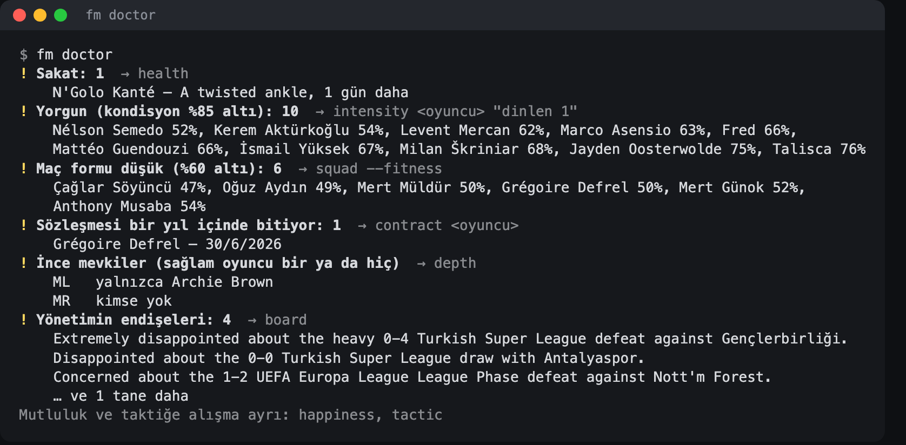

### Kim mutlu, kim neden değil — `happiness`

`fm happiness` oyuncuları en mutsuzdan başlayarak sıralar; yanında oyunun durum bayrakları açık adıyla
yazar (Rest, Unregistered, Transfer listed, Fitness Test…). `fm squad` da aynı bayrakları son kolonda gösterir;
denemeye gelmiş oyuncu orada "Free Agent (denemede)" diye görünür.

`fm happiness <oyuncu>` nedenini söyler: morali, soyunma odasındaki yeri, şikâyetleri (−) ve memnun
olduğu şeyler (+).

```
$ fm happiness alvarez
Edson Álvarez  Biraz mutsuz · moral Normal · Yüksek Nüfuzlu Oyuncu · Slt
  − (Minor Issue) Unhappy with his amount of playing time
  + Is enjoying playing for the club
  + Is pleased to be considered a highly influential player within the dressing room
```

`fm happiness --why` yalnızca şikâyeti olanları, şikâyetleriyle verir (~10 sn):

```
Anthony Musaba  Biraz mutlu · moral İyi Sayılır · Diğerleri
  − (Pre-concern) Is starting to feel that his agreed playing time is not being fulfilled
…
21 oyuncudan 4 tanesinin şikâyeti var; kalan 17 oyuncunun yok.
```

```
$ fm doctor
! Sakat: 1  → health
    N'Golo Kanté — A twisted ankle, 1 gün daha
! Sözleşmesi bir yıl içinde bitiyor: 1  → contract <oyuncu>
    Grégoire Defrel — 30/6/2026
! İnce mevkiler (sağlam oyuncu bir ya da hiç)  → depth
    ML   yalnızca Archie Brown
    MR   kimse yok
```

### Kadro derinliği — `depth`

Her saha mevkisinde (GK'den ST'ye) kimlerin oynayabildiği, oyuncuların mevki bilgisinden; kiralıkta
olanlar ve U19 hariç. Hiç oyuncusu olmayan mevki kırmızı "YOK", tek oyunculu "tek". Altında yaş
profili.

```
fm depth
```

### Kim gelişiyor — `progress`

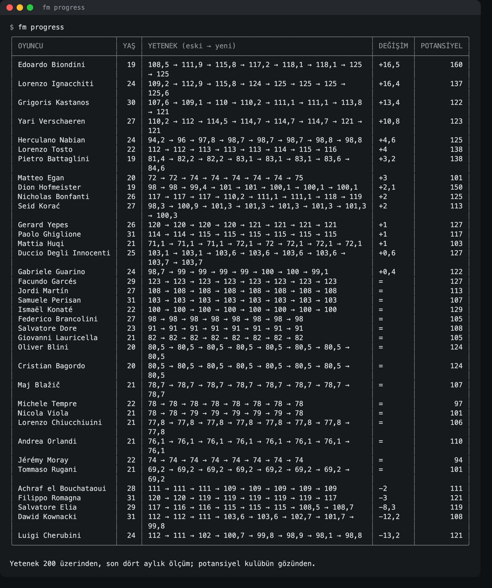

`fm progress` kadrodaki herkesin son dört aylık yetenek ölçümünü (200 üzerinden) ve aradaki değişimi
verir; en çok gelişen üstte, en çok gerileyen altta. Aynı satır oyuncu kartında da var ("Yetenek").

```
$ fm progress
OYUNCU              YAŞ  YETENEK (eski → yeni)      DEĞİŞİM  POTANSİYEL
Archie Brown        23   130 → 130 → 134.7 → 133.6  +3.6     149
Jayden Oosterwolde  24   135 → 136 → 136 → 138      +3       149
Ederson             32   163 → 163 → 163 → 163      =        160
İrfan Can Kahveci   30   123 → 123 → 122 → 108.3    -14.7    124
```

Sayılar oyunun gelişim grafiğinin verisi; başka kulüplerin oyuncuları için oyun bunu vermiyor.

## 6. Oyuncu kartı — `player`, `search`

`fm player <isim>` oyuncunun kartını açar: kimlik, sözleşme, sahadaki mevkisi ve renkli
özellikleri. Kadronda olmayan bir oyuncuyu da arayıp bulur. Kartın altında hangi mevkide ne
kadar iyi olduğu (oyunun 1-20 puanı: 20 doğal mevki, 15 ve üstü usta, 10 ve üstü yeterli) ve
sakatlık geçmişi var: kaç sakatlık, bu ve geçen sezon kaç, son beşi tarihiyle ve süresiyle.

```
$ fm player Fred
Mevkiler (20 doğal, 15+ usta, 10+ yeterli): DM 20 · M (C) 17 · AM (C) 15 · M (L) 10 · AM (L) 10
Sakatlık geçmişi: 7 sakatlık · bu sezon 0, geçen sezon 2 · kaçırdığı maç: 0%
  Mart 2025  A moderate hamstring strain, 14 gün
  Temmuz 2024  Sprained knee ligaments, 17 gün
```


Kartta "Potansiyel 146/200, kulübün gözünden" satırı oyunun personelinin oyuncuda gördüğü
potansiyel (oyunun yıldızları bunu kulübün seviyesine göre gösterir; burada sayı olarak).

Adın bir parçası yeter, aksan ve büyük harf önemsiz (`skriniar`, `kerem`). Ufak bir yazım hatası
da tutuyor: `fm player osimen` Osimhen'i, `guendozi` Guendouzi'yi açar. Kısa yazılan (3 harfe kadar)
kelimeye tolerans yok; kadroda yazım hatasına benzeyen biri olsa bile dünyada adı tam öyle olan
biri varsa o seçilir. Aynısı oyuncu alan bütün komutlarda (`intensity`, `training`, `captains`,
`register`, `opposition`…) ve seçeneklerde geçerli.

`--actions` o oyuncu için oyunun sunduğu işlemleri (teklif, kısa liste, scout…) listeler ve
okla seçtirir.

Oyunun genel araması — oyuncu, teknik adam, kulüp:

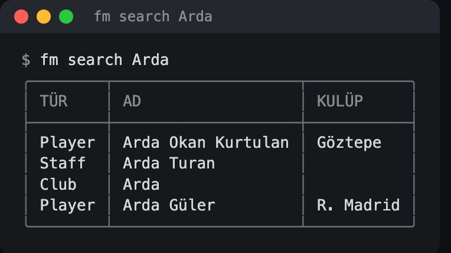

Her kişinin yanında, oyunun kendi listelerindeki gibi, onu adaşlarından ayıran bilgiler durur: yaş, mevki,
ülke, kulüp. Bir komuta yazılan ad birden çok kişiye uyuyorsa (ör. `actions néné`: Fenerbahçe'deki
Dorgéles Néné, AVS'deki Nenê…) komut tahmin etmez; aynı satırlarla seçtirir, terminal yoksa listeleyip
tam adı ister.


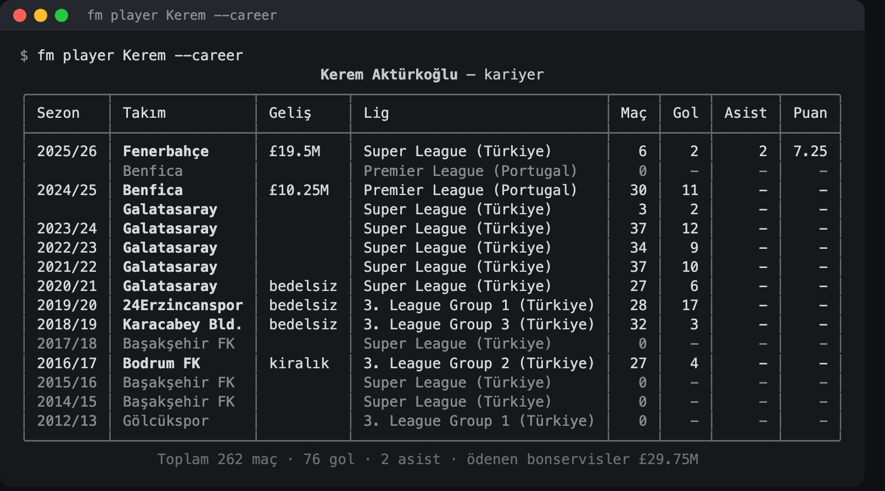

`player <isim> --career` sezon sezon kariyeri verir: kulüp, nasıl geldiği (bonservis, kiralık,
bedelsiz), lig, maç, gol, puan ve en altta toplamlar. Kalecide gol yerine gol yemeden maç.

```
$ fm player kerem --career
                          Kerem Aktürkoğlu — kariyer
│ Sezon   │ Takım          │ Geliş    │ Lig                         │ Maç │ Gol │
│ 2025/26 │ Fenerbahçe     │ £19.5M   │ Super League (Türkiye)      │   3 │   1 │
│         │ Benfica        │          │ Premier League (Portugal)   │   0 │   - │
│ 2024/25 │ Benfica        │ £10.25M  │ Premier League (Portugal)   │  30 │  11 │
│ 2020/21 │ Galatasaray    │ bedelsiz │ Super League (Türkiye)      │  27 │   6 │
│ 2016/17 │ Bodrum FK      │ kiralık  │ 3. League Group 2 (Türkiye) │  27 │   4 │
          Toplam 259 maç · 75 gol · ödenen bonservisler £29.75M
```

### Maç maç puanlar — `player --matches`

Oyuncunun bu sezonki bütün maçları: tarih, rakip, skor, mevki ve rol, oyuna girdiği / çıktığı
dakika, xG, gol, asist ve puan; üstte maç sayısı, en iyi, en kötü ve ortalama puan. Kalecide
xG yerine rakibin xG'si ve yediği gol. Skor oyunun verdiği gibi ev sahibi önce.
İkinci satır puanların küçük grafiği: her çubuk bir maç, soldan sağa eskiden yeniye; terminalde
7.5 ve üstü yeşil, 6.5 altı kırmızı.

```
$ fm player kerem --matches
Kerem Aktürkoğlu — 22 maç · ortalama 6.91 · en iyi 8.90 · en kötü 6.20 · 7 gol · 3 asist
puan  ▂█▄▃▆▃▃▅▂▃▃▃▅▅▃▂▇▄▃▃▃▃  eski → yeni
#   TARİH       RAKİP           SKOR (EV-DEP)  MEVKİ      GİRDİ/ÇIKTI  xG   GOL  AS  PUAN
17  13/09/2025  Başakşehir FK   4 - 1          AM (L) IW               0.2  1    1   8.50
16  08/09/2025  Spain           0 - 4          ST (C) CHF  60' çıktı   0.0  0    0   6.20
15  05/09/2025  Bulgaria        0 - 2          ST (C) CHF  75' girdi   0.0  0    0   6.60
…
```

### Penaltı sırası — `penalties`

```
$ fm penalties
SIRA  #   OYUNCU            MAÇA          SOĞUKKANLILIK  PENALTI
1     94  Talisca           ilk 11 · STC  15             15
2     21  Marco Asensio     ilk 11 · AMR  15             14
3     9   Kerem Aktürkoğlu  ilk 11 · AML  12             13

  1. İki gol atan da atabilir: kapalı
  2. Bir penaltı atan bir sonrakini bırakır: kapalı
  3. Penaltı kaçıran bir sonrakini bırakır: kapalı
```

`fm penalties 3 açık` üçüncü kuralı açar.

Sırayı değiştirmek:

```
fm penalties move kerem 1          Kerem ilk sırada atsın (öbürleri birer kayar)
fm penalties move 3 1              aynısı, sıra numarasıyla
fm penalties add osimhen           kadrodan birini ekle (sona); "add osimhen 2": ikinci sıraya
fm penalties remove asensio        listeden çıkar
```

Terminalde `fm penalties move` (ya da `add`, `remove`) tek başına yazılırsa oyuncuyu ve yeni
sırayı okla seçersin. Her değişiklikten sonra yeni sıra basılır.

### Duran top atıcıları — `takers`

```
$ fm takers
DURAN TOP                     SAĞ                                                         SOL
Korner                        1. Kerem Aktürkoğlu, 2. Oğuz Aydın, 3. Nélson Semedo        1. Marco Asensio, 2. Talisca, 3. Levent Mercan
Serbest vuruş · şut mesafesi  1. Talisca, 2. Marco Asensio, 3. Kerem Aktürkoğlu           1. Talisca, 2. Marco Asensio, 3. Kerem Aktürkoğlu
Serbest vuruş · kanat         1. Kerem Aktürkoğlu, 2. Mattéo Guendouzi, 3. Nélson Semedo  1. Talisca, 2. Marco Asensio, 3. Fred
Serbest vuruş · derin         1. Kerem Aktürkoğlu, 2. Mattéo Guendouzi, 3. Nélson Semedo  1. Talisca, 2. Marco Asensio, 3. Fred
Taç · hücum bölgesi           1. Archie Brown, 2. Dorgéles Néné, 3. Mert Müldür           1. Archie Brown, 2. Dorgéles Néné, 3. Mert Müldür
```

Her türün iki listesi var: korner ve serbest vuruşta sağ ayaklılar ve sol ayaklılar, taçta sağ taraf ve
sol taraf. Beş türü dolaştığı için bu komut 15-20 saniye sürer; tek tür 4-5 saniye:

```
$ fm takers korner
Korner — sağ ayaklılar  (sağ)
SIRA  #   OYUNCU            MAÇA          TEKNİK  ORTA  KORNER
1     9   Kerem Aktürkoğlu  ilk 11 · AML  13      11    14
2     70  Oğuz Aydın        yedek         13      12    11
3     27  Nélson Semedo     ilk 11 · DR   15      13    10

Korner — sol ayaklılar  (sol)
SIRA  #   OYUNCU         MAÇA          TEKNİK  ORTA  KORNER
1     21  Marco Asensio  ilk 11 · AMR  17      13    15
2     94  Talisca        ilk 11 · STC  18      13    13
3     22  Levent Mercan  ilk 11 · DL   14      14    10
```

Türler: `korner`, `frikik` (şut mesafesi), `kanat`, `derin`, `tac`. Sırayı değiştirmek penaltıdaki gibi,
araya hangi liste olduğu (`sağ` ya da `sol`) giriyor:

```
fm takers korner sağ move semedo 1     Semedo sağ ayaklılarda ilk sıraya
fm takers korner sol add fred 2        Fred'i sol ayaklılara ikinci sıraya ekle
fm takers frikik sol remove talisca    listeden çıkar
```

Eklenebilecekler o listenin ayağını kullananlar; yanlış ad yazarsan kimlerin eklenebileceğini söyler.
Savunma ve orta saha taçlarında oyun atıcı seçtirmiyor.

### Duran top rutini — `setpieces <tür>`

Topun nasıl kullanılacağı ve rutindeki her oyuncunun görevi. Türler `takers`'takilerle aynı.

```
$ fm setpieces korner
Korner
  Vuruş tipi  Inswinger   (Inswinger · Outswinger)
  Atıcı       Kerem Aktürkoğlu   (sıra: takers korner)
  Hedef       Near Post   (Mixed · Short · Near Post · Far Post · Edge of Area · Centre)

YER  GRUP                GÖREV                          OLMAZSA
A1   Aerial Threats      Attack Near Post
A2   Aerial Threats      Attack Near Post
A3   Aerial Threats      Lurk at Far Post
C1   Creators            Lurk Outside Area (Near Side)
C2   Creators            Lurk Outside Area (Far Side)
D1   Recovery Defenders  Stay Back
D2   Recovery Defenders  Stay Back
D3   Recovery Defenders  Stay Back If Needed            Go Forward
D4   Recovery Defenders  Stay Back If Needed            Go Forward
```

Değiştirmek:

```
fm setpieces korner vurus out              dışa kıvrılan (atıcı öbür ayağın listesinden gelir)
fm setpieces korner hedef "far post"       topun gideceği yer; adın bir parçası ya da sıra numarası yeter
fm setpieces korner a3 "attack far"        A3'ün görevi
fm setpieces korner d1 needed centre       D1: gerekirse geride kal, gerekmezse ceza sahası dışında bekle
fm setpieces korner a1 ?                   A1'e verilebilecek görevleri listeler
fm setpieces tac hedef long                taçta: Work Into Box ya da Long Throw
```

"OLMAZSA" yalnızca "Stay Back If Needed" gibi iki seçimli görevlerde dolu. Taç "Work Into Box"tayken oyun
oyunculara tek tek görev verdirmiyor; "Long Throw" seçilince yerler gelir. Şut mesafesindeki serbest vuruşta
vuruş tipi ve hedef yok.

### Kadroda sorgu — `query`

Koşulları `ve` ile bağla; her koşul bir alan, bir karşılaştırma ve bir değer.

```
$ fm query "yaş<25 ve potansiyel>140"
OYUNCU              YAŞ  MEVKİ            POTANSİYEL
Dorgéles Néné       22   AM (RL), ST (C)  144
Archie Brown        23   D/WB/M (L)       149
Jayden Oosterwolde  24   D (LC)           148

3 oyuncu (28 içinden)
```

```
fm query "sözleşme<1yıl"               sözleşmesi bir yıldan az kalanlar
fm query "mevki=ST ve gol>2"           forvet oynayabilen, ikiden çok gol atanlar
fm query "kondisyon<70 ve !sakat"      yorgun ama sakat olmayanlar
fm query "maaş>150K" --sort yaş        haftalık 150 binden çok alanlar, yaşa göre
fm query                               alanların listesi
```

Alanlar: `ad`, `yaş`, `mevki`, `no`, `ülke`, `boy`, `kondisyon`, `form` (maç formu), `sakat`, `potansiyel`
(kulübün gördüğü, 200 üzerinden), `maaş` (haftalık), `sözleşme` (kalan süre: `1yıl`, `18ay`), `statü`, `maç`,
`gol`, `asist`, `puan`. Karşılaştırmalar: `<  <=  >  >=  =  !=`. Yazı alanlarında `=` "içinde geçiyor"
demek (`mevki=ST` hem "ST (C)" hem "AM (RC), ST (C)" olanı bulur). Sonuç ilk koşulun alanına göre sıralanır
("küçüktür" sorduysan küçükten büyüğe); `--sort <alan>` ve `--asc` değiştirir. Kabukta `<` ve `>` için
koşulu tırnak içine al.

### İki oyuncu yan yana — `compare`

`fm compare fred guendouzi` iki oyuncunun kimliğini ve özelliklerini yan yana basar; her
özellikte iyi olan yeşil (düz çıktıda `◂`). Çok kelimeli adı tırnakla ya da araya `vs` koy.
Scout edilmemiş oyuncunun özelliği aralık olabilir ("14-17"); aralıklar örtüşüyorsa işaret konmaz.

```
$ fm compare kerem vs osimhen
	Kerem Aktürkoğlu	Victor Osimhen
Yaş	26	26
Mevki	AM (RLC), ST (C)	ST (C)
Değer	£37M - £41M	£120M - £146M
…
Pace	12	17 ◂
Stamina	14 ◂	13
…
Kerem Aktürkoğlu 10 özellikte, Victor Osimhen 14 özellikte önde.
```

## 7. Taktik — `tactic`

Taktiği iki saha olarak çizer: topla oynarken ve topsuzken. Her mevkide oyuncu, mevki kısaltması
ve rolü var; rollerin açılımı altta. Başlıktaki **akıcılık**, takımın bu taktiğe ne kadar
alıştığı (oyunun taktik ekranındaki çubuk); altta taktiği henüz tam bilmeyen oyuncular yüzdeleriyle,
en az bilen önce ("Taktiğe tam alışamayanlar: İsmail 71%, Kerem 74%…").


Değiştirmek için:

| Komut | Ne yapar |
|---|---|
| `tactic mentality [<x>]` | mentaliteyi göster / değiştir |
| `tactic style [<x>]` | oyun stilini göster / değiştir |
| `tactic role <mevki> [<rol>]` | mevkinin rolünü göster / değiştir (`--oop`: topsuz rol) |
| `tactic player <mevki> <oyuncu>` | yedeklerden birini o mevkiye koy |
| `tactic pick` | ilk 11'i oyuna seçtir |
| `tactic new "<stil>" "<topla>" "<topsuz>"` | yeni taktik oluştur |
| `setpieces new` | duran top rutinlerini kur (altı soru, okla) |

### Diziliş değiştirmek — `tactic new`, `tactic slot`

Oyunda bir taktiğin dizilişi sonradan değişmiyor; yeni bir taktik kuruluyor. `fm tactic new`
sihirbazı açar (stil, topla diziliş, topsuz diziliş); takımın taktiği varsa yenisi yeni bir
yuvaya girer ve etkin olur. Takım en fazla üç taktik tutar:

```
fm tactic new Gegenpress "4-2-3-1 DM Wide" "4-4-1-1 2 DM"
fm tactic slot          yuvalar ve hangisi etkin
fm tactic slot 1        1. yuvadaki taktiğe geç
fm tactic copy          etkin taktiği yeni yuvaya kopyala ("Copy of: …"), kopya etkin olur
fm tactic clear 2       2. yuvayı boşaltmadan önce ne silineceğini söyler
fm tactic clear 2 --yes boşalt (oyunun "Are you sure…" sorusu onaylanır); tek taktik silinmez
fm tactic save "Baskı"  etkin taktiği dosyaya kaydet (--note "<açıklama>"); taktiğin adı da bu olur
fm tactic saved         kaydedilmiş taktikler;  saved delete "<ad>" --yes: birini sil
fm tactic load "Baskı"  ne olacağını söyler; --yes ile etkin yuvadaki taktiğin yerine yükler
```

### Takım talimatları — `tactic instructions`

```
fm tactic instructions                         topla (evre evre) ve topsuz bütün talimatlar
fm tactic instructions --oop                   yalnızca topsuz talimatlar
fm tactic instructions Tempo Higher            birini değiştir
fm tactic instructions "Defensive Line" Lower  topsuz bir talimatı değiştir
fm tactic instructions "Goal Kicks"            seçeneklerini göster (terminalde okla seçtirir)
```

Örnek çıktının topsuz kısmı:

```
TOPSUZ
  Line of Engagement: High Press
  Defensive Line: Higher
  Trigger Press: Much More Often
  Tackling: Standard
  …
```

Sayfa açmadan okur ve değiştirir. Maç sırasında da çalışır: o zaman maçın taktiğini değiştirir, oyun
değişikliği ilk ölü topta uygular, takımın kayıtlı taktiği olduğu gibi kalır (`tactic pi` için de aynısı).
Talimat adları ve seçenekleri ilk kullanımda oyundan bir kez okunup saklanır (`--refresh` yeniden okur).
"Dribbling" oyunda tek ayar (ekranda hem son üçte birde hem ilerlemede görünür). Savunma çizgisinin
ofsayt tuzağı gibi ek ayarlar henüz yok.

### Oyuncu talimatları — `tactic pi`

```
fm tactic pi DR                          sağ bekin talimatları, topla ve topsuz
fm tactic pi DR Shooting "Shoot Less"    birini değiştir
fm tactic pi DR Tackling "Tackle Harder" topsuz bir talimatı değiştir
fm tactic pi AML "Forward Runs"          seçeneklerini göster
```

Örnek çıktı:

```
DR · Wing Back / topsuz Pressing Full Back
Topla
  Shooting: Standard
  Forward Runs: Make More Runs (rolden)
  …
Topsuz
  Trigger Press: More Often (rolden)
  Marking: Standard
  Tackling: Standard
  Marking Target: Standard
```

"(rolden)" yazanları rol belirliyor; değiştirmek isteyince komut bunu söyler ve rolü değiştirmeyi
(`tactic role DR`, topsuzsa `--oop`) önerir. Kart açılmaz, talimatlar doğrudan oyunun verisinden okunup yazılır.
Mevki yerine oyuncunun adı da olur (`fm tactic pi Semedo`); maç sırasında rol adları görünmez, değişiklik maçın taktiğine
gider.

### Rakip talimatları — `opposition`

Sıradaki rakibin her oyuncusu için sıkı markaj, pres, sert giriş ve hangi ayağa yönlendirileceği:

```
fm opposition                                tablo
fm opposition --advice                       yardımcının önerisini uygula
fm opposition Kaku Pres=Always "Sert giriş=Hard"
fm opposition --clear                        hepsini temizle
```

### Bireysel antrenman — `training`

```
fm training                                    herkesin mevki/rol, topsuz rol ve odak eğitimi
fm training Waine --focus Çabukluk             ek odak (Yok: kaldır); yanlış bir değer seçenekleri listeler
fm training Waine --position "Striker (Core)>Pivot Santrafor"
fm training Waine --position "Striker (Core)"  o alt menüdeki rolleri listeler
fm training Waine --role "Forvetler>Merkez Forvet"   topsuz rol de alt menülü
fm training Fred --report                      raporu hazırlayabilecek antrenörler (terminalde okla seçtirir)
fm training Fred --report --coach zeki         antrenörden rapor iste ve göster
```

Değerler oyunun dilinde, listede göründüğü gibi yazılır (baştan bir parçası yeter). Liste sayfa açmadan okunur;
değiştirmek için komut Antrenman › Bireysel Antrenman'ı kendisi açar.

Rapor bir mesaj olarak gelir; komut onu açıp basar:

```
Fred — antrenman raporu (Zeki Murat Göle)
  Has shown early signs that he may be on the decline over the last three months.
  He is now training as a central midfielder.
  He has been below par in training lately.

  Gidişat: Player is showing signs of decline
  Strength 10 · Agility 16 · Pace 9 · Stamina 12
  Antrenman puanı 4.70 · yük Half · Def. Unit

Tavsiyeyi uygulamak ya da eleştirmek için: reply "Fred's training report"
```

Alışkanlık (oyuncu hareketi) öğretmek:

```
fm training "Archie Brown" --trait                     sahip oldukları ve öğrenebilecekleri
fm training "Archie Brown" --trait "one-twos"          öğretmeye başla
fm training "Archie Brown" --trait-remove "down left"  bir alışkanlığı bıraktır
fm training "Archie Brown" --trait-suggest             yardımcıya sor
fm training "Archie Brown" --trait-cancel              süren eğitimi durdur
```

Yardımcı karşıysa ("Really Unsuitable To Add", yaşlı oyuncuda "Too Old To Change Game") komut
itirazı gösterir ve durur; terminalde okla sorar, yine de yapmak için `--yes`.

### Antrenman programı — `schedule`

Bu haftanın ve gelecek haftanın antrenmanı, gün gün üç seans. Terminalde bugün `▶` ile, maç
günleri sarı; geçmiş günler ve dinlenme soluk.

```
$ fm schedule
GÜN           1. SEANS               2. SEANS               3. SEANS
Pzt 6 Ekim    yolculuk               Recovery               dinlenme
Sal 7 Ekim    Attacking Shadow Play  Defensive Shadow Play  dinlenme
Çar 8 Ekim    Match Tactics          Match Practice         Recovery
```

**Bir seansı değiştirmek** — gün, günün kaçıncı seansı (1-3), istersen seansın adı:

```
$ fm schedule set 9 3 quickness
9 Ekim Perşembe, 3. seans: Rest → Quickness
  A specialised session focused on speed. Performed as a team.
  Özellikler: Acceleration, Agility, Pace
  Etkiler: Fatigue ↑ · Injury Risk ↑↑ · Condition ↓↓
```

Seansın adını yazmazsan terminalde önce kategoriyi (General, Attacking, Physical…), sonra o
kategorinin seanslarını okla seçersin; şu anki seçim işaretli gelir. Adın bir parçası yeter
(`"shadow"` iki seansa uyarsa hangileri olduğunu söyler); aynı ad iki kategorideyse
`physical/recovery` diye kategorisiyle yaz. Değişiklikten sonra seansın ne çalıştırdığı ve
kondisyona, sakatlık riskine etkisi yazılır (↑ artırır, ↓ azaltır, çift ok: çok).

Gün şöyle yazılır: `14` (bugünden sonraki ilk 14'ü), `"14 ekim"`, `2025-10-14`, `yarın`, `cuma`.
Geçmiş günler, maçın kendisi ve yolculuk değiştirilemez.

**Haftanın programını değiştirmek** — o haftadan herhangi bir gün ve programın adı:

```
$ fm schedule style 14 gegenpress
13 Ekim haftası: Control Possession → Gegenpress
  A training schedule focused on a selected tactical style.
```

Program yazmazsan türü (Training Style, Tactical Style, Scenario, Pre-Season › Early/Mid/Late) ve
programı okla seçersin. Aynı ad birden çok türde varsa (Tactical, Technical) sezon içi olan
seçilir; sezon öncesi programı için türüyle yaz: `"pre-season early/light"`. Program bütün
haftanın seanslarını yeniden yazar; tek tek değiştirdiğin seanslar gider. Elle değiştirilmiş bir
haftanın adı oyunda "Tactical (Modified)" diye görünür.

### Antrenman yoğunluğu — `intensity`

```
fm intensity                       her oyuncunun yoğunluğu
fm intensity Kanté yarım           otomatik · yarım · normal · çift
fm intensity Kanté "dinlen 3"      3 gün saha ve salon çalışması yok (7, 14: bir, iki hafta)
fm intensity Fred "tatil 1"        bir hafta tatil (1–4; oyun izin verirse)
fm intensity --auto                hepsini kondisyon hocasına bırak: oyunun uyarısını gösterir, "hayır" der
fm intensity --auto --yes          uyarıyı onaylar; değişenleri tek tek yazar
```

Tatile giden oyuncu tatil bitene kadar tatilde kalır; oyun o sürede başka seviye almaz. "Otomatik" seçilince
oyun kendi kurallarına göre hemen bir seviye seçer, listede o seviye görünür.

### Antrenör görevleri — `coaches`

Dokuz antrenman alanının (hücum / savunma / topla oynama × taktik / teknik, kaleci, kondisyon, duran top)
her birini hangi antrenörün çalıştırdığı. `✓` görevli olduğu alan ve oradaki yıldızı, `·` atanabileceği
alan; boş hücre işinin izin vermediği alan (kaleci antrenörüne hücum verilemez). Altta her alanın iş yükü ve
baş antrenörünün yıldızı. "Coaching assignments need attention" mesajı geldiğinde boş kalan alan burada
"Antrenörü olmayan alan" diye yazar.

```
$ fm coaches
ANTRENÖR         HÜC-TAK  HÜC-TEK  SAV-TAK  SAV-TEK  TOP-TAK  TOP-TEK  KALECİ  KOND   DURAN
Faruk Kavlak     ✓ ★★★★   ·        ·        ·        ·        ·        ·       ·      ·
Tom Shaw         ·        ·        ·        ✓ ★★★    ·        ·        ·       ·      ✓ ★★
David Preece                                                           ✓ ★★★½
Chris Cohen      ✓ ★★½    ·        ·        ·        ·        ✓ ★★½    ·       ·      ·
iş yükü          orta     hafif    orta     orta     ağır     ağır     hafif   ağır   hafif
baş antrenör     ★★★★     ★★½      ★★½      ★★★      yok      ★★½      ★★★½    ★★½    ★★
Antrenörü olmayan alan: topla taktik

fm coaches Kavlak topla taktik     ata (alan Türkçe ya da oyundaki başlıkla: "Poss Tact")
fm coaches Kavlak topla taktik --off   görevden al
fm coaches --auto                  yardımcı hepsini dağıtsın
```

Bir antrenöre ikinci alan verince ilk alandaki yıldızı düşebilir: Faruk Kavlak topla taktiğe de atanınca
hücum taktikteki 4 yıldız 3'e indi. İş yükü dağıldıkça her alana ayırdığı emek azalıyor.

### Maç hazırlığı — `prep`

Sıradaki maç için antrenmanda neye çalışıldığı: topla ve topsuz birer taktik odak, iki de duran top odağı.
`fm prep` dördünü, ne işe yaradıklarını ve yerlerine neyin seçilebileceğini gösterir; oyunun rakibe göre
önerdiği seçenek `(öneri)` diye işaretlidir.

```
$ fm prep
Maç hazırlığı
  Topla        Final Third — Focus on attacking situations in the final third in possession.
               başka: Build Up (öneri) · Progression
  Topsuz       High Press — Focus on a high press out of possession to disrupt and win the ball back high.
               başka: Low Block · Mid Block
  Duran top 1  Defending Corners — Focus on the Opposition's main strategies from attacking corners.
               başka: Attacking Free Kicks (öneri) · Defending Free Kicks (öneri) · Penalties
  Duran top 2  Attacking Corners — Study the Opposition's defensive set-up at corners to identify vulnerabilities.
               başka: Attacking Free Kicks (öneri) · Defending Free Kicks (öneri) · Penalties

Değiştir: prep <topla | topsuz | duran1 | duran2> [odak]
```

Değiştirmek için yuvayı ve odağı yaz (adın bir parçası yeter); odağı yazmazsan seçenekleri okla sunar:

```
$ fm prep topla progression
Topla: Final Third → Progression
$ fm prep duran1 "free kicks"
```

İki duran top yuvası aynı odağı alamaz.

## 8. Maç günü — `match`, `sub`, `talk`, `report`

`fm match` maç gününde önce sorar: **Maçı nasıl oynayalım?**

- **İzle**: kadro sahada çizilir, anlatım ve skor akar. Maç öncesi, devre arası ve maç sonu
  konuşmalarında söz sende: seçenekler çıkar, okla seçersin ya da konuşmayı geçersin.
- **Anında sonuç**: maçı yardımcılar yönetir, birkaç saniyede biter.

Script'te sormadan: `match --play` (izle) ya da `match --instant`. `--no-talk` konuşmaları geçer.

Maç sırasında:

| Komut | Ne yapar |
|---|---|
| `sub` / `sub <çıkan> <giren>` | sahadakiler ve kulübe / oyuncu değiştir |
| `tactic mentality [<x>]` | mentaliteyi göster / değiştir |
| `tactic role <oyuncu> [<rol>]` | oyuncunun rolü (`--oop`: topsuz rolü); rol yazmazsan okla seçtirir |
| `shout [<x>]` | kenardan bağır (Encourage, Focus, Fire Up…) |
| `dugout` | yardımcının tavsiyeleri; `dugout <no> uygula` / `dugout <no> kaldır` |

```
$ fm tactic role talisca poacher
Talisca: Centre Forward → Poacher
$ fm shout focus
Bağırış: Focus (oyun yeni bağırışı bir süre kapattı)
$ fm shout encourage
Oyuncular az önce bir bağırış duydu; oyun yeni bağırışa bir süre izin vermiyor.
$ fm dugout
  1   34'  Takım talimatı: Discourage Long Shots
  2   36'  Oyuncu talimatı (Talisca): Shoot Less Often
  3   48'  We must improve our game, especially in creating chances.
```

Bir oyuncu sakatlanınca maç durur: `match --play` kimin sakatlandığını yazar ("Maç 80:05'da durdu:
Tom Bayliss sakatlandı") ve terminalde kimin çıkıp kimin gireceğini sorar; script'te
`sub <çıkan> <giren>` maçı da sürdürür, değişiklik yapmadan sürdürmek için yeniden `match`.
`sub` listesi her oyuncunun yanına maçta olanı yazar:

```
$ fm sub
Sahada:
  Tendayi Darikwa  (Composed, Poor)  sarı kart · puan 6.8
  Tom Bayliss  (Anxious, Poor)  SAKAT · puan 6.6
  …
```

`match --play` maç bitince skor ve istatistiklerin altına kartları, sakatlananları ve
oyuncularımızın puanlarını da yazar:

```
Kartlar: biz: Jack Moylan, Tom Hamer, Tendayi Darikwa · rakip: Zack Nelson
Puanlarımız: Freddie Draper 9.7 · Kaide Gordon 8.4 · Tom Bayliss 7.4 · …
```

Bağırıştan sonra oyun yeni bağırışa birkaç dakika izin vermiyor; `shout` bunu söyler. Yardımcının
tavsiyeleri `match --play` akışında da çıkar ("Yardımcı: …"). Dugout paneli pozisyon oynatılırken
gizleniyor; `dugout` o sırada çağrılırsa panel geri gelene kadar bekler.

Basın toplantısı, toplantı gibi açık bir konuşmayı `talk` baştan sona okla yürütür;
`talk leave` çıkar.

Maç bitince `report`:


### Rakip — `opponent`

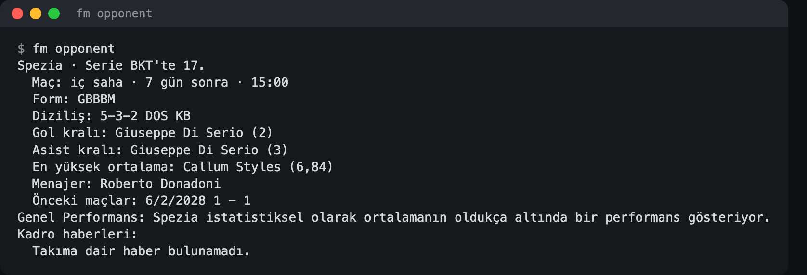

`fm opponent` sıradaki rakibi özetler: ligdeki yeri, dizilişi, gol / asist kralı, menajeri ve oyun
tarzı, maçın nasıl beklendiği, sezon sayıları, analistlerin birim birim görüşü ve kadro haberleri.

```
$ fm opponent
Kocaelispor · 9th in Turkish Super League
  Diziliş: 4-3-3 DM Wide
  Gol kralı: Bruno Petković (6)
  Asist kralı: Can Keleş (3)
  Menajer: Selçuk İnan (Türkiye) · galibiyet 33% - Pld 9 · mentalite Balanced · pres Balanced · markaj Mixed
  Beklenti: This should be a close contest between two very evenly-matched teams.
Genel performans (Super League, This Season):
  maç başı gol 1.2 · penaltısız xG/90 1.1 · maç başı yenen 1.3 · maç başı şut 11.6 · pas % 90.3
  Performing to an average level — Kocaelispor are performing around average statistically.
Defending - Defenders: Performing much better than average
  Pas % 89.0 · Tck/90 3.9 · Tck % 87.0 · Int/90 4.1 · Hdr W/90 1.9
Creativity - Attackers: Performing much better than average
  Darko Churlinov is performing well above average in key statistics for this creative role.
  Attempts a high number of dribbles per 90 minutes compared to average.
Creativity - Midfielders: Performing much worse than an average
  Show is performing well below average in key statistics for this creative role.
Kadro haberleri:
  Mateusz Wieteska unregistered
```

Alttaki bloklar rakibe göre değişir: bazıları bir birimin sayılarını verir, bazıları o birimde öne
çıkan (ya da aksayan) oyuncuyu anlatır. Dikkat edilecek adam orada yazar.

Ligi oyunda yüklü olmayan bir rakipte (Avrupa'dan küçük bir kulüp) sezon sayıları ve bu bloklar gelmez.

## 9. Lig, kupa ve fikstür — `table`, `fixtures`, `league`, `stages`

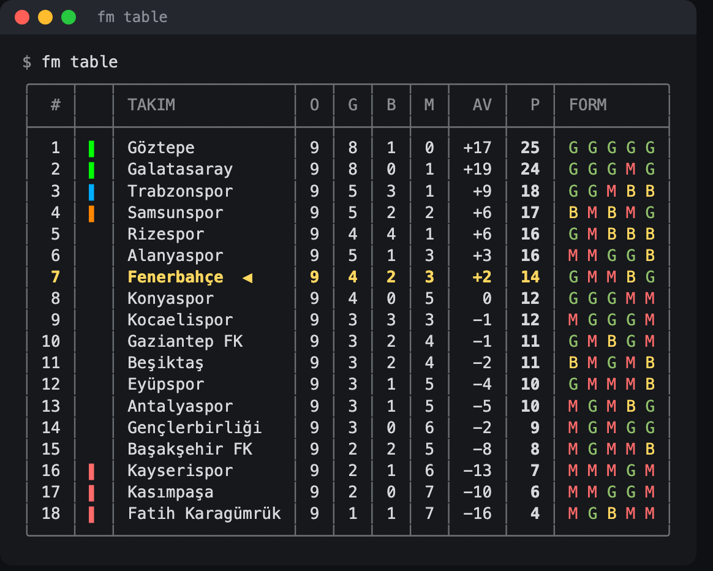

Soldaki renkli şeritler bölgeleri gösterir (üstte Avrupa, altta küme düşme). Senin takımın sarı ve okla işaretli.

`fm table` her zaman ligi verir; başka bir turnuvanın tablosu için adını yaz: `fm table europa` Avrupa Ligi'nin
lig aşamasını gösterir. Kupalarda tablo olmaz.


Oynanmış maçlar beyaz ve sonuçlu, oynanacaklar soluk.


`fixtures --all` sezonun bütün fikstürünü verir (takvimden ay ay toplar, ~15 sn). `calendar [ay]`
bir ayı gün gün gösterir: maçlar, transfer döneminin açılıp kapandığı gün, kupa kuraları, milli
maçlar; `--u19` altyapı maçlarını da ekler.

```
$ fm calendar eylül
Eylül 2025
   5 Cum  World Cup Quals (EUR) · Bulgaria v Türkiye
  13 Cmt  Başakşehir FK (6th) · iç saha · Super League · 16:00
          Transfer window closes (midnight) · Super League
  20 Cmt  Gençlerbirliği (18th) · deplasman · Super League · 18:00
```

`league [turnuva]` turnuvanın liderlerini verir (varsayılan lig): on takım, on oyuncu istatistiği, her birinde
kim önde.

```
$ fm league
Super League — liderler
Takımlar
  En çok gol: Galatasaray (24)
  Topa en çok sahip olan: Trabzonspor (64%)
  …
Oyuncular
  En yüksek ortalama puan: Victor Osimhen (7.80)
  En çok gol: Victor Osimhen (13)
  En çok asist: Felipe Augusto (5)
  …
```

`--stat <ad>` o istatistikte herkesi sıralar: gol krallığı, asist, puan, xG, kurtarış… İlk 20'yi gösterir;
`--top <n>` ya da `--all` ile daha fazlası.

```
$ fm league --stat gol --top 5
Super League — Goals (ilk 5 / 97 oyuncu)
#   OYUNCU             TAKIM           Gls   Apps   Mins/Gl
1   Victor Osimhen     Galatasaray     13    9      62.31
2   Steve Mounié       Alanyaspor      8     8      89.38
=   Eldor Shomurodov   Başakşehir FK   8     9      100.75
4   Talisca            Fenerbahçe      7     9      115.71
5   Juan Santos        Göztepe         6     8      109.50
```

Takım sıralamaları için `--teams` (yalnızca takımlarda olan bir istatistikte, örneğin formda, kendiliğinden):

```
$ fm league --stat form --top 3
Super League — Form (ilk 3 / 18 takım)
#   TAKIM         Form    Home Form   Away Form
1   Göztepe       GGGGG   GGGGG       BGGG
2   Fenerbahçe    GBGGG   BGGMG       MGMB
3   Galatasaray   GGMGG   GGGGG       GGGM
```

Ad oyunun kendi adı (`"expected goals"`, `"average rating"`, `saves`), bir parçası yeter; sık kullanılanların
Türkçesi de var: `gol`, `asist`, `puan`, `sari`, `kirmizi`, `sut`, `kurtaris`, `form`, `seyirci`. Hepsinin listesi
(127 oyuncu, 100 takım istatistiği): `fm league --stats`. Başka turnuva: `fm league europa --stat asist`.
İlk kullanımda istatistik adları oyundan bir kez okunur (yarım dakika kadar).

### Kupalar ve başka ligler — `stages`

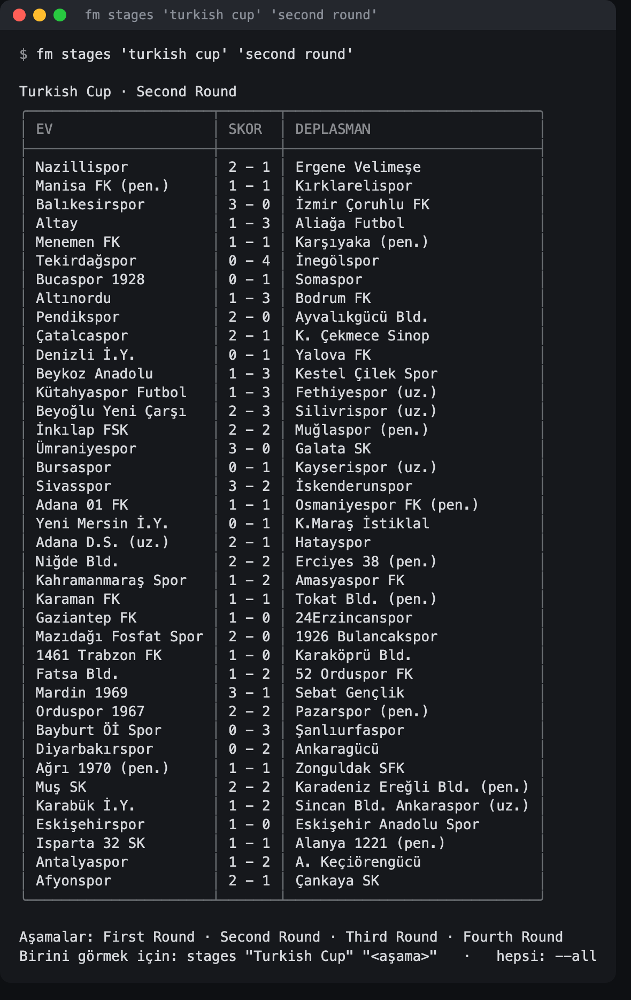

`fm stages "<turnuva>"` bir turnuvayı aşama aşama gösterir: kupada turun eşleşmeleri, lig aşamasında
tablo. Yalnızca kendi turnuvaların değil, oyunun dünyasındaki her turnuva yazılabilir; adın bir
parçası yeter (`fm stages "fa cup"`, `fm stages bundesliga`). Hepsinin listesi: `fm stages --list`.

```
$ fm stages "turkish cup" "second round"

Turkish Cup · Second Round
EV                    SKOR    DEPLASMAN
Nazillispor           2 - 1   Ergene Velimeşe
Manisa FK (pen.)      1 - 1   Kırklarelispor
Kütahyaspor Futbol    1 - 3   Fethiyespor (uz.)
…
```

Takımın yanındaki `(pen.)` turu penaltılarla, `(uz.)` uzatmada geçtiğini söyler. İki maçlı turlarda
(Avrupa elemeleri) son maçın skorunun yanında `TOPLAM` sütunu da gelir. Henüz oynanmamış eşleşmede
skor yerinde `-` durur.

Aşama yazmazsan kupada kurası çekilmiş son tur gelir, altında sıradaki turun kura tarihiyle;
ligde tablo. Çıktının sonunda turnuvanın bütün aşamaları sayılır; birini görmek için adını ekle,
hepsini art arda görmek için `--all`:

```
$ fm stages "turkish cup"
…
Sıradaki tur Fourth Round: kura 31/10/2025

Aşamalar: First Round · Second Round · Third Round · Fourth Round
```

Lig tablolarında `FORM` sütunu son beş maçtır, eskiden yeniye (G galibiyet, B beraberlik, M
yenilgi). `fm table` ve `fm table europa` da artık bu tam tabloyu verir.

`fm table <turnuva>` de kendi turnuvan olmayan bir ad verince buraya düşer: `fm table bundesliga`.
Uzun bir turu okumak birkaç saniye sürer (liste kaydırılarak okunuyor); kupada aşama yazmadan
sormak, çekilmiş son turu ararken 20 saniyeyi bulabilir.

## 10. Transfer ve sözleşme — `players`, `offer`, `contract`

`fm players` oyunun oyuncu veritabanını listeler: `--filter "<x>"` hazır süzgeçlerden birini
uygular, `--view "<x>"` kolonları değiştirir.

Serbest oyuncular için `fm players --free` (sözleşmesi bitmiş olanlar; `--view Contract` ile maaş ve
statü kolonları gelir). Süzgeç oyunda açık kalır, `fm players --clear` kaldırır.

Belirli bir oyuncu tipi aramak için oyunun arama panelindeki süzgeçler de komutta:

```
$ fm players --role "centre forward" --age 17-21 --view "General Info"
OYUNCU                  BOY  YAŞ  KULÜP           DEĞER
Arnu                    185  18   R. Madrid       £375K - £3.9M
Artem Shumanskiy        186  20   Krylja Sovetov  £375K - £3.7M
Benoný Breki Andrésson  188  20   Stockport       £600K - £6M
```

- `--position DL` — asıl mevkisi (GK, DR, DL, DC, WBR, WBL, DM, MR, ML, MC, AMR, AML, AMC, ST)
- `--role "<rol>"` — topla oynarken oynayabildiği rol (Centre Forward, Wing-Back, Deep-Lying Playmaker…)
- `--max-value 10M` — değeri en çok bu kadar olanlar (oyunun listesindeki yuvarlak tutarlardan biri
  kullanılır: 8M yazarsan 7.5M alınır ve bunu söyler)
- `--age 18-23` — yaş aralığı
- `--grade B` — scoutların verdiği en düşük not (A+ … F)
- `--contract "expiring (6 months)"` — sözleşme durumu (Expiring (1 Year), Expired, Unattached…)
- `--listed`, `--loan-listed` — transfer / kiralık listesinde olanlar
- `--attr "pace>=16"` — nitelik koşulu (1–20; `>=`, `<=`, `>`, `<`), istediğin kadar tekrarlanır:
  `fm players --age 18-23 --attr "pace>=16" --attr "finishing>=13"`. Scoutlarının bilmediği
  oyuncuların nitelikleri bilinmediği için onlar bu aramada çıkmaz.

Örneğin 10 milyonu geçmeyen, genç bir sol bek:

```
$ fm players --position DL --max-value 10M --age 18-25 --grade C --view "General Info"
OYUNCU           BOY  YAŞ  KULÜP           DEĞER
Antonino Gallo   182  25   U.S. Lecce      £4.7M - £7.6M
Hodei Arrillaga  175  21   Eibar           £300K - £3.1M
John Tolkin      170  23   Holstein Kiel   £2.7M - £5.4M
Moussa Diarra    183  24   RSC Anderlecht  £6M - £7.4M
```

Bunlar da oyunda açık kalır: bir sonraki `fm players` aynı aramayla gelir, `--clear` sıfırlar.
Liste yine yalnızca ekrandaki ~20 satırdır (ada göre sıralı); daraltmak için süzgeçleri sıkılaştır.

### Transfer hedefleri — `targets`

İki adım. Önce durum: kalan bütçe ve kadroda ince mevkiler (sağlam oyuncusu bir ya da hiç olan). Hangi mevkiye
bakılacağına sen karar verirsin.

```
$ fm targets
Bütçe: transfer £11.1M · maaş £12.5K p/w boşta

Kadroda ince mevkiler (sağlam oyuncu bir ya da hiç):
  ML   yalnızca Archie Brown
  MR   kimse yok

Öbür mevkiler: GK 2 · DL 4 · DC 6 · DR 2 · …

Aramak için: targets <mevki>   (ör. targets DL, targets "sol bek")
```

Sonra mevkiyi yaz: oyuncu veritabanı o mevkide, değeri transfer bütçesini aşmayanlarla aranır.

```
$ fm targets MR
MR — değeri £11.1M ve altı (transfer bütçen; değiştirmek için --max-value <para>)
Maaş bütçesi: £12.5K p/w boşta
(değer sınırı oyunun listesindeki £10M olarak alındı)
OYUNCU               YAŞ   KULÜP                   DEĞER
Fermín               22    Burgos                  £375K
Ryan Longman         24    Wrexham                 £2.5M
…
```

Mevki kısaltmayla (`DL`, `AMC`, `ST`) ya da Türkçe (`"sol bek"`, `stoper`, `forvet`, `"sag kanat"`). `players`'ın
arama seçenekleri burada da geçer: `--max-value 5M`, `--age 18-23`, `--grade B`, `--listed`, `--attr "pace>=14"`.
Liste yalnızca oyunun bildiği (scoutlarının gördüğü) oyunculardır. Arama oyunda açık kalır; her yeni arama öncekini
siler, kapatmak için `fm players --clear`.

### Teklif — `offer`

```
fm offer "<oyuncu>"                 teklif ekranını aç, kartı göster, okla düzenle
fm offer "<oyuncu>" 7.5M            bonservisi baştan yaz
fm offer "<oyuncu>" --loan          kiralık
fm offer "<oyuncu>" 7.5M --dry      hazırla, kartı göster, gönderme
```

Teklif terminalde bir kart olarak çizilir: temel şartlar (bonservis, transfer tarihi), ek
ödemeler, ek maddeler, bütçeden ne çıkacağı. Altında bir menü var: bir şartı seçip değerini
değiştirirsin, "+ Ek ödeme ekle" / "+ Madde ekle" ile yenisini koyarsın, bir şartı kaldırırsın.
Her değişiklikten sonra kart oyundan yeniden okunur, yani gördüğün şey oyunun ekranında
olanın kendisi. "Teklifi gönder" bir kez daha sorar, çünkü gönderilen teklif geri alınamaz.

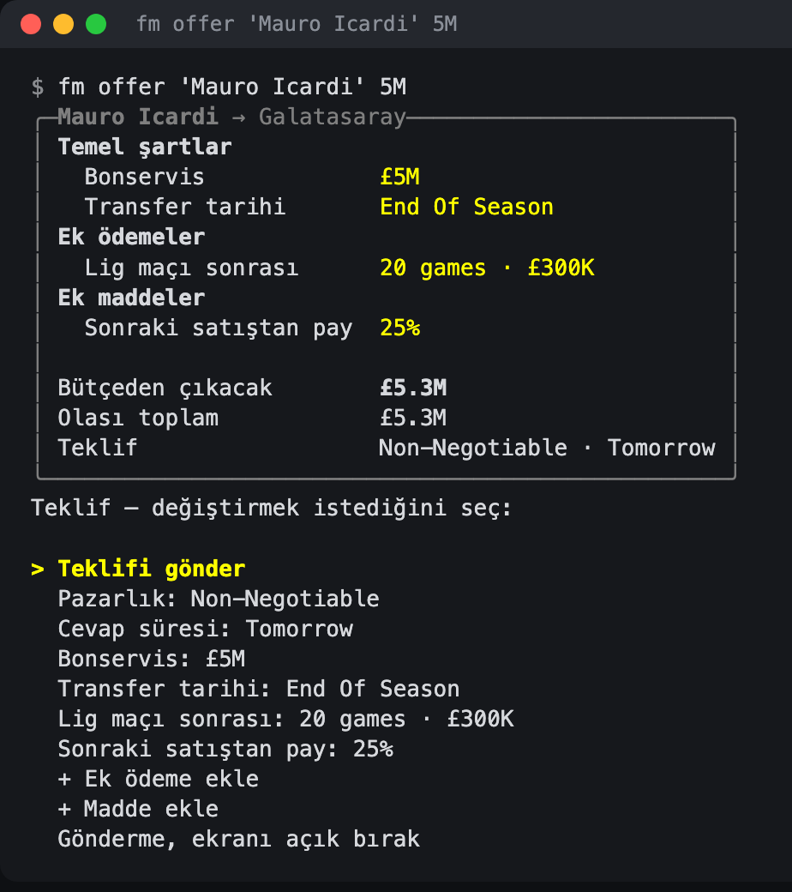

Sonraki satıştan payı %25'ten %35'e çekince:


Script'ten (ya da menüye girmeden) şartlar `--term "Şart=değer"` ile verilir; oyunun kendi
adları ve seçenekleri kullanılır, Türkçe karşılıkları da olur. Ekranda olmayan bir ödeme ya
da madde önce eklenir. İki değeri olan şartta (kaç maç sonra, ne kadar) değerler virgülle
ayrılır. Göndermek için `--yes`:

```
fm offer "Robin Hack" 4M \
  --term "Percentage Of Next Sale=10%" \
  --term "After League Appearances=20 games,250K" \
  --term "Transfer Date=End Of Season" \
  --term "Cevap süresi=Tomorrow" --yes
```

Kiralıkta (`--loan`) kart başka şartlarla gelir: aylık ücret (oynarsa / oynamazsa), maaş
katkısı yüzdesi, süre; ardından kiralık maddeleri (forma süresi sözü, primler), evet / hayır
seçenekleri (kupa maçlarında oynayabilir, geri çağrılabilir…) ve kalıcı olursa satın alma
bedelleri. Oyunun gri gösterdiği (o teklifte verilmeyen) seçenekler menüde çıkmaz.

```
fm offer "Matteo Cancellieri" --loan --term "Maaş katkısı (oynarsa)=100%" \
  --term "Playing Monthly Fee=20K" --term "Opsiyonlu satın alma bedeli=kaldır" --yes
```

Kulübün cevabı gelen kutusuna düşer. "View Offer" ya da "Negotiate" ile açılan karşı teklif de
aynı komutla kart olarak görünür ve oradan düzenlenip geri gönderilir (`fm offer Hack`).
"Gösterilen" satırı kulübün teklifiyle senin önceki teklifin arasında geçiş yapar.

Oyun teklifi baştan reddederse (oyuncu başka kulüple anlaşmışsa, rakip kulüpse…) sebebini
olduğu gibi yazar: `Orkun Kökçü için teklif yapılamıyor. Oyun diyor ki: Cannot sign Orkun.
This player has already agreed to join his loan club.`

Her şartın bir de pazarlık kilidi var (oyundaki asma kilit): **Pazarlığa açık**, **Yarı
pazarlıklı**, **Pazarlıksız** ve ek ödeme ile maddelerde **Çıkar ve yasakla** (karşı taraf bunu
teklife geri koyamaz). Menüde şartı seçip "Pazarlık durumu"ndan değiştirilir; kartta açık
olmayanlar renkli yazar. Script'te değer olarak verilir:
`--term "Fee=Non-Negotiable"`, `--term "Instalments (12 monthly)=Remove & Exclude"`.


Kupa ya da ödül primi ve takasa oyuncu alt menülerde: menüde "›" ile biten bir seçeneğe girince
bir alt seviye açılır ("Turnuva başarısı primi › Turkish Cup › Bonus upon reaching the Semi Final…",
"Kadrodan bir oyuncu › A takım › Mert Müldür"); "Bir üst menü" geri çıkar. Script'te yol `>` ile
yazılır:

```
fm offer "Robin Hack" 4M \
  --term "Bonus After Competition Achievement>Turkish Cup>Bonus upon reaching the Semi Final of the Turkish Cup=100K" \
  --term "Oyuncu ödülü primi>World Golden Ball=250K" \
  --term "Players To Exchange" --term "Other Player From Squad>Senior Squad>Mert Müldür=6 Month Loan"
```

Takasa konan oyuncu "Takas oyuncuları" başlığı altında görünür; değeri transfer ya da kiralık
süresidir. Sözleşmede aynı yol primler için de geçerli:
`--term "Competition Bonuses>Turkish Super League>Winning the Super League=200K"`.

### Sözleşme — `contract`

```
fm contract "<oyuncu>"        kendi oyuncumuzla yeni sözleşme görüşmesini aç
fm contract                   açık görüşmeyi kart olarak göster, okla düzenle
```

Görüşme iki aşamalı, oyundaki gibi. Önce **vaatler**: kadro statüsü, başlangıç tarihi ve
menajerin istediği vaatler (kaptanlık, kulübün hedefi…). "+ Vaat ekle" ile sen de vaat
verirsin; bir vaadi değiştirince menü "Vaatleri menajere öner" olur, menajer kabul edince
"Vaatleri onayla, şartlara geç".


Sonra **şartlar**: ücret, süre, menajer ücreti, sadakat primi, primler ve maddeler. Kartın
altında maaş bütçesine etkisi ve oyuncunun şu anki sözleşmesi yazar.


Bir şart oyunun kuralına uymazsa (ör. ücreti düşürünce menajer ücreti izin verilen oranı
aşar) satırın yanında kırmızıyla sebebi yazar — "Menajer ücreti: £1.1M (izin verilen oranın
üstünde)" — ve öneri gönderilemez; o şartı düzeltince geri gelir.

"Şartları menajere öner" deyince menajer ya kabul eder ya da kendi istediklerini karta geri
koyar; kart neyin değiştiğini söyler:


"Bu şartlarla imzala" bir kez daha sorar. Yenilemede oyuncu kararını hemen vermez: menajer
"kararı birkaç gün içinde bildireceğiz" der, cevap gelen kutusuna düşer. Transferde (teklif
kabul edildikten sonra gelen kutusundaki "Enter Contract Negotiations") imza o an olur.

Script'ten:

```
fm contract "Levent Mercan"                       görüşmeyi aç, vaatleri göster
fm contract --term "Kadro statüsü=Regular Starter" --term "Will appoint player as captain"
fm contract --next                                vaatleri onayla (ya da öner), şartlara geç
fm contract --wage 20K --term "Yıllık zam=10%" --term "Appearance Fee=kaldır"
fm contract --term "Haftalık ücret=Pazarlıksız"   bir şartın kilidi; "Tüm teklif=…" hepsinin
fm contract --sign --yes                          menajere sun / imzala
fm contract --cancel                              görüşmeyi iptal et
```

Değeri olmayan bir ad (`--term "Will appoint player as captain"`) vaadi ya da maddeyi ekler,
`=kaldır` kaldırır. Vaatler aşamasında olmayan bir şart, `--next` ile şartlara geçilince
uygulanır. Menajere sormadan görüşmeye girmek oyunda oyuncuyu ve menajeri üzebilir; oyun bunu
sorar, `contract` da terminalde sorar. İptal edilen görüşme bir süre yeniden açılamayabilir.

### Menajere sormak — `contract --agent`

`fm contract Kerem --agent` menajerine yenilemeye açık olup olmadığını sorar; ilgi derecesini
`talk <numara>` ile seçersin, cevabı görürsün.

### Oyuncuyu kulüplere önermek — `propose`

Satmak ya da kiralamak istediğin oyuncuyu başka kulüplere duyurur (oyundaki "Offer via TransferRoom").

```
$ fm propose "cengiz ünder" 60M
Cengiz Ünder kulüplere önerilecek: satış, bonservis £60M
Göndermek için: propose "Cengiz Ünder" 60000000 --yes

$ fm propose söyüncü --loan --yes
Çağlar Söyüncü kulüplere kiralık olarak önerilecek.
Önerildi. İlgilenen kulüpler önümüzdeki günlerde gelen kutusuna düşer.
```

Ücret yazmazsan bonservis "belirtilmemiş" gider. Terminalde göndermeden önce sorar; script'te `--yes` ister.
Bir oyuncu bir kez önerilir; ikinci denemede oyun seçeneği göstermez.

### Serbest bırakma — `release`

```
fm release Fred                  iki yolu gösterir
fm release Fred --free           oyunun tazminat penceresini gösterir, onaylamaz
fm release Fred --free --yes     bedelsiz serbest bırak (tazminat transfer bütçesinden)
fm release Fred --mutual --yes   karşılıklı fesih teklif et
```

Karşılıklı fesih oyunda onay sormadan işler; bu yüzden komut `--yes` (ya da terminalde okla onay)
olmadan göndermez. Bedelsiz bırakmayı oyun hemen onaylar ama gün ilerleyince uygular: `fm next`
sonrası "… given free transfer" haberi gelir, oyuncu kadrodan çıkar, tazminat bütçeden düşer.

### Bütçe — `budget`


```
$ fm budget
Transfer bütçesi: £11.07M (bu sezon harcanan £4.9M, başta £11.25M)
Maaş bütçesi: £22K p/w boşta · ödenen £2.1M p/w
Scouting bütçesi: £360K
```

`budget ayarla` kurulun transfer ↔ maaş kaydırıcısını açar ve her adımı rakamıyla listeler;
terminalde okla seçersin, script'te `budget ayarla <adım>`. Seçmezsen hiçbir şey değişmez.

```
  14  Transfer £10,336,378    · Maaş £2,142,221 p/w
  15  Transfer £11,074,688    · Maaş £2,128,023 p/w  ← şu an
```

### Scoutların bulduğu oyuncular — `scout`

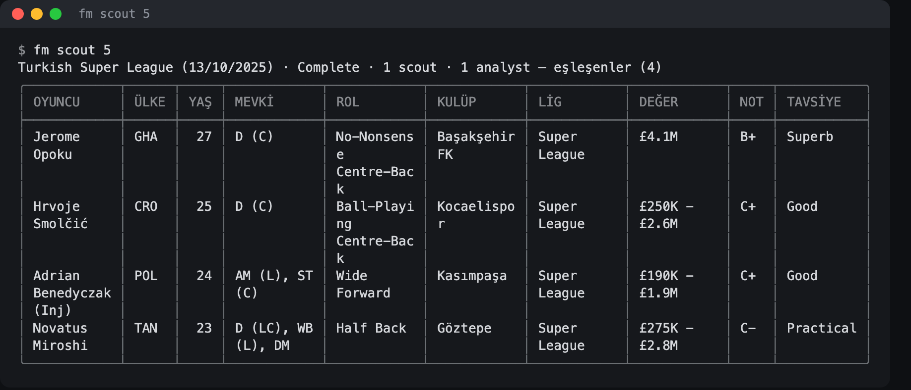

`fm scout` scout odaklarını sayar: neye bakıldığı, durumu, kimin atandığı ve kaç oyuncu çıktığı.

```
$ fm scout
#  ODAK                               DURUM        ATANAN               EŞLEŞEN  YAKIN  SÜREN
1  South Eastern Europe               In Progress  1 scout · 1 analyst  0        12     7
5  Türkiye (7/10/2025)                Complete     1 scout · 1 analyst  5        7      0
```

`fm scout 5` (ya da adıyla: `fm scout "south eastern"`) o odağın oyuncularını verir: mevki, en iyi
rolü, kulübü, değer aralığı, scoutların notu (A–E) ve tavsiyesi. Eşleşen varsa onlar gelir; yoksa
yakın eşleşenler. Hangisini istediğini de söyleyebilirsin: `--matched`, `--near`, `--progress`
(hâlâ incelenenler). Adın yanındaki `(Inj)` gibi notlar oyunun durum işaretleridir.

```
$ fm scout 5
Türkiye (7/10/2025) · Complete · 1 scout · 1 analyst — eşleşenler (5)
OYUNCU         ÜLKE  YAŞ  MEVKİ             ROL             KULÜP         DEĞER          NOT  TAVSİYE
Mohamed Bayo   GUI   27   AM (RL), ST (C)   Centre Forward  Gaziantep FK  £170K - £1.7M  B    Quality
```

### Yeni odak kurmak, durdurmak

`fm scout new` scoutlara yeni bir iş verir. Ne arandığını (mevki, istersen rol), nerede arandığını
(bölge), yaş aralığını ve önceliği söylersin; en az bir mevki ya da bölge gerekir, öncelik her zaman:

```
$ fm scout new --position DL --role "wing-back" --area "Northern Europe, turkiye" --age 18-23 --name "CLI sol bek" --priority standard
Odak kuruldu: CLI sol bek · Standard · D (L) · Wing-Back · Northern Europe · Türkiye · 18–23 yaş · 1 scout · 1 analyst
Bulduklarını görmek için: scout "CLI sol bek"
```

- **Mevki** sahadaki adıyla: `DL`, `DC`, `WBR`, `DM`, `MC`, `AML`, `ST`…
- **Bölge** kıta, bölge ya da ülke ise adı yeter (`"Northern Europe"`, `turkiye`). Bir lig için yolunu
  yazarsın: `"Competition>Türkiye>Super League"`. Birden çok bölge virgülle ayrılır. Seçenekleri
  `fm scout areas` verir; altı olanlar `›` ile biter: `fm scout areas "Region>Europe"`.
- **Öncelik** `top` (hemen, iki kişiyle), `standard` (tek scout, daha yavaş) ya da `ongoing` (sürekli).
  Yazmazsan komut sorar; kendisi seçmez.
- **En düşük yetenek / potansiyel** yıldızla: `--ability 3 --potential 3.5` (yarım yıldız adımlarıyla 0.5–5).
- **Kim baksın** dersen `--by "soykan, ciloglu"`; yazmazsan oyun kendi seçer. Scoutları `fm scout staff` listeler.
  Analist için aynısı: `--analysts "bayar"`.
- Yazmadığın her şey oyunun bıraktığı gibi kalır (her mevki, 15–50 yaş, her yer).

`fm scout edit <#|ad>` var olan bir odağı aynı seçeneklerle değiştirir; yalnızca yazdıkların değişir.
Mevki ve rol buradan değişmez, `--area` ile yazdığın bölgeler eklenir. Oyun odağın eski halini listede
"Complete" olarak bırakır.

```
$ fm scout edit "CLI yildiz" --ability 2.5 --age 19-22 --by "gorgec" --name "CLI yildiz 2" --priority ongoing
Odak güncellendi: CLI yildiz 2 · yetenek ≥ 2.5★ · Ongoing · Serkan Görgeç · 19–22 yaş
(oyun eski halini listede 'Complete' olarak bırakır)
```

`fm scout remove <#|ad>` bir odağı durdurur; `--yes` olmadan yalnızca ne olacağını söyler. Oyun durdurulan
odağı silmez: listede **Durduruldu** diye kalır, bulduğu oyuncular da durur. `fm scout restart <#|ad>`
durmuş ya da bitmiş bir odağı yeniden başlatır (oyun ondan yeni bir odak açar, eskisi listede kalır).

```
$ fm scout remove "cli deneme"
'CLI deneme' (1 eşleşen, 0 yakın) scout önceliklerinden çıkarılır. Onaylamak için: scout remove 5 --yes
$ fm scout remove "cli deneme" --yes
Odak durduruldu: CLI deneme  (listede kalır; yeniden başlatmak: scout restart)
```

Durdurduğun odak gün dönene kadar listede "In Progress" yazmaya devam eder; ertesi gün adı tarihle
biter ve durumu "Complete" olur. `scout restart` oyun o butonu gösterdiğinde çalışır (her gün göstermiyor).

`fm scout staff` scout ekibini verir: kim oyuncunun yeteneğini ve potansiyelini ne kadar iyi görüyor,
kaç bölge ve ülke biliyor, şu an hangi odaklarda çalışıyor:

```
$ fm scout staff
SCOUT          GÖREV  YETENEĞİ GÖRME  POTANSİYELİ GÖRME  BÖLGE  ÜLKE  ODAKLARI
Serkan Görgeç  Scout  Competent       Average            13     44    Türkiye
Sercan Soykan  Scout  Good            Average            13     44    Europe, South Eastern Europe
Cihan Çiloğlu  Scout  Average         Average            13     44    Turkish 1. League, Turkish Super League
```

Henüz yok: en düşük yetenek / potansiyel (yıldız), belirli scout ve analist atamak, topsuz rol,
var olan odağı düzenlemek.

### Bir oyuncuyu izletmek, listeye almak, kulübüne yoklamak

`fm scout player <ad> --for <süre>` o oyuncuya scout gönderir. Süreyi sen söylersin: `"1 hafta"`,
`"2 ay"`, `"3 maç"` ya da `tam` (scoutlar onu iyice tanıyana kadar). Kimi göndereceğini söylemezsen
boşta kim varsa o gider; belirli birini istersen `--by`:

```
$ fm scout player "Luka Jović" --for "1 hafta"
Luka Jović: Report › Assign to Scouting Pool › For 1 Week — yapıldı.

$ fm scout who "Mauro Icardi"
Devin Özek (Director of Football)
Serkan Görgeç (Scout)
…
$ fm scout player "Mauro Icardi" --by görgeç --for "2 maç"
```

Süreyi yazmazsan komut bir şey yapmaz, seçenekleri sayar (oturumda okla sorar). Zaten izlenen bir
oyuncuda "zaten izleniyor" der. **Görevi iptal etmek (`--cancel`) şu an işlemiyor:** oyun soruyu
kapatıyor ama görev duruyor; komut bunu kontrol edip söyler. Süre dolunca görev kendiliğinden biter.

`fm shortlist add <ad> --for <süre>` oyuncuyu kısa listeye alır (`"1 ay"`, `"3 ay"`, `"6 ay"`,
`"1 yıl"`, `süresiz`), `fm shortlist remove <ad>` çıkarır:

```
$ fm shortlist add "Adam Gnezda Čerin" --for "6 ay"
Adam Gnezda Čerin: Add To Shortlist › 6 Months — yapıldı.
```

Scout dönünce raporu `fm player <ad> --report` ile okursun: notu, yeteneği ve potansiyeli için ne
dedikleri, oyuncunun gelmeye ne kadar istekli olduğu, kaça mal olacağı, artılar, eksiler ve kadronda o
mevkide kaçıncı sırada olacağı:

```
$ fm player "Adam Gnezda Čerin" --report
Adam Gnezda Čerin — scout raporu · son izleyen Sercan Soykan (14/10/2025)
  Not: C — Would be a useful signing.
  Yetenek: Leading Super League · Potansiyel: Could improve slightly
  Transfere ilgisi: Extremely Interested · kiralığa: Very Interested
  Değer: £5.25M - £6.25M · tahmini maaş: £23,500 p/w - £31,500 p/w
Artılar:
  + Is a current international with plenty of experience.
  + His stamina allows him to keep performing when others often get tired.
Eksiler:
  - Would need to learn the language.
Kadroda sırası (M (C)):
   7  Talisca
   8  Adam Gnezda Čerin  ←
   9  Adnan Efe Fettahoğlu
```

Kendi oyuncun ya da hiç izlenmemiş biri için rapor yoktur; komut bunu söyler.

Teklif vermeden önce kulübü yoklamanın üç yolu:

- `fm enquire <ad>` kulübüne "ne istersiniz?" diye sorar. Cevap gelen kutusuna düşer.
- `fm interest <ad> --top | --transfer | --loan` ilgimizi duyurur (gözde hedef / transfer / kiralık).
- `fm trial <ad> --for "2 hafta"` oyuncuyu denemeye çağırır (1–4 hafta).

İlgi ve deneme için oyun önce sorar. `--yes` yazmadıysan komut soruyu gösterir ve "Hayır" der:

```
$ fm trial "Pedro Chirivella" --for "1 hafta"
Offer Trial
  Offer a trial to Pedro Chirivella?

Gönderilmedi. Göndermek için aynı komut, sonuna --yes

$ fm trial "Pedro Chirivella" --for "1 hafta" --yes
Offer Trial
  Offer a trial to Pedro Chirivella?

Trial Offered
  Pedro Chirivella has been offered a trial and a response will be received shortly.
```

Ad yazarken soyadı yeter: `cerin` Čerin'i bulur. Birden çok kişiye uyarsa komut kim olduklarını
sayar. Bunların hepsi oyuncunun sağ tık menüsündeki girişler; menünün tamamı `fm actions <ad>`.

## 11. Kaydetmek, yüklemek ve oyun ayarları — `save`, `saves`, `load`, `settings`

`fm save --yes` oyunu kaydeder. Mevcut kaydın üzerine yazar, o yüzden `--yes` ister.

`fm save --as "deneme" --yes` başka adla kaydeder. Yüklediğin dosya olduğu gibi kalır; oyun bundan
sonra yeni dosyaya kaydeder (kendi otomatik kayıtları da oraya gider). O adda bir kayıt varsa üzerine
yazar; `--yes` olmadan hangisinin olacağını söyler:

```
$ fm save --as "deneme"
Oyun 'deneme' adıyla yeni bir dosyaya kaydedilir (19 Ekim 2025 Pazar); sonraki kayıtlar da oraya gider.
Onaylamak için: save --as "deneme" --yes
```

`fm saves` diskteki kayıtları gösterir. `fm load "<ad>"` bunlardan birini yükler. Adın tamamını
yazmak gerekmez: `fm load v02`, adında "v02" geçen tek kaydı bulur. Oyun bir kaydı yalnızca ana
menüden yüklediği için, o an bir kayıttaysan oyun kapatılıp yeniden açılır (bir iki dakika) ve
kaydedilmemiş ilerleme gider; bu yüzden önce sorar ("Önce kaydet" / "Kaydetmeden yükle"), script'te
`--save` ya da `--no-save` dersin. `fm start --menu` oyunu kayıt yüklemeden ana menüde açar.

```
$ fm load v02 --no-save
Oyun kapatılıyor…
FM başlatılıyor…
'Faruk Kavlak - Fenerbahçe (v02)' yükleniyor…
Hazır: Faruk Kavlak - Fenerbahçe (v02) (12 Ekim 2025 Pazar).
```

`fm saves delete "<ad>" --yes` bir kaydı siler; geri alınamaz. O an yüklü olan kayıt silinmez.

`fm world` hangi kayıtta olduğunu ve oyunun dünyasını söyler:

```
$ fm world
Kayıt     Faruk Kavlak - Fenerbahçe
          Last saved over 31 minutes ago (2 days ago in-game time) · Saves automatically every week
Oynanan   0 Days, 13 Hours, 55 Minutes
Dünya     5 ülke · 12 lig · yaklaşık 34500 oyuncu
Detay     turnuvalar: Default · milli turnuvalar: Default
Menajer   Faruk Kavlak · Fenerbahçe A.Ş. · Playing
```

`fm stop` oyunu kapatır. Kaydedilmemiş ilerleme oyunla birlikte gittiği için önce sorar: "Kaydet ve
kapat" ya da "Kaydetmeden kapat". Script'te hangisi olduğunu sen söylersin: `fm stop --save` ya da
`fm stop --no-save`. Oyunu kendi çıkışıyla kapatır (birkaç saniye), olmazsa zorla. (Oturumdaki `quit` yalnızca
oturumdan çıkar, oyun açık kalır.)

`fm settings` oyunun ayarlarını gösterir: maçın ne kadarının gösterildiği ve hızı, otomatik
kayıt, dil, para birimi, birimler. Terminaldeysen ardından hangisini değiştirmek istediğini
okla sorar; "Hiçbiri" ile çıkarsın.

```
$ fm settings
Maç
  maç gösterimi: Önemli anlar        az gösterim maçı kısaltır
  dinamik mod: Kapalı                 gösterimi oyun seçer
  vurgu hızı: 1.5x                    pozisyon oynarken
  ara hızı: 30x                       pozisyonlar arası
Kayıt
  otomatik kayıt: Açık
  kayıt sıklığı: Her hafta
  kayıt türü: 3 dosya, sırayla
Bölge ve birimler
  dil: English                        İngilizce dışı komutları bozar
  para birimi: £ - UK Pound Sterling
  maaş: Haftalık
  tarih: dd/mm/yyyy
  sıcaklık: Santigrat · boy: Santimetre · kısa mesafe: Metre · uzun mesafe: Kilometre
  oran biçimi: Fractional (e.g. 15-1)
İşlem
  diğer maçların hızı: Fast (Less Responsive)        Fast: gün ilerletme daha çabuk
  maç takvimi: Allow matches to be moved for TV broadcast
  okumadan ilerleme yok: Kapalı                      bütün mesajlar okunmadan Continue çalışmaz
```

Tek bir ayarı adıyla değiştirmek için değeri de yaz; değer yazmazsan seçenekleri okla sunar
(şu anki işaretli):

```
$ fm settings vurgu hızı 2x
vurgu hızı: 1.5x → 2x
$ fm settings kayıt sıklığı her gün
kayıt sıklığı: Her hafta → Her gün
$ fm settings para birimi euro
para birimi: £ - UK Pound Sterling → € - Euro
$ fm settings otomatik kayıt kapalı
```

Değer Türkçe ya da oyundaki İngilizce adıyla, baştan ya da içinden bir parçayla yazılabilir
("euro", "uk pound", "2" = 2x); birden çok seçeneğe uyarsa hangileri olduğunu söyler. Oyunda
ayarlar ancak "Confirm" ile işlenir; `settings` bunu kendisi yapar ve sayfayı yeniden açıp yeni
değeri okuyarak doğrular. Satırlar oyunun dilinden bağımsız bulunur: Almanca (ya da başka dilli)
bir oyunda da aynı satırlar okunur ve değiştirilir.

Maçı kısaltmanın iki yolu var: **maç gösterimi** "Yalnızca anlatım" ya da "Önemli anlar"
(daha az pozisyon) ve **hızlar** (vurgu sırasında en çok 10x, aradaki sürede en çok 40x).
Dili değiştirmek mümkün ama fm-cli oyunun İngilizce yazılarını okuduğu için çoğu komut çalışmaz
hale gelir; `settings` bunu sorar, script'te `--yes` ister.

### İş aramak — `jobs`

Kovulunca ya da istifa edince yeni bir iş gerekir. `fm jobs` açık ilanları listeler:

```
321 iş ilanı

#   KULÜP         LİG                ÜLKE  SIRA  İTİBAR    MALİ DURUM   BAŞVURU
1   Celesti       Serie A            ITA   7.    Kıtasal   Sağlam       kapalı
4   York          Sky Bet League Two ENG   3.    Bölgesel  İdare eder   açık
6   FC Augsburg   Bundesliga 2       GER   3.    Ulusal    Sağlam       ?
…
```

"BAŞVURU kapalı" demek, o kulübün şu an başvuru kabul etmediği anlamına gelir. Yine de ilgi
bildirebilirsin. Liste bütün sayfayı gezdiği için 20-30 saniye kadar sürer.

Oyun listeyi ekranda yalnız gördüğü satırlar kadar döşüyor; `fm jobs` listeyi kendi kaydırması
boyunca baştan sona gezerek okur, yani liste tamdır: ilanları kaydırmak gerekmez, oyunun
gösterdiği bütün işler (bu kayıtta 321) aynı sırayla gelir.

"BAŞVURU" sütunu yalnız **boş** (menajersiz) ilanlar için sorulur; menajeri olan ilanlar "?" der,
çünkü o düğmenin açık olup olmadığı ancak satır seçilince belli olur ve yüzlerce satırı tek tek
seçmek dakikalar alırdı. Bir ilanı sorduğunda (`fm jobs "<kulüp>"`) başvuru durumu yine gelir;
satır görünüme kaydırılarak seçildiği için pencerede olmayan ilanlarda da doğrudur.

`fm jobs kayseri` (ya da numarasıyla, `fm jobs 5`) ilanın ayrıntısını gösterir: maaş gideri,
antrenman tesisleri ve menajer kuralları. Kulüp seçince:

- `fm jobs kayseri apply` işe başvurur,
- `fm jobs kayseri interest` kulübe ilgi bildirir.

İkisi de göndermeden önce sorar. Script'te `--yes` gerekir.

## 12. Kulüp — `club`, `staff`, `finances`, `supporters`, `board`, `facilities`

Hepsi yalnızca okur; oyunda hiçbir şeyi değiştirmez.

### Kulüp özeti — `club`


Kulübün tek ekranlık hali: yönetimin notu ve havası, taraftarların havası, kulüp vizyonundaki
hedefler (önem derecesi ve şu anki durumu), kasa, geçen ayın geliri ve gideri, haftalık maaşın
bütçeye oranı, itibar, stadyum ve tesisler, her ekipte kaç kişi olduğu ve hangi rollerin boş olduğu.

```
$ fm club
Yönetim
  Not                    C · memnun
  Taraftar               memnun · yönetime etkisi yüksek
Hedefler
  Work within wage budget (zorunlu) — yolunda
  Win the Super League (bu sezon) — memnun
```

### Personel — `staff`

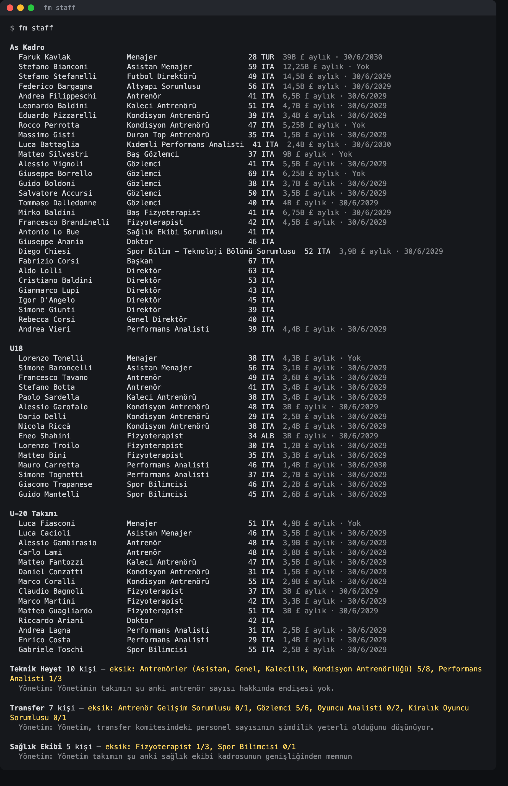

Kulüpte çalışan herkes, önce A takım sonra U19: işi, yaşı, uyruğu, haftalık maaşı ve sözleşmesinin
bittiği tarih. Altında her ekip (antrenörler, scouting, sağlık) için yönetimin istediği en az
sayıya göre eksik roller ve yönetimin ekip hakkındaki görüşü.

```
$ fm staff
A takım
  Faruk Kavlak             Manager                     25 TUR  £62K p/w · 30/6/2027
  Zeki Murat Göle          Assistant Manager           46 TUR  £4.7K p/w · 30/6/2026
…
Sağlık 6 kişi — eksik: Head of Sports Science 0/1, Physio 1/5, Sports Scientist 0/3
```

### Finans — `finances`


Kasa ve son üç ayın başındaki bakiye, bu ayın geliri ve gideri, kalan borç, finansal fair play durumu,
haftalık maaş bordrosu (oyuncu statüsüne göre: yıldız, ilk 11, rotasyon… hepsi), maç bileti ve
kombine fiyatı, sponsorluk
anlaşmaları tek tek (tür, sezonluk değer, bitiş) ve yönetimin önümüzdeki sezonlar için bakiye/ciro tahmini. Zarar parantezle ve kırmızı yazılır.
Transfer ve maaş bütçesi için `budget`.

```
$ fm finances
Kasa
  Bakiye                 £51,257,456
  Bu ay gelir            £381K
  Borç                   £124,551,321 kaldı (başta £285,857,212)
Yönetimin projeksiyonu
  2026/27                bakiye (£34.96M) · ciro £161M
```

Kalem kalem gelir ya da gider: `finances gelir` / `finances gider`, dönemi arkasına yaz — `ay`
(varsayılan), `geçen ay`, `sezon`, `geçen sezon`. Bütün kalemler, büyükten küçüğe; sıfır olanlar soluk.
Hepsi kulübün verisinden okunur, oyunda hiçbir sayfa açılmaz.


```
$ fm finances gider sezon
Gider — bu sezon: £57,523,168
  Player Wages                  £26,556,424
  Tax                           £7,399,431
```

### Taraftarlar — `supporters`

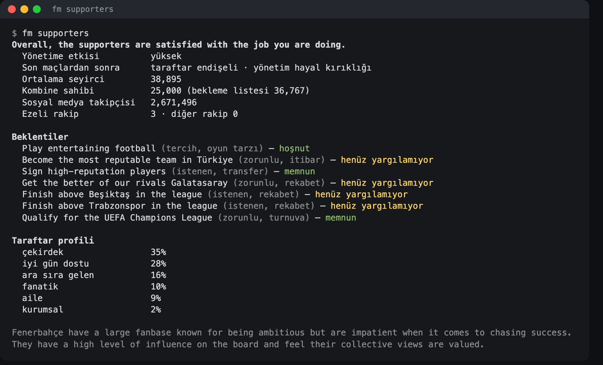

Taraftarın genel havası, yönetime etkisi, son maçlardan sonraki tepkisi, ortalama seyirci, kombine
sahibi ve bekleme listesi, sosyal medya takipçisi, rakipler; her beklenti (önemi, türü, şu anki
tepkisi) ve taraftar profili (çekirdek, aile, iyi gün dostu…).

```
$ fm supporters
Beklentiler
  Play entertaining football (tercih, oyun tarzı) — hoşnut
  Get the better of our rivals Galatasaray (zorunlu, rekabet) — henüz yargılamıyor
```

### Yönetimin ve taraftarın görüşü — `board`

Yönetimin menajer hakkında söyledikleri, konu konu: genel, son maçlar, oyuncuların desteği, taktik,
transfer, kulübün vizyonu ve kültürü, turnuvalar. Altında memnun oldukları (+) ve endişeleri (-),
sonra taraftarın aynı görüşleri. Cümleler oyunun kendi (İngilizce) cümleleri.

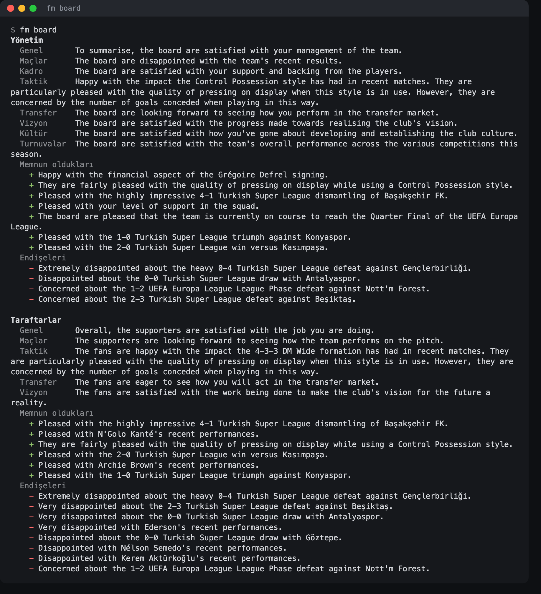

```
$ fm board
Yönetim
  Genel       To summarise, the board are satisfied with your management of the team.
  Maçlar      The board are disappointed with the team's recent results.
  Memnun oldukları
    + Pleased with the highly impressive 4-1 Turkish Super League dismantling of Başakşehir FK.
  Endişeleri
    - Extremely disappointed about the heavy 0-4 Turkish Super League defeat against Gençlerbirliği.
```

`fm board request` yönetimden neler istenebileceğini sayar (tesis, bütçe, altyapı ağı, personel
kadrosu, yeni stadyum, yeni sözleşme). Birini istemek için adını yaz; adın ayırt eden bir parçası
yeter, `--yes` olmadan yalnızca neyin isteneceğini söyler:

```
$ fm board request "scouts allowed" --yes
İstendi: Scouts Allowed
  Yönetim: The board will get back to you shortly to let you know of their decision
```

Karar sonradan gelen kutusuna mesaj olarak düşer ("Number of scouts increased", "Board respond to
board request - …"). Cevap bekleyen talepler varken oyun yeni talep açtırmıyor; komut o zaman
"Yönetim şu an talep almıyor" der.

### Personel aramak — `staff find`

`fm staff find` oyunun personel veritabanını listeler (antrenör, scout, fizyoterapist…): görevi,
sözleşmesi, maaşı. Yanına yazdığın şey gelenleri ad ya da göreve göre süzer.

```
$ fm staff find --filter "first team" --view coaching
KİŞİ               WORKING WITH YOUNGSTER  TACTICAL  TECHNICAL  DEFENDING  ATTACKING  JOB    DURUM
Abdullah Gür       12                      5         5          5          5          Coach  FrA
```

Aramayı oyunun kendi süzgeçleriyle daraltırsın: `--role <görev>` (scout, coach, physio, goalkeeping
coach, assistant manager…), `--free` (bir kulüpte çalışmayanlar), `--reputation <seviye>` (good,
very good, superb…). `--view` sütunları değiştirir (Contract, Rating, Coaching, Medical, Mental,
Scouting); `--filter` kulübe gelmek isteyenleri seçer (`staff find --filters`).

```
$ fm staff find --role scout --free --view scouting
KİŞİ         ANALYSING DATA  JUDGING PLAYER ABILITY  JUDGING PLAYER POTENTIAL  JOB    DURUM
Ibrahim Bâ   3               15                      14                        Scout  FrA
```

Arama oyunda açık kalır (sonraki `staff find` de aynı süzgeçle gelir); sıfırlamak için `--clear`.
`DURUM`'daki `FrA` serbest demek.

### Personel almak ve göndermek — `staff hire`, `staff fire`

`fm staff hire <ad>` o kişiyle sözleşme görüşmesini açar ve ne istediğini gösterir; henüz bir şey
teklif edilmiş olmaz.

```
$ fm staff hire "Antonio Agostini"
Antonio Agostini ·  — Şartlar
Şartlar:
  Job: Physio
  Secondary Job: None
  Contract Status: Full Time
  Haftalık ücret: £1,400 p/w
  Start Date: Immediate - 23/10/2025
  Süre: 3 years (Oct 2025 - Jun 2028)

Menajere sunmak / imzalamak için: contract --sign --yes   (şart değiştirmek: --wage <tutar>, --term "Şart=değer")
```

Buradan sonrası oyuncu sözleşmesiyle aynı: `fm contract --wage 1200` ile pazarlık edersin (karşı
teklifini söyler), `fm contract --sign --yes` ile teklifi verirsin, `fm contract --cancel` ile
vazgeçersin. Hepsini tek satırda da yazabilirsin: `fm staff hire "<ad>" --wage 1200 --sign --yes`.
Teklif verilince kararı birkaç gün içinde gelen kutusuna düşer; o arada teklifi geri çekmek için
`fm actions "<ad>" "Withdraw Contract Offer"`.

`fm staff fire <ad>` kendi personelinle yolları ayırır. Oyun ödenecek tazminatı söyler; `--yes`
yazmadıysan komut "Hayır" deyip çıkar.

```
$ fm staff fire "Cabir Sevim"
Release Cabir Sevim?
  Are you sure you want to terminate Cabir Sevim's contract?
  Fenerbahçe will have to pay £110K in compensation to Cabir Sevim.

Vazgeçildi. Feshetmek için: staff fire "Cabir Sevim" --yes
```

`--mutual` tazminatsız karşılıklı fesih teklif eder; oyun bunu sormadan işlediği için o da `--yes` ister.

### Bir kişi için ne yapılabilir — `actions`

`fm actions <kişi>` oyunun o kişi için sağ tıkta açtığı menüyü gösterir. Kişi oyuncu da olabilir,
personel de; kadromuzda olması gerekmez.

```
$ fm actions "Cabir Sevim"
Cabir Sevim
  Contract ›
    Enter Contract Negotiations
    DoF To Negotiate Contract
    Terminate Contract
    Mutual Termination
  Report ›
    Find Similar Staff
  Misc ›
    Set Nickname
    Send On Coaching Course
```

Bir oyuncuda liste uzundur: scout atamak (`Scout Player`, `Assign Scout › <scout> › <süre>`), listeye
almak (`Add To Shortlist › <süre>`), ilgi bildirmek (`Declare Interest › For Transfer`), denemeye
çağırmak (`Offer Trial › 2 Weeks`), kadro planına eklemek… Çok uzun alt menüler sayısıyla yazılır;
tamamı için `--all`.

Yapmak için seçeneği de yaz. Yolun tamamı şart değil, son kısmı tekse yeter:

```
$ fm actions "Jerome Opoku" "Add To Shortlist > Indefinitely"
$ fm actions "Cabir Sevim" "send on coaching course"
```

⚠ Seçenek yazınca oyun onu hemen yapar. Oyun kendisi soruyorsa (tazminat, geri çekme) soruyu görürsün
ve `fm dialog Yes` / `fm dialog No` ile cevaplarsın; sormuyorsa iş olmuştur. Terminalde seçenek yazmadan
çalıştırırsan menüde okla gezersin.

### Kim neyi yapıyor — `responsibilities`

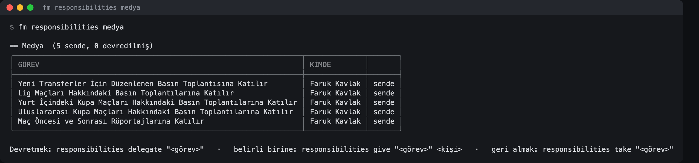

`fm responsibilities` kulüpteki bütün işlerin kimde olduğunu gösterir. İşler oyundaki dokuz alana
ayrılır: yönetim, personel, scout, transfer ve sözleşme, medya (basın toplantıları), antrenman, taktik,
maç günü, duran top. Hepsini okumak yarım dakika kadar sürer. Tek bir alan için adını yaz:
`fm responsibilities medya` (ya da basın, antrenman, taktik, maç, duran top, transfer, scout,
personel, yönetim). Başka bir şey yazarsan bütün alanlarda süzer (`fm responsibilities u21`).

```
$ fm responsibilities medya

== Media  (4 sende, 1 devredilmiş)
GÖREV                                      KİMDE         
Attends New Signing Press Conferences      Faruk Kavlak  sende
Attends League Press Conferences           Tom Shaw      devredildi
Attends Domestic Cup Press Conferences     Faruk Kavlak  sende
Attends Continental Cup Press Conferences  Faruk Kavlak  sende
Attends Broadcast Interviews               Faruk Kavlak  sende
```

Basın toplantısı mesajındaki "Delegate …" cevabı da aynı işi devreder; geri almak için
`fm responsibilities take "league press conferences"`.

Bir işi devretmek ya da geri almak için görevin adını (ayırt eden kelimeleri yeter) yaz:

```
$ fm responsibilities delegate "renewing chief scout"
Renewing the Chief Scout's contract: devredildi → Devin Özek
$ fm responsibilities take "renewing chief scout"
Renewing the Chief Scout's contract: artık sende.
```

`delegate` işi oyunun önerdiği kişiye verir. Belirli birine vermek için `give`; kişiyi yazmazsan
kimlere verilebileceğini sayar (terminalde okla seçtirir):

```
$ fm responsibilities give "loan manager's contract"
Renewing the Loan Manager's contract: Faruk Kavlak
Verilebilecekler: Faruk Kavlak · Devin Özek · Şenol Çorlu · Sadettin Saran
$ fm responsibilities give "loan manager's contract" Şenol
Renewing the Loan Manager's contract: Faruk Kavlak → Şenol Çorlu
```

### Altyapı — `youth`

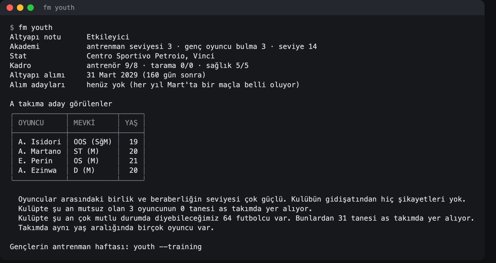

`fm youth` altyapının durumunu verir: genel not, akademi, altyapı kadrosu, A takıma aday görülen
gençler ve bir sonraki altyapı alımının tarihi.

```
$ fm youth
Altyapı notu      Good
Akademi           antrenman: Great training facilities · tarama: Great training facilities · seviye: 11
Kadro             antrenör 11/13 · tarama 0/0 · sağlık 5/5
Altyapı alımı     11th March 2026 (141 days to go)

Alım adayları     henüz yok (her yıl Mart'ta bir maçla belli oluyor)

A takıma aday görülenler
OYUNCU           MEVKİ   YAŞ
S. Chérif        ST (C)  18
Yiğit Efe Demir  D (C)   21
```

`fm youth --training` altyapı takımının (kulübe göre U19, U21…) antrenman haftasını verir: hafta nasıl geçti, ortalama puan ve her oyuncunun
ek odağı ile puanı (en iyiden başlayarak; `-` o hafta çalışmamış demek).

```
$ fm youth --training
U19 antrenman haftası: Very Good Week · 3 players currently injured · ortalama 7.76

OYUNCU                YAŞ  MEVKİ            EK ODAK             PUAN
Adnan Efe Fettahoğlu  16   M (C), AM (RC)   Attacking Movement  8.80
Engin Can Biterge     18   GK               GK Tactical         8.80
Sidiki Chérif         18   AM (RL), ST (C)  Final Third         8.50
```

`fm youth candidates` (ya da `fm youth adaylar`) o yılın altyapı alımını listeler; adaylar Mart'ta geldikten
sonra çalışır. Oyun adayları beş gruba ayırır (Elite, Top, Good, Decent, Poor); her satırda yaş, mevki, rol,
ülke, şimdiki yetenek ve potansiyel var. Potansiyel bir aralıktır: oyun henüz emin değildir, "en az – en çok" yazar.

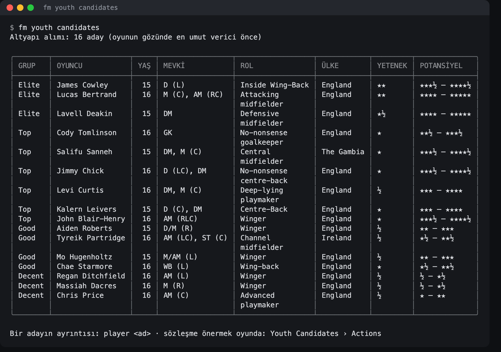

```
$ fm youth candidates
Altyapı alımı: 16 aday (oyunun gözünde en umut verici önce)

GRUP    OYUNCU           YAŞ  MEVKİ            ROL                     ÜLKE        YETENEK  POTANSİYEL
Elite   James Cowley     15   D (L)            Inside Wing-Back        England     ★★       ★★★½ – ★★★★½
Elite   Lucas Bertrand   16   M (C), AM (RC)   Attacking midfielder    England     ★★       ★★★★ – ★★★★★
Top     Cody Tomlinson   16   GK               No-nonsense goalkeeper  England     ★        ★★½ – ★★★½
Top     Salifu Sanneh    15   DM, M (C)        Central midfielder      The Gambia  ★        ★★★½ – ★★★★½
Decent  Chris Price      16   AM (C)           Advanced playmaker      England     ½        ★ – ★★
```

Adaylar gelmeden önce `fm youth` "henüz yok" der; gelince "GELDİ — liste: youth candidates" yazar. Adaya sözleşme
önermek şimdilik oyunun içinden (Youth Candidates › Actions).

### Tesisler — `facilities`


Stadyum (kapasite, yapım yılı, sahibi, zemin ısıtma, çatı, zemin, saha ölçüsü ve durumu),
antrenman tesisi, altyapı tesisleri, akademi antrenmanı, genç oyuncu bulma ve kurumsal tesisler.

## 13. Her şeye erişim — `pages`, `buttons`, `press`

Henüz komutu olmayan bir şey için oyunun ekranlarını doğrudan kullanabilirsin:

| Komut | Ne yapar |
|---|---|
| `pages` | oyunun bütün sayfaları |
| `open "<sayfa>"` | sayfayı aç |
| `buttons` | ekrandaki butonlar |
| `press "<etiket>"` | butona bas |
| `dropdowns` | ekrandaki açılır listeler |
| `select <liste> "<seçenek>"` | listeden seç |
| `dialog [cevap]` | açık onay penceresini göster / cevapla |
| `tour` | açık tanıtım turunu yürüt (`--skip`: atla) |

Değiştiren komutların çoğu `--dry` alır: yapmaz, ne yapacağını söyler. Bir şey gösteren her
komut `--json` alır: tablo yerine JSON basar, soru sormaz, renk kullanmaz. Örnek:

```
$ fm captains --json
{"Captain":"Milan Škriniar","ViceCaptain":"Kerem Aktürkoğlu"}
$ fm league --json | jq -r '.Players[] | "\(.Stat): \(.Player)"'
Highest Average Rating: Victor Osimhen
Most Goals: Victor Osimhen
…
```

Aynı şekilde `--csv` yalnızca tabloları CSV olarak basar (tablosu olmayan komut hata verir),
`--md` tabloları Markdown tablosuna çevirip aradaki satırları korur:

```
$ fm table --csv | head -3
#,TAKIM,O,G,B,M,AV,P
1,Galatasaray,8,7,0,1,18,21
2,Göztepe,7,6,1,0,11,19
```

### Son bakıştan bu yana — `diff`

`fm diff` o anki hali kaydeder; bir sonraki `fm diff` aradan geçen sürede neyin değiştiğini
söyler ve yeni hali kaydeder (~13 sn, yalnızca lig tablosu ile finans sayfalarını açar):

```
$ fm diff
20 Eylül 2025 → 5 Ekim 2025 · 15 gün
  Lig               10. → 8. sıra · 7 → 11 puan (2 maçta 4)
  Kasa              £52.72M → £51.26M (-£1.46M)
  Transfer bütçesi  £12M → £11.07M (-£930K)
  Gelen             Grégoire Defrel
  Giden             Edin Džeko
  İyileşen          Talisca
  Sözleşme          Fred: 30/6/2026 → 30/6/2027

OYUNCU             MAÇ  GOL  ASİST  ORT. PUAN
Kerem Aktürkoğlu    +2   +2     +1  6.88
Ederson             +2              6.55 → 6.70
```

`--keep` bu bakışı kaydetmez (karşılaştırma hep aynı günle yapılır, ör. haftalık özet için),
`--reset` yalnızca şimdiki hali kaydeder. Kayıt `~/.config/fm-cli/diff-<takım>.json`.

### Rapor dosyası — `export`

`fm export rapor.md` durum, kadro, lig tablosu, fikstür, sağlık, sözleşmeler ve finansı başlık
başlık tek bir Markdown dosyasına yazar (~15 sn). İstediğin komutları sırayla da verebilirsin;
birden çok kelimeli komut tırnak içinde:

```
$ fm export rapor.md
/…/rapor.md yazıldı (7/7 bölüm).
$ fm export maç-öncesi.md opponent "squad --fitness" health
$ fm export kadro.csv "squad --stats"      CSV: tek komutun tablosu
```

Dosyanın başı şöyle:

```
# Fenerbahçe — 5 Ekim 2025

## Durum
FM açık, kayıt yüklü. 5 Ekim 2025 Pazar 17:15
Sıradaki maç: Fatih Karagümrük · iç saha · Super League · 18 Ekim Cumartesi 16:00 (13 gün sonra)

## Kadro

| OYUNCU | POZİSYON | YAŞ | STATÜ | MAAŞ | DEĞER | DURUM |
|---|---|---|---|---|---|---|
| Anthony Musaba | AM (RL), ST (C) | 24 | Squad Player | £14.25K p/w | £2.1M - £5.2M |  |
…
```

Dosya adı verilmezse rapor ekrana basılır (`fm export | less`).

## 14. Claude'dan oynamak — MCP

`fm mcp` bütün komutları MCP araçları olarak sunar; repo kökündeki `.mcp.json` bunu
tanımlıyor. Claude Code'da proje açıkken araçlar `fm_status`, `fm_squad`, `fm_match`… adıyla
gelir. İlk çağrılacak olan `fm_status`: oyunun neyi beklediğini ve hangi aracın onu çözdüğünü söyler.

### Soyunma odası — `dynamics`

Kim kiminle takılıyor, kimin sözü geçiyor, kim nasıl bir karakter.

```
$ fm dynamics
Menajere destek: 0 destekliyor · 21 kararsız · 0 karşı

Çekirdek grup (6)
  This group is made up of players who share similar levels of professionalism.
OYUNCU            HİYERARŞİ     KİŞİLİK
Kerem Aktürkoğlu  Takım lideri  Perfectionist
İsmail Yüksek     Takım lideri  Fairly Determined
Çağlar Söyüncü    Çok etkili    Fairly Loyal
…
```

Gruplar oyunun kendi ayrımı (çekirdek, ikincil A / B, gruba girmeyenler); altındaki cümle grubu neyin bir arada
tuttuğunu söyler. Takım liderlerini üzmek soyunma odasını çabuk bozar; kaptan seçerken ve birini satarken bak.

### Kulüp vizyonu toplantısı — `vision`

Sezon bitince yönetim "Club vision and expectations meeting" mesajını yollar. Mesaja `Accept Current Vision`
dersen hedefler olduğu gibi kalır; `Negotiate` dersen toplantı açılır ve `fm vision` ile yürütülür:

```
$ fm vision
Kulüp vizyonu toplantısı
  Yönetim: Here is our updated strategy for the future. …

Yapılacak hedefler
  1  Develop players using the club's youth system — tercih
  2  Sign players under the age of 23 for the first team — tercih
  3  Work within wage budget — zorunlu
  4  Grow the club's reputation — tercih

Bilgi amaçlı hedefler
  5  Maximum one-year contracts for players over the age of 34 — istenen
  6  Maximum two-year contracts for players over the age of 32 — yeğlenen
```

İstemediğin bir hedefi çıkarıp yönetime önerirsin; yönetim kabul eder ya da neden olmadığını söyler:

```
$ fm vision remove 2
Çıkarıldı: Sign players under the age of 23 for the first team. Yönetime sunmak için: vision suggest
$ fm vision suggest
$ fm vision
  Yönetim: The issue we have with your proposal is that you're unwilling to work towards signing players
  no older than 23 for the first team.
```

Zorunlu hedefler çıkarılamaz. `vision undo` son değişikliği, `vision reset` hepsini geri alır. Anlaşınca
`vision confirm` (geri alınmaz; script'te `--yes` ister), sonra `vision end` toplantıyı kapatır. Toplantı açıkken
`status` bunu söyler; oyun toplantı bitmeden ilerlemez.

### Kaptanlar — `captains`

```
fm captains                          kaptan ve yardımcısı
fm captains --captain "Škriniar"     kaptanı değiştir
fm captains --vice "İsmail Yüksek"   yardımcı kaptanı değiştir
```

Oyun yardımcı kaptanın günde bir kez değişmesine izin veriyor; aynı gün ikinci kez denersen komut
bunu söyler, `fm next` sonrası yeniden dene. Yardımcı adayları oyunun önerdiği birkaç kişi.

### Bir oyuncunun sözleşmesi — `contracts <oyuncu>`

```
$ fm contracts kerem
Kerem Aktürkoğlu — sözleşme 30/6/2029 tarihine kadar
ŞART                    DEĞER
Haftalık ücret          £115K p/w
Vergi sonrası           £93K p/w
Kadro statüsü           Regular Starter
Tür                     Full Contract
Maç başı ücret          £23.5K
Gol primi               £17.5K
Oynamayan yedek ücreti  £5.75K
Düşersek indirim        25%
```

Yalnızca sözleşmede olan şartlar listelenir. Kupa ve ödül primleri burada görünmüyor (oyun onları ayrı bir listede
tutuyor); yenileme kartında (`contract <oyuncu>`) görürsün.

### Basın ne yazıyor — `news`

Gelen kutusu değil; oyunun haber sitesindeki başlıklar, en yeni önce. Rakipler, transfer söylentileri, lig.

```
$ fm news
Tiago still searching for first goal   · Fatih Karagümrük · 30 dk önce
    Fatih Karagümrük A.Ş.'s Tiago Çukur has vowed to put an end to growing concern over his lack of goals for the club.
Argentina call-up unlikely for Barco   · Argentina · 2 saat önce
Fatih Tekke chasing Muçi   · Beşiktaş · 20 saat önce
…
```

Başlıkların önünde numara var; `fm news 3` ya da `fm news tiago` o haberin tamamını verir.

### Oyuncularımıza gelen teklifler — `offers`

```
$ fm offers
#  OYUNCU           KULÜP       TÜR    DURUM       BEDEL
1  Grégoire Defrel  Angers SCO  Satış  Offer Made  £50K

$ fm offers defrel view          teklifin bütün şartları, kart olarak
$ fm offers defrel stall         beklet: karar için zaman kazan
$ fm offers defrel accept --yes  kabul et (oyun ayrıca sormaz)
$ fm offers 1 reject --yes       reddet
```

Teklifin mesajı birkaç gün sonra gelen kutusundan düşer ama teklif beklemeye devam eder; süresi dolarken oyun
"Review Transfer Offer" diye durur. O zaman cevap buradan verilir. Pazarlıksız ya da bir kez bekletilmiş teklif
yeniden bekletilemez.

### Milli oyuncular — `internationals`

```
$ fm internationals
OYUNCU             ÜLKE      MİLLİ MAÇ  GOL  BU SEZON
Edson Álvarez      Mexico    96         7    4 maç
Milan Škriniar     Slovakia  85         3    4 maç
Dorgéles Néné      Mali      27         8    4 maç, 1 gol
…
22 oyuncu milli olmuş; 9 tanesi bu sezon milli takımda oynadı.
```

Milli arada kimlerin yorulacağını görmek için: "BU SEZON" sütunu dolu olanlar davet alanlar.

### Mentorluk grupları — `mentoring`

Gençlerin tecrübelilerden öğrenmesi için kurulan gruplar.

```
$ fm mentoring
Mentoring Group 1 (3)
OYUNCU          KİŞİLİK
Milan Škriniar  Perfectionist
Archie Brown    Balanced
Levent Mercan   Resolute
```

`fm mentoring --auto` grupları yardımcına kurdurur. Zaten grup varsa oyun önce "bütün gruplar silinecek" diye sorar;
komut bu soruyu gösterip "Hayır" der, kurdurmak için `fm mentoring --auto --yes`.

Elle kurmak için önce kimlerin seçilebildiğine bak, sonra üç oyuncuyu yaz (bir grup hep üç kişi):

```
$ fm mentoring new
OYUNCU              YAŞ  YÜK     KİŞİLİK            HİYERARŞİ
Talisca             31   Light   Spirited           Influential Player
Dorgéles Néné       22   Light   Fairly Determined  Others
Fred                32   Light   Fairly Loyal       Influential Player
…

$ fm mentoring new talisca fred nene --name "Deneme Grubu"
Kuruldu: Deneme Grubu — Talisca, Fred, Dorgéles Néné
```

`--name` yazmazsan oyun grubu kendisi adlandırır ("Mentoring Group 2"). Bir grubu dağıtmak için
`fm mentoring remove "<grup>" --yes`; oyun bunu sormadan yaptığı için `--yes` komutta.

Bir grubu dağıttığın gün yeni grup kurulmaz: oyun o gün yeni grup açınca dağıtılanı geri getirip grupları karıştırıyor.
Komut bunu söyler; `fm next` ile bir gün ilerletip sonra kur.

