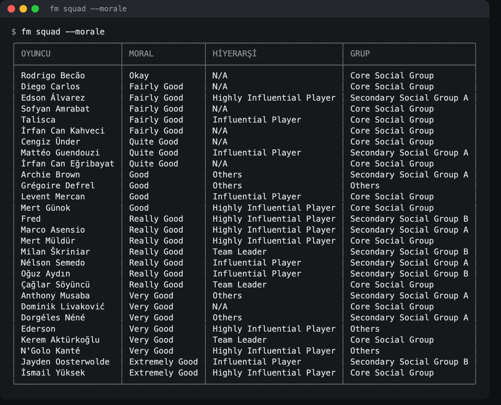
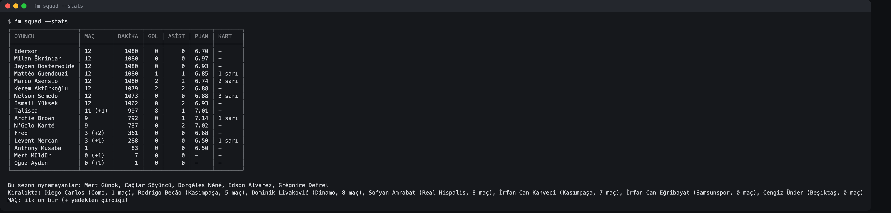
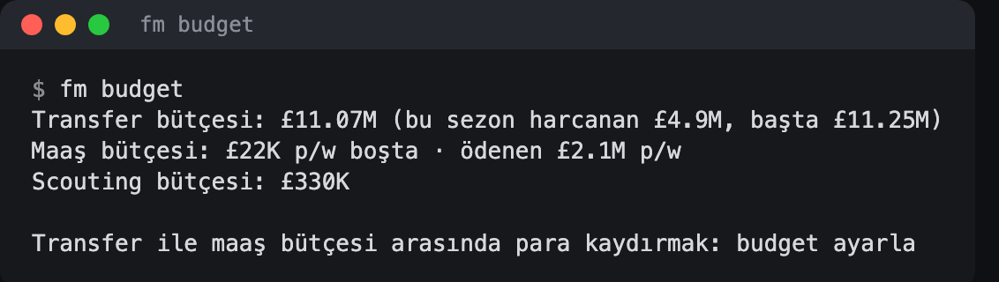
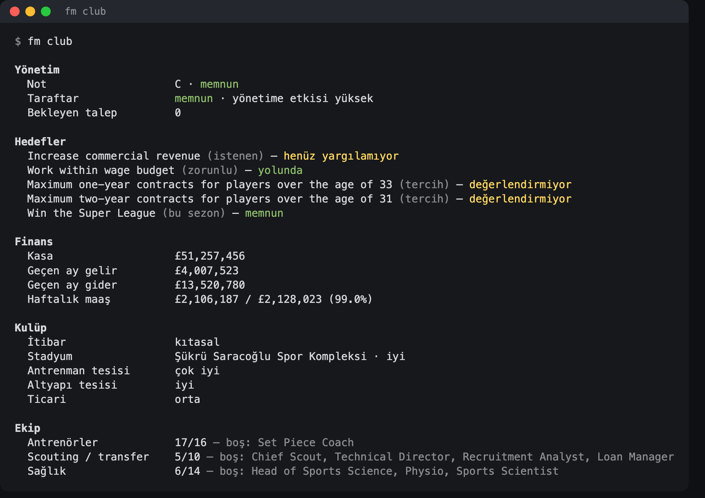
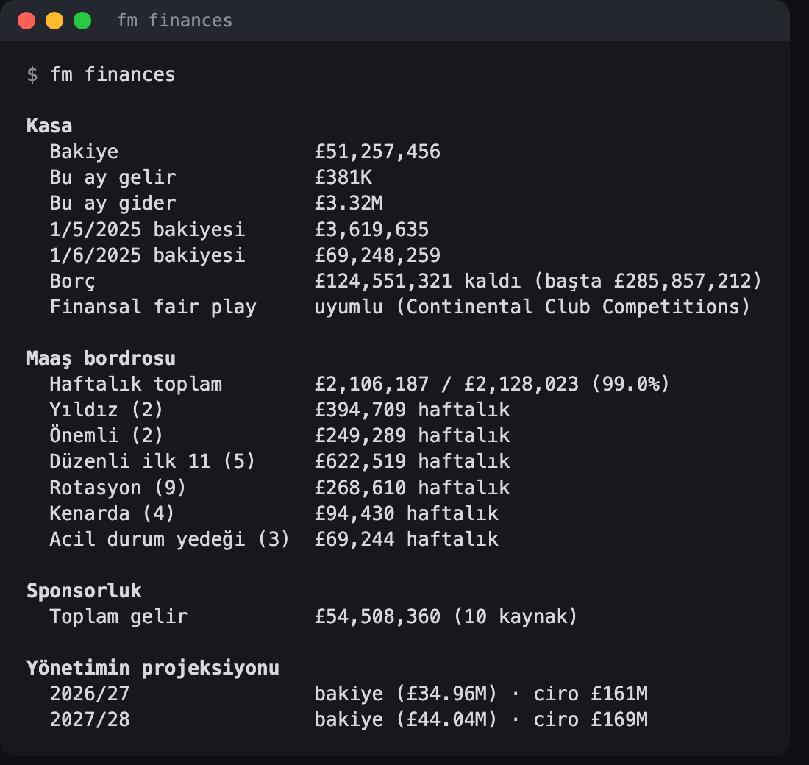
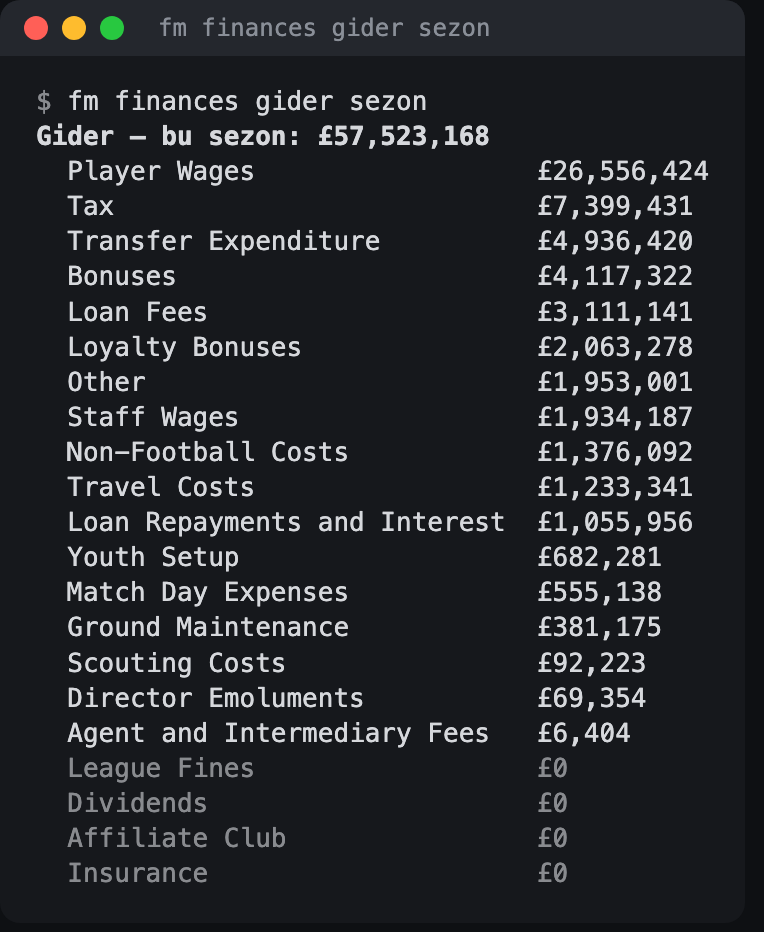
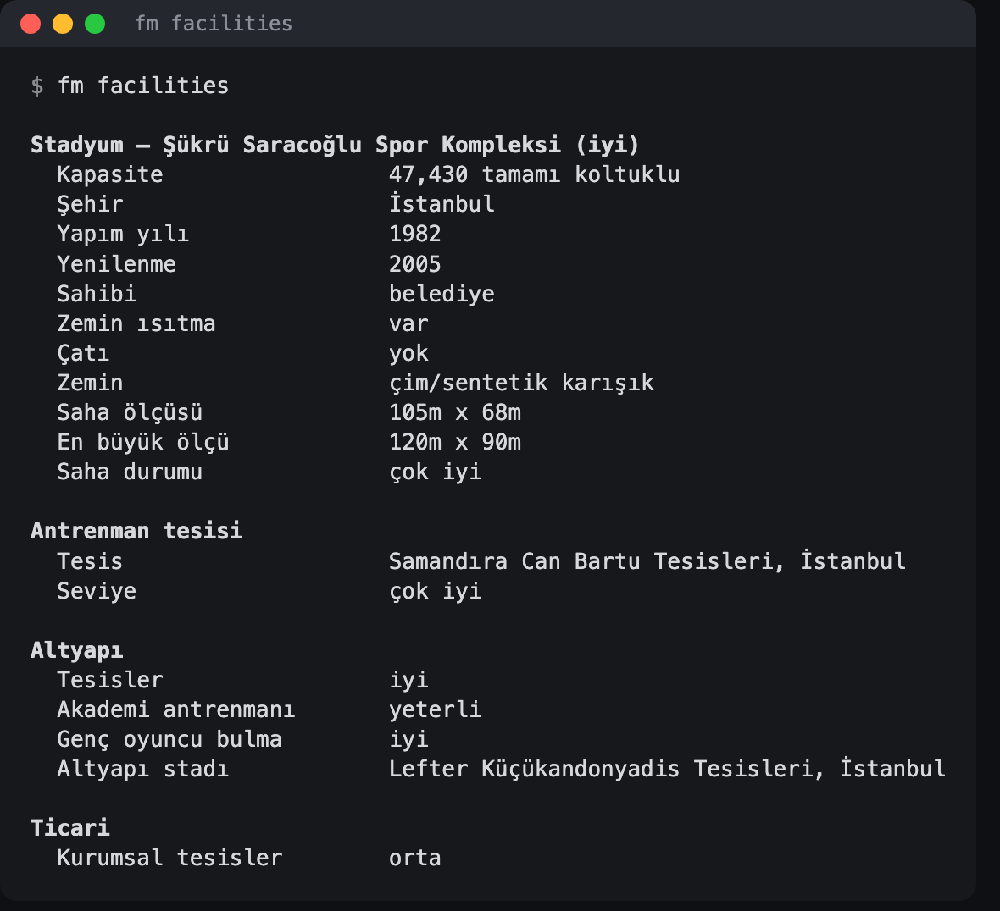

# fm — Kullanım Kılavuzu

Gerçek Football Manager 26'yı terminalden oynamak için. Oyun arka planda açık durur,
sen her şeyi `fm` komutlarıyla yaparsın.

> Ekran görüntüleri gerçek oyundan alınıyor. Yenilemek için oyun açıkken:
> `tools/manual/shots.sh` (hepsi) ya da `tools/manual/shots.sh squad` (adında "squad" geçenler).
> Okla seçilen, oyunu değiştiren komutlar (`reply`, `register`, `match`…) oynanarak çekilir:
> `uv run --with pyte tools/manual/drive.py docs/manual/img <sahne>` — sahneler `drive.py`'nin
> başında, hangi tuşa basılacağı ve ne zaman fotoğraf çekileceğiyle. Bunlar oyunu ilerletir.
> Bir komut eklenince ya da değişince: görüntüsünü ilgili listeye ekle, buraya bölümünü yaz.

**İçindekiler**
1. [Başlarken](#1-başlarken)
2. [Neredeyim? — `status`](#2-neredeyim--status)
3. [Gelen kutusu ve cevaplar — `inbox`, `reply`](#3-gelen-kutusu-ve-cevaplar--inbox-reply)
4. [Zamanı ilerletmek — `next`](#4-zamanı-ilerletmek--next)
5. [Kadro — `squad`](#5-kadro--squad)
6. [Oyuncu kartı — `player`, `search`](#6-oyuncu-kartı--player-search)
7. [Taktik — `tactic`](#7-taktik--tactic)
8. [Maç günü — `match`, `sub`, `talk`, `report`](#8-maç-günü--match-sub-talk-report)
9. [Lig ve fikstür — `table`, `fixtures`](#9-lig-ve-fikstür--table-fixtures)
10. [Transfer ve sözleşme — `players`, `offer`, `contract`](#10-transfer-ve-sözleşme--players-offer-contract)
11. [Kaydetmek ve oyun ayarları — `save`, `settings`](#11-kaydetmek-ve-oyun-ayarları--save-settings)
12. [Kulüp — `club`, `staff`, `finances`, `supporters`, `board`, `facilities`](#12-kulüp--club-staff-finances-supporters-board-facilities)
13. [Her şeye erişim — `pages`, `buttons`, `press`](#13-her-şeye-erişim--pages-buttons-press)
14. [Claude'dan oynamak — MCP](#14-claudedan-oynamak--mcp)

---

## 1. Başlarken

```
$ fm start
FM başlatılıyor…
Son kayıt yükleniyor…
Hazır.
fm›
```

`fm start` oyunu açar, son kaydı yükler ve seni `fm›` oturumuna sokar. Oyun zaten açıksa
ona bağlanır. Oturumun içinde komutları `fm` yazmadan verirsin (`squad`, `next`…); oturum
dışında her komutun başına `fm` eklenir (`fm squad`). Bu kılavuz ikinci yazımı kullanıyor.

Oyun ekranda ve Dock'ta görünmez. Pencereyi görmek istersen: `fm start --debug`.

### Kısaltmalar ve tab tamamlama

Komutun tamamını yazmak gerekmez:

- Başı yeter, tek bir komuta uyuyorsa: `fm sq` → `squad`, `fm fix` → `fixtures`. Birden çok komuta
  uyuyorsa (`fm re`) adaylar listelenir.
- Kısa adlar: `s` status · `n` next · `i` inbox · `t` table · `fx` fixtures · `m` match · `p` player · `tc` tactic.
- Türkçe adlar, aksanlı ya da aksansız: `kadro`, `taktik`, `maç`/`mac`, `tablo`, `fikstür`, `gelen`, `ileri`,
  `sağlık`, `yönetim`, `doktor`… Oyuncu bırakan ya da teklif gönderen komutların kısa adı yok.

Tab tamamlama için kabuğuna bir satır ekle:

```
# ~/.zshrc
source <(fm completion zsh)
# ~/.bashrc (macOS'un bash'i <(…) ile yükleyemiyor)
eval "$(fm completion bash)"
```

zsh komutları açıklamalarıyla, seçenekleri (`fm squad --<Tab>`) ve oyun açıksa kadrodaki oyuncuların
adlarını tamamlar: `fm player Ke<Tab>` → `fm player Kerem\ Aktürkoğlu`.

## 2. Neredeyim? — `status`

Kaybolduğunda ilk yazacağın komut. Tarihi, sıradaki maçı, son maçların formunu ve oyunun
şu an neyi beklediğini söyler.


Alttaki "Bloke" satırı önemli: oyun bir şey beklerken zaman ilerlemez. Neyi beklediğini ve
hangi komutla çözüleceğini burada yazar.

## 3. Gelen kutusu ve cevaplar — `inbox`, `reply`


- Mavi nokta: okunmamış.
- **cevaplanabilir**: istersen cevap verirsin, vermezsen oyun devam eder.
- **cevap bekliyor**: cevaplamadan zaman ilerlemez.

Cevaplamak için mesajın numarasını ver. Mesajın tamamı ve cevapları çıkar, okla seçip Enter'a basarsın:


Seçince oyunun ne dediği altta yazar:


Burada mesaj cevaplandı ama oyun kadro listesini hâlâ bekliyor: listeyi göndermek ayrı bir
iş, onu `register` yapıyor (aşağıda).

Seçimi doğrudan da verebilirsin: `fm reply 4 2` ya da cevabın bir parçasıyla `fm reply 4 accept`.

### Kadro listesi — `register`, `numbers`

Sezon başında ve her Avrupa turundan önce oyun kayıtlı oyuncu listesi ister; gönderilmeden
zaman ilerlemez. `fm register` listeyi açar: kim listede (✓), kim yetişme kotasına sayılıyor
(**kulüpte** / **ülkede**), kim değiştirilemez (kiralıkta olanlar), ve turnuvanın kuralları.


Altta menü var: oyuncunun üstüne gelip Enter'a basınca listeye girer ya da çıkar.
"Yardımcı seçsin" oyunun önerdiği listeyi kurar.


Menünün başlığı kuralların anlık halini gösterir. Hepsi ✓ olunca en üste **Listeyi gönder** gelir:


Gönderince ne değiştiği yazılır:


> **Yetişme kotası tutmuyorsa:** UEFA listesi 25 kişi, bunun 8'i yetişmiş oyunculara ayrılmış.
> Yetişmiş oyuncun eksikse o kadar yer boş kalır: yetişme bayrağı olmayan oyunculardan
> çıkarırsın, oyun kotayı ✓ sayar. Örnekte 6 yetişmiş oyuncu vardı (8'den 2 eksik), yani
> en fazla 23 kişi; Emre Mor çıkınca liste gönderilebildi.

Script'te ya da Claude'dan:

```
fm register                        listeyi ve kuralları yaz
fm register --out "Emre Mor"       listeden çıkar  (--in: listeye koy; ikisi de tekrarlanabilir)
fm register --auto                 önce yardımcı seçsin
fm register --send                 gönder (kurallar tutuyorsa)
```

`fm numbers` forma numaralarını yardımcıya verdirip gönderir. Script'te sormadan: `--auto`.

## 4. Zamanı ilerletmek — `next`

`next` oyunun "Continue" tuşudur. Oyun bir yerde durana kadar (yeni mesaj, maç günü,
basın toplantısı…) ilerler ve neden durduğunu söyler. `next 3` üç kez ilerler.

```
fm› next
Bloke: 5 mesaj cevap bekliyor.
  08:13  Club vision and expectations meeting
  ...
```

Toplantı ya da basın toplantısı gibi bir konuşma açılırsa `talk` ile yürütülür (bkz. §8).

## 5. Kadro — `squad`

Kadro; kondisyon ve maç formu çubuklu. Sakat oyuncular kırmızı.


En yorgun önce sıralı kondisyon görünümü:


Moral, takım içi hiyerarşi ve sosyal grup:



Sezon istatistikleri: maç (ilk on bir, yedekten girdikleri parantezde), dakika, gol, asist,
ortalama puan, kart; en çok oynayan önce. Altında hiç oynamayanlar ve kiralıktakiler (kulübü ve
orada oynadığı maç).



Oyundaki kadro tablosunun başka görünümleri de var: `fm squad --views` listeler,
`fm squad --view "<ad>"` o görünümün kolonlarını gösterir.

### Sözleşme takvimi — `contracts`

Kadronun sözleşmeleri, en yakın biten önce; terminalde bir yıldan az kalan kırmızı, iki yıldan
az kalan sarı. Yenilemek için `contract <oyuncu>`.

```
$ fm contracts
OYUNCU            YAŞ  MEVKİ            BİTİŞ      KALAN
Grégoire Defrel   34   ST (C)           30/6/2026  9 ay
Fred              32   DM, M/AM (C)     30/6/2027  1 yıl 9 ay
```

### Kadro sağlığı — `health`

Sakatlar ve dönüş süreleri, kondisyonu düşük olanlar, maç formu düşük olanlar ve oyunun
sakatlık riski puanı en yüksek olanlar tek raporda:

```
$ fm health
Sakat
  N'Golo Kanté — A twisted ankle, 1 gün daha
Yorgun (kondisyon %85 altı)
  Kerem Aktürkoğlu 51%
Maç formu düşük (%60 altı)
  Çağlar Söyüncü 47%
Sakatlık riski en yüksek (oyunun puanı 385)
  Fred
```

### Kadroda ne yanlış — `doctor`

Sağlık, sözleşme, derinlik ve yönetim okumalarını tek bakışta toplar; her bulgunun yanında içine
girmek için hangi komutun kullanılacağı yazar. Ekran açmaz, bir iki saniye sürer. Sakatlar ve
dönüşlerine kalan gün, kondisyonu %85 altı olanlar, maç formu %60 altı olanlar, sözleşmesi bir
yıl içinde bitenler, sağlam oyuncusu bir ya da hiç olmayan mevkiler (sakatlar sayılmaz) ve yönetimin
endişeleri. Mutluluk ve taktiğe alışma ayrı komutlarda (`happiness`, `tactic`).


```
$ fm doctor
! Sakat: 1  → health
    N'Golo Kanté — A twisted ankle, 1 gün daha
! Sözleşmesi bir yıl içinde bitiyor: 1  → contract <oyuncu>
    Grégoire Defrel — 30/6/2026
! İnce mevkiler (sağlam oyuncu bir ya da hiç)  → depth
    ML   yalnızca Archie Brown
    MR   kimse yok
```

### Kadro derinliği — `depth`

Her saha mevkisinde (GK'den ST'ye) kimlerin oynayabildiği, oyuncuların mevki bilgisinden; kiralıkta
olanlar ve U19 hariç. Hiç oyuncusu olmayan mevki kırmızı "YOK", tek oyunculu "tek". Altında yaş
profili.

```
fm depth
```

## 6. Oyuncu kartı — `player`, `search`

`fm player <isim>` oyuncunun kartını açar: kimlik, sözleşme, sahadaki mevkisi ve renkli
özellikleri. Kadronda olmayan bir oyuncuyu da arayıp bulur. Kartın altında hangi mevkide ne
kadar iyi olduğu (oyunun 1-20 puanı: 20 doğal mevki, 15 ve üstü usta, 10 ve üstü yeterli) ve
sakatlık geçmişi var: kaç sakatlık, bu ve geçen sezon kaç, son beşi tarihiyle ve süresiyle.

```
$ fm player Fred
Mevkiler (20 doğal, 15+ usta, 10+ yeterli): DM 20 · M (C) 17 · AM (C) 15 · M (L) 10 · AM (L) 10
Sakatlık geçmişi: 7 sakatlık · bu sezon 0, geçen sezon 2 · kaçırdığı maç: 0%
  Mart 2025  A moderate hamstring strain, 14 gün
  Temmuz 2024  Sprained knee ligaments, 17 gün
```


Kartta "Potansiyel 146/200, kulübün gözünden" satırı oyunun personelinin oyuncuda gördüğü
potansiyel (oyunun yıldızları bunu kulübün seviyesine göre gösterir; burada sayı olarak).

Adın bir parçası yeter, aksan ve büyük harf önemsiz (`skriniar`, `kerem`). Ufak bir yazım hatası
da tutuyor: `fm player osimen` Osimhen'i, `guendozi` Guendouzi'yi açar. Kısa yazılan (3 harfe kadar)
kelimeye tolerans yok; kadroda yazım hatasına benzeyen biri olsa bile dünyada adı tam öyle olan
biri varsa o seçilir. Aynısı oyuncu alan bütün komutlarda (`intensity`, `training`, `captains`,
`register`, `opposition`…) ve seçeneklerde geçerli.

`--actions` o oyuncu için oyunun sunduğu işlemleri (teklif, kısa liste, scout…) listeler ve
okla seçtirir.

Oyunun genel araması — oyuncu, teknik adam, kulüp:


`player <isim> --career` sezon sezon kariyeri verir: kulüp, nasıl geldiği (bonservis, kiralık,
bedelsiz), lig, maç, gol, puan ve en altta toplamlar. Kalecide gol yerine gol yemeden maç.

```
$ fm player kerem --career
                          Kerem Aktürkoğlu — kariyer
│ Sezon   │ Takım          │ Geliş    │ Lig                         │ Maç │ Gol │
│ 2025/26 │ Fenerbahçe     │ £19.5M   │ Super League (Türkiye)      │   3 │   1 │
│         │ Benfica        │          │ Premier League (Portugal)   │   0 │   - │
│ 2024/25 │ Benfica        │ £10.25M  │ Premier League (Portugal)   │  30 │  11 │
│ 2020/21 │ Galatasaray    │ bedelsiz │ Super League (Türkiye)      │  27 │   6 │
│ 2016/17 │ Bodrum FK      │ kiralık  │ 3. League Group 2 (Türkiye) │  27 │   4 │
          Toplam 259 maç · 75 gol · ödenen bonservisler £29.75M
```

### Maç maç puanlar — `player --matches`

Oyuncunun bu sezonki bütün maçları: tarih, rakip, skor, mevki ve rol, oyuna girdiği / çıktığı
dakika, xG, gol, asist ve puan; üstte maç sayısı, en iyi, en kötü ve ortalama puan. Kalecide
xG yerine rakibin xG'si ve yediği gol. Skor oyunun verdiği gibi ev sahibi önce.
İkinci satır puanların küçük grafiği: her çubuk bir maç, soldan sağa eskiden yeniye; terminalde
7.5 ve üstü yeşil, 6.5 altı kırmızı.

```
$ fm player kerem --matches
Kerem Aktürkoğlu — 22 maç · ortalama 6.91 · en iyi 8.90 · en kötü 6.20 · 7 gol · 3 asist
puan  ▂█▄▃▆▃▃▅▂▃▃▃▅▅▃▂▇▄▃▃▃▃  eski → yeni
#   TARİH       RAKİP           SKOR (EV-DEP)  MEVKİ      GİRDİ/ÇIKTI  xG   GOL  AS  PUAN
17  13/09/2025  Başakşehir FK   4 - 1          AM (L) IW               0.2  1    1   8.50
16  08/09/2025  Spain           0 - 4          ST (C) CHF  60' çıktı   0.0  0    0   6.20
15  05/09/2025  Bulgaria        0 - 2          ST (C) CHF  75' girdi   0.0  0    0   6.60
…
```

### Penaltı sırası — `penalties`

```
$ fm penalties
SIRA  #   OYUNCU            MAÇA          SOĞUKKANLILIK  PENALTI
1     94  Talisca           ilk 11 · STC  15             15
2     21  Marco Asensio     ilk 11 · AMR  15             14
3     9   Kerem Aktürkoğlu  ilk 11 · AML  12             13

  1. İki gol atan da atabilir: kapalı
  2. Bir penaltı atan bir sonrakini bırakır: kapalı
  3. Penaltı kaçıran bir sonrakini bırakır: kapalı
```

`fm penalties 3 açık` üçüncü kuralı açar.

Sırayı değiştirmek:

```
fm penalties move kerem 1          Kerem ilk sırada atsın (öbürleri birer kayar)
fm penalties move 3 1              aynısı, sıra numarasıyla
fm penalties add osimhen           kadrodan birini ekle (sona); "add osimhen 2": ikinci sıraya
fm penalties remove asensio        listeden çıkar
```

Terminalde `fm penalties move` (ya da `add`, `remove`) tek başına yazılırsa oyuncuyu ve yeni
sırayı okla seçersin. Her değişiklikten sonra yeni sıra basılır.

### Duran top atıcıları — `takers`

```
$ fm takers
DURAN TOP                     SAĞ                                                         SOL
Korner                        1. Kerem Aktürkoğlu, 2. Oğuz Aydın, 3. Nélson Semedo        1. Marco Asensio, 2. Talisca, 3. Levent Mercan
Serbest vuruş · şut mesafesi  1. Talisca, 2. Marco Asensio, 3. Kerem Aktürkoğlu           1. Talisca, 2. Marco Asensio, 3. Kerem Aktürkoğlu
Serbest vuruş · kanat         1. Kerem Aktürkoğlu, 2. Mattéo Guendouzi, 3. Nélson Semedo  1. Talisca, 2. Marco Asensio, 3. Fred
Serbest vuruş · derin         1. Kerem Aktürkoğlu, 2. Mattéo Guendouzi, 3. Nélson Semedo  1. Talisca, 2. Marco Asensio, 3. Fred
Taç · hücum bölgesi           1. Archie Brown, 2. Dorgéles Néné, 3. Mert Müldür           1. Archie Brown, 2. Dorgéles Néné, 3. Mert Müldür
```

Her türün iki listesi var: korner ve serbest vuruşta sağ ayaklılar ve sol ayaklılar, taçta sağ taraf ve
sol taraf. Beş türü dolaştığı için bu komut 15-20 saniye sürer; tek tür 4-5 saniye:

```
$ fm takers korner
Korner — sağ ayaklılar  (sağ)
SIRA  #   OYUNCU            MAÇA          TEKNİK  ORTA  KORNER
1     9   Kerem Aktürkoğlu  ilk 11 · AML  13      11    14
2     70  Oğuz Aydın        yedek         13      12    11
3     27  Nélson Semedo     ilk 11 · DR   15      13    10

Korner — sol ayaklılar  (sol)
SIRA  #   OYUNCU         MAÇA          TEKNİK  ORTA  KORNER
1     21  Marco Asensio  ilk 11 · AMR  17      13    15
2     94  Talisca        ilk 11 · STC  18      13    13
3     22  Levent Mercan  ilk 11 · DL   14      14    10
```

Türler: `korner`, `frikik` (şut mesafesi), `kanat`, `derin`, `tac`. Sırayı değiştirmek penaltıdaki gibi,
araya hangi liste olduğu (`sağ` ya da `sol`) giriyor:

```
fm takers korner sağ move semedo 1     Semedo sağ ayaklılarda ilk sıraya
fm takers korner sol add fred 2        Fred'i sol ayaklılara ikinci sıraya ekle
fm takers frikik sol remove talisca    listeden çıkar
```

Eklenebilecekler o listenin ayağını kullananlar; yanlış ad yazarsan kimlerin eklenebileceğini söyler.
Savunma ve orta saha taçlarında oyun atıcı seçtirmiyor.

### Kadroda sorgu — `query`

Koşulları `ve` ile bağla; her koşul bir alan, bir karşılaştırma ve bir değer.

```
$ fm query "yaş<25 ve potansiyel>140"
OYUNCU              YAŞ  MEVKİ            POTANSİYEL
Dorgéles Néné       22   AM (RL), ST (C)  144
Archie Brown        23   D/WB/M (L)       149
Jayden Oosterwolde  24   D (LC)           148

3 oyuncu (28 içinden)
```

```
fm query "sözleşme<1yıl"               sözleşmesi bir yıldan az kalanlar
fm query "mevki=ST ve gol>2"           forvet oynayabilen, ikiden çok gol atanlar
fm query "kondisyon<70 ve !sakat"      yorgun ama sakat olmayanlar
fm query "maaş>150K" --sort yaş        haftalık 150 binden çok alanlar, yaşa göre
fm query                               alanların listesi
```

Alanlar: `ad`, `yaş`, `mevki`, `no`, `ülke`, `boy`, `kondisyon`, `form` (maç formu), `sakat`, `potansiyel`
(kulübün gördüğü, 200 üzerinden), `maaş` (haftalık), `sözleşme` (kalan süre: `1yıl`, `18ay`), `statü`, `maç`,
`gol`, `asist`, `puan`. Karşılaştırmalar: `<  <=  >  >=  =  !=`. Yazı alanlarında `=` "içinde geçiyor"
demek (`mevki=ST` hem "ST (C)" hem "AM (RC), ST (C)" olanı bulur). Sonuç ilk koşulun alanına göre sıralanır
("küçüktür" sorduysan küçükten büyüğe); `--sort <alan>` ve `--asc` değiştirir. Kabukta `<` ve `>` için
koşulu tırnak içine al.

### İki oyuncu yan yana — `compare`

`fm compare fred guendouzi` iki oyuncunun kimliğini ve özelliklerini yan yana basar; her
özellikte iyi olan yeşil (düz çıktıda `◂`). Çok kelimeli adı tırnakla ya da araya `vs` koy.
Scout edilmemiş oyuncunun özelliği aralık olabilir ("14-17"); aralıklar örtüşüyorsa işaret konmaz.

```
$ fm compare kerem vs osimhen
	Kerem Aktürkoğlu	Victor Osimhen
Yaş	26	26
Mevki	AM (RLC), ST (C)	ST (C)
Değer	£37M - £41M	£120M - £146M
…
Pace	12	17 ◂
Stamina	14 ◂	13
…
Kerem Aktürkoğlu 10 özellikte, Victor Osimhen 14 özellikte önde.
```

## 7. Taktik — `tactic`

Taktiği iki saha olarak çizer: topla oynarken ve topsuzken. Her mevkide oyuncu, mevki kısaltması
ve rolü var; rollerin açılımı altta. Başlıktaki **akıcılık**, takımın bu taktiğe ne kadar
alıştığı (oyunun taktik ekranındaki çubuk); altta taktiği henüz tam bilmeyen oyuncular yüzdeleriyle,
en az bilen önce ("Taktiğe tam alışamayanlar: İsmail 71%, Kerem 74%…").


Değiştirmek için:

| Komut | Ne yapar |
|---|---|
| `tactic mentality [<x>]` | mentaliteyi göster / değiştir |
| `tactic style [<x>]` | oyun stilini göster / değiştir |
| `tactic role <mevki> [<rol>]` | mevkinin rolünü göster / değiştir (`--oop`: topsuz rol) |
| `tactic player <mevki> <oyuncu>` | yedeklerden birini o mevkiye koy |
| `tactic pick` | ilk 11'i oyuna seçtir |
| `tactic new "<stil>" "<topla>" "<topsuz>"` | yeni taktik oluştur |
| `setpieces new` | duran top rutinlerini kur (altı soru, okla) |

### Diziliş değiştirmek — `tactic new`, `tactic slot`

Oyunda bir taktiğin dizilişi sonradan değişmiyor; yeni bir taktik kuruluyor. `fm tactic new`
sihirbazı açar (stil, topla diziliş, topsuz diziliş); takımın taktiği varsa yenisi yeni bir
yuvaya girer ve etkin olur. Takım en fazla üç taktik tutar:

```
fm tactic new Gegenpress "4-2-3-1 DM Wide" "4-4-1-1 2 DM"
fm tactic slot          yuvalar ve hangisi etkin
fm tactic slot 1        1. yuvadaki taktiğe geç
fm tactic copy          etkin taktiği yeni yuvaya kopyala ("Copy of: …"), kopya etkin olur
fm tactic clear 2       2. yuvayı boşaltmadan önce ne silineceğini söyler
fm tactic clear 2 --yes boşalt (oyunun "Are you sure…" sorusu onaylanır); tek taktik silinmez
```

### Takım talimatları — `tactic instructions`

```
fm tactic instructions                         evre evre bütün talimatlar
fm tactic instructions Tempo Higher            birini değiştir
fm tactic instructions "Final Third/Dribbling" Encourage
fm tactic instructions "Goal Kicks"            seçeneklerini göster (terminalde okla seçtirir)
```

Şimdilik yalnızca topla oynarken talimatlar var. Bitiş bölgesindeki ve ilerlemedeki "Dribbling"
oyunda tek ayar; biri değişince öteki de değişir.

### Oyuncu talimatları — `tactic pi`

```
fm tactic pi DR                          sağ bekin talimatları
fm tactic pi DR Shooting "Shoot Less"    birini değiştir
fm tactic pi AML "Forward Runs"          seçeneklerini göster
```

### Rakip talimatları — `opposition`

Sıradaki rakibin her oyuncusu için sıkı markaj, pres, sert giriş ve hangi ayağa yönlendirileceği:

```
fm opposition                                tablo
fm opposition --advice                       yardımcının önerisini uygula
fm opposition Kaku Pres=Always "Sert giriş=Hard"
fm opposition --clear                        hepsini temizle
```

### Bireysel antrenman — `training`

```
fm training                                    herkesin mevki/rol, topsuz rol ve odak eğitimi
fm training Kanté --focus Endurance            ek odak (None: kaldır)
fm training Kanté --position "Midfielder (Centre)>Central Midfielder"
fm training Kanté --position "Midfielder (Centre)"   o alt menüdeki rolleri listeler
fm training Fred --report                      raporu hazırlayabilecek antrenörler (terminalde okla seçtirir)
fm training Fred --report --coach zeki         antrenörden rapor iste ve göster
```

Rapor bir mesaj olarak gelir; komut onu açıp basar:

```
Fred — antrenman raporu (Zeki Murat Göle)
  Has shown early signs that he may be on the decline over the last three months.
  He is now training as a central midfielder.
  He has been below par in training lately.

  Gidişat: Player is showing signs of decline
  Strength 10 · Agility 16 · Pace 9 · Stamina 12
  Antrenman puanı 4.70 · yük Half · Def. Unit

Tavsiyeyi uygulamak ya da eleştirmek için: reply "Fred's training report"
```

Alışkanlık (oyuncu hareketi) öğretmek:

```
fm training "Archie Brown" --trait                     sahip oldukları ve öğrenebilecekleri
fm training "Archie Brown" --trait "one-twos"          öğretmeye başla
fm training "Archie Brown" --trait-remove "down left"  bir alışkanlığı bıraktır
fm training "Archie Brown" --trait-suggest             yardımcıya sor
fm training "Archie Brown" --trait-cancel              süren eğitimi durdur
```

Yardımcı karşıysa ("Really Unsuitable To Add", yaşlı oyuncuda "Too Old To Change Game") komut
itirazı gösterir ve durur; terminalde okla sorar, yine de yapmak için `--yes`.

### Antrenman programı — `schedule`

Bu haftanın ve gelecek haftanın antrenmanı, gün gün üç seans. Terminalde bugün `▶` ile, maç
günleri sarı; geçmiş günler ve dinlenme soluk.

```
$ fm schedule
GÜN           1. SEANS               2. SEANS               3. SEANS
Pzt 6 Ekim    yolculuk               Recovery               dinlenme
Sal 7 Ekim    Attacking Shadow Play  Defensive Shadow Play  dinlenme
Çar 8 Ekim    Match Tactics          Match Practice         Recovery
```

**Bir seansı değiştirmek** — gün, günün kaçıncı seansı (1-3), istersen seansın adı:

```
$ fm schedule set 9 3 quickness
9 Ekim Perşembe, 3. seans: Rest → Quickness
  A specialised session focused on speed. Performed as a team.
  Özellikler: Acceleration, Agility, Pace
  Etkiler: Fatigue ↑ · Injury Risk ↑↑ · Condition ↓↓
```

Seansın adını yazmazsan terminalde önce kategoriyi (General, Attacking, Physical…), sonra o
kategorinin seanslarını okla seçersin; şu anki seçim işaretli gelir. Adın bir parçası yeter
(`"shadow"` iki seansa uyarsa hangileri olduğunu söyler); aynı ad iki kategorideyse
`physical/recovery` diye kategorisiyle yaz. Değişiklikten sonra seansın ne çalıştırdığı ve
kondisyona, sakatlık riskine etkisi yazılır (↑ artırır, ↓ azaltır, çift ok: çok).

Gün şöyle yazılır: `14` (bugünden sonraki ilk 14'ü), `"14 ekim"`, `2025-10-14`, `yarın`, `cuma`.
Geçmiş günler, maçın kendisi ve yolculuk değiştirilemez.

**Haftanın programını değiştirmek** — o haftadan herhangi bir gün ve programın adı:

```
$ fm schedule style 14 gegenpress
13 Ekim haftası: Control Possession → Gegenpress
  A training schedule focused on a selected tactical style.
```

Program yazmazsan türü (Training Style, Tactical Style, Scenario, Pre-Season › Early/Mid/Late) ve
programı okla seçersin. Aynı ad birden çok türde varsa (Tactical, Technical) sezon içi olan
seçilir; sezon öncesi programı için türüyle yaz: `"pre-season early/light"`. Program bütün
haftanın seanslarını yeniden yazar; tek tek değiştirdiğin seanslar gider. Elle değiştirilmiş bir
haftanın adı oyunda "Tactical (Modified)" diye görünür.

### Antrenman yoğunluğu — `intensity`

```
fm intensity                       her oyuncunun yoğunluğu
fm intensity Kanté yarım           otomatik · yarım · normal · çift
fm intensity Kanté "dinlen 3"      3 gün saha ve salon çalışması yok (7, 14: bir, iki hafta)
fm intensity Fred "tatil 1"        bir hafta tatil (oyun izin verirse)
fm intensity --auto                hepsini kondisyon hocasına bırak
```

## 8. Maç günü — `match`, `sub`, `talk`, `report`

`fm match` maç gününde önce sorar: **Maçı nasıl oynayalım?**

- **İzle**: kadro sahada çizilir, anlatım ve skor akar. Maç öncesi, devre arası ve maç sonu
  konuşmalarında söz sende: seçenekler çıkar, okla seçersin ya da konuşmayı geçersin.
- **Anında sonuç**: maçı yardımcılar yönetir, birkaç saniyede biter.

Script'te sormadan: `match --play` (izle) ya da `match --instant`. `--no-talk` konuşmaları geçer.

Maç sırasında:

| Komut | Ne yapar |
|---|---|
| `sub` / `sub <çıkan> <giren>` | sahadakiler ve kulübe / oyuncu değiştir |
| `tactic mentality [<x>]` | mentaliteyi göster / değiştir |
| `tactic role <oyuncu> [<rol>]` | oyuncunun rolü (`--oop`: topsuz rolü); rol yazmazsan okla seçtirir |
| `shout [<x>]` | kenardan bağır (Encourage, Focus, Fire Up…) |
| `dugout` | yardımcının tavsiyeleri; `dugout <no> uygula` / `dugout <no> kaldır` |

```
$ fm tactic role talisca poacher
Talisca: Centre Forward → Poacher
$ fm shout focus
Bağırış: Focus (oyun yeni bağırışı bir süre kapattı)
$ fm shout encourage
Oyuncular az önce bir bağırış duydu; oyun yeni bağırışa bir süre izin vermiyor.
$ fm dugout
  1   34'  Takım talimatı: Discourage Long Shots
  2   36'  Oyuncu talimatı (Talisca): Shoot Less Often
  3   48'  We must improve our game, especially in creating chances.
```

Bir oyuncu sakatlanınca maç durur: `match --play` yardımcının notunu yazar ("Kanté … twisted
ankle") ve terminalde kimin çıkıp kimin gireceğini sorar; script'te `sub <çıkan> <giren>` maçı da
sürdürür, değişiklik yapmadan sürdürmek için yeniden `match`.

Bağırıştan sonra oyun yeni bağırışa birkaç dakika izin vermiyor; `shout` bunu söyler. Yardımcının
tavsiyeleri `match --play` akışında da çıkar ("Yardımcı: …"). Dugout paneli pozisyon oynatılırken
gizleniyor; `dugout` o sırada çağrılırsa panel geri gelene kadar bekler.

Basın toplantısı, toplantı gibi açık bir konuşmayı `talk` baştan sona okla yürütür;
`talk leave` çıkar.

Maç bitince `report`:


## 9. Lig ve fikstür — `table`, `fixtures`


Soldaki renkli şeritler bölgeleri gösterir (üstte Avrupa, altta küme düşme). Senin takımın sarı ve okla işaretli.


Oynanmış maçlar beyaz ve sonuçlu, oynanacaklar soluk.


`fixtures --all` sezonun bütün fikstürünü verir (takvimden ay ay toplar, ~15 sn). `calendar [ay]`
bir ayı gün gün gösterir: maçlar, transfer döneminin açılıp kapandığı gün, kupa kuraları, milli
maçlar; `--u19` altyapı maçlarını da ekler.

```
$ fm calendar eylül
Eylül 2025
   5 Cum  World Cup Quals (EUR) · Bulgaria v Türkiye
  13 Cmt  Başakşehir FK (6th) · iç saha · Super League · 16:00
          Transfer window closes (midnight) · Super League
  20 Cmt  Gençlerbirliği (18th) · deplasman · Super League · 18:00
```

`league [turnuva]` turnuvanın liderlerini verir (varsayılan lig):

```
$ fm league
Super League — liderler
Takımlar
  En çok gol: Galatasaray (22)
Oyuncular
  En yüksek ortalama puan: Victor Osimhen (8.24)
  En çok gol: Victor Osimhen (13)
  En çok asist: Yusuf Özdemir (4)
```

## 10. Transfer ve sözleşme — `players`, `offer`, `contract`

`fm players` oyunun oyuncu veritabanını listeler: `--filter "<x>"` hazır süzgeçlerden birini
uygular, `--view "<x>"` kolonları değiştirir. *(Çıktısı şu an dar terminalde dağınık;
düzeltilince görüntüsü buraya gelecek.)*

Serbest oyuncular için `fm players --free` (sözleşmesi bitmiş olanlar; `--view Contract` ile maaş ve
statü kolonları gelir). Süzgeç oyunda açık kalır, `fm players --clear` kaldırır.

### Teklif — `offer`

```
fm offer "<oyuncu>"                 teklif ekranını aç, kartı göster, okla düzenle
fm offer "<oyuncu>" 7.5M            bonservisi baştan yaz
fm offer "<oyuncu>" --loan          kiralık
fm offer "<oyuncu>" 7.5M --dry      hazırla, kartı göster, gönderme
```

Teklif terminalde bir kart olarak çizilir: temel şartlar (bonservis, transfer tarihi), ek
ödemeler, ek maddeler, bütçeden ne çıkacağı. Altında bir menü var: bir şartı seçip değerini
değiştirirsin, "+ Ek ödeme ekle" / "+ Madde ekle" ile yenisini koyarsın, bir şartı kaldırırsın.
Her değişiklikten sonra kart oyundan yeniden okunur, yani gördüğün şey oyunun ekranında
olanın kendisi. "Teklifi gönder" bir kez daha sorar, çünkü gönderilen teklif geri alınamaz.


Sonraki satıştan payı %25'ten %35'e çekince:


Script'ten (ya da menüye girmeden) şartlar `--term "Şart=değer"` ile verilir; oyunun kendi
adları ve seçenekleri kullanılır, Türkçe karşılıkları da olur. Ekranda olmayan bir ödeme ya
da madde önce eklenir. İki değeri olan şartta (kaç maç sonra, ne kadar) değerler virgülle
ayrılır. Göndermek için `--yes`:

```
fm offer "Robin Hack" 4M \
  --term "Percentage Of Next Sale=10%" \
  --term "After League Appearances=20 games,250K" \
  --term "Transfer Date=End Of Season" \
  --term "Cevap süresi=Tomorrow" --yes
```

Kiralıkta (`--loan`) kart başka şartlarla gelir: aylık ücret (oynarsa / oynamazsa), maaş
katkısı yüzdesi, süre; ardından kiralık maddeleri (forma süresi sözü, primler), evet / hayır
seçenekleri (kupa maçlarında oynayabilir, geri çağrılabilir…) ve kalıcı olursa satın alma
bedelleri. Oyunun gri gösterdiği (o teklifte verilmeyen) seçenekler menüde çıkmaz.

```
fm offer "Matteo Cancellieri" --loan --term "Maaş katkısı (oynarsa)=100%" \
  --term "Playing Monthly Fee=20K" --term "Opsiyonlu satın alma bedeli=kaldır" --yes
```

Kulübün cevabı gelen kutusuna düşer. "View Offer" ya da "Negotiate" ile açılan karşı teklif de
aynı komutla kart olarak görünür ve oradan düzenlenip geri gönderilir (`fm offer Hack`).
"Gösterilen" satırı kulübün teklifiyle senin önceki teklifin arasında geçiş yapar.

Oyun teklifi baştan reddederse (oyuncu başka kulüple anlaşmışsa, rakip kulüpse…) sebebini
olduğu gibi yazar: `Orkun Kökçü için teklif yapılamıyor. Oyun diyor ki: Cannot sign Orkun.
This player has already agreed to join his loan club.`

Her şartın bir de pazarlık kilidi var (oyundaki asma kilit): **Pazarlığa açık**, **Yarı
pazarlıklı**, **Pazarlıksız** ve ek ödeme ile maddelerde **Çıkar ve yasakla** (karşı taraf bunu
teklife geri koyamaz). Menüde şartı seçip "Pazarlık durumu"ndan değiştirilir; kartta açık
olmayanlar renkli yazar. Script'te değer olarak verilir:
`--term "Fee=Non-Negotiable"`, `--term "Instalments (12 monthly)=Remove & Exclude"`.


Kupa ya da ödül primi ve takasa oyuncu alt menülerde: menüde "›" ile biten bir seçeneğe girince
bir alt seviye açılır ("Turnuva başarısı primi › Turkish Cup › Bonus upon reaching the Semi Final…",
"Kadrodan bir oyuncu › A takım › Mert Müldür"); "Bir üst menü" geri çıkar. Script'te yol `>` ile
yazılır:

```
fm offer "Robin Hack" 4M \
  --term "Bonus After Competition Achievement>Turkish Cup>Bonus upon reaching the Semi Final of the Turkish Cup=100K" \
  --term "Oyuncu ödülü primi>World Golden Ball=250K" \
  --term "Players To Exchange" --term "Other Player From Squad>Senior Squad>Mert Müldür=6 Month Loan"
```

Takasa konan oyuncu "Takas oyuncuları" başlığı altında görünür; değeri transfer ya da kiralık
süresidir. Sözleşmede aynı yol primler için de geçerli:
`--term "Competition Bonuses>Turkish Super League>Winning the Super League=200K"`.

### Sözleşme — `contract`

```
fm contract "<oyuncu>"        kendi oyuncumuzla yeni sözleşme görüşmesini aç
fm contract                   açık görüşmeyi kart olarak göster, okla düzenle
```

Görüşme iki aşamalı, oyundaki gibi. Önce **vaatler**: kadro statüsü, başlangıç tarihi ve
menajerin istediği vaatler (kaptanlık, kulübün hedefi…). "+ Vaat ekle" ile sen de vaat
verirsin; bir vaadi değiştirince menü "Vaatleri menajere öner" olur, menajer kabul edince
"Vaatleri onayla, şartlara geç".


Sonra **şartlar**: ücret, süre, menajer ücreti, sadakat primi, primler ve maddeler. Kartın
altında maaş bütçesine etkisi ve oyuncunun şu anki sözleşmesi yazar.


Bir şart oyunun kuralına uymazsa (ör. ücreti düşürünce menajer ücreti izin verilen oranı
aşar) satırın yanında kırmızıyla sebebi yazar — "Menajer ücreti: £1.1M (izin verilen oranın
üstünde)" — ve öneri gönderilemez; o şartı düzeltince geri gelir.

"Şartları menajere öner" deyince menajer ya kabul eder ya da kendi istediklerini karta geri
koyar; kart neyin değiştiğini söyler:


"Bu şartlarla imzala" bir kez daha sorar. Yenilemede oyuncu kararını hemen vermez: menajer
"kararı birkaç gün içinde bildireceğiz" der, cevap gelen kutusuna düşer. Transferde (teklif
kabul edildikten sonra gelen kutusundaki "Enter Contract Negotiations") imza o an olur.

Script'ten:

```
fm contract "Levent Mercan"                       görüşmeyi aç, vaatleri göster
fm contract --term "Kadro statüsü=Regular Starter" --term "Will appoint player as captain"
fm contract --next                                vaatleri onayla (ya da öner), şartlara geç
fm contract --wage 20K --term "Yıllık zam=10%" --term "Appearance Fee=kaldır"
fm contract --term "Haftalık ücret=Pazarlıksız"   bir şartın kilidi; "Tüm teklif=…" hepsinin
fm contract --sign --yes                          menajere sun / imzala
fm contract --cancel                              görüşmeyi iptal et
```

Değeri olmayan bir ad (`--term "Will appoint player as captain"`) vaadi ya da maddeyi ekler,
`=kaldır` kaldırır. Vaatler aşamasında olmayan bir şart, `--next` ile şartlara geçilince
uygulanır. Menajere sormadan görüşmeye girmek oyunda oyuncuyu ve menajeri üzebilir; oyun bunu
sorar, `contract` da terminalde sorar. İptal edilen görüşme bir süre yeniden açılamayabilir.

### Menajere sormak — `contract --agent`

`fm contract Kerem --agent` menajerine yenilemeye açık olup olmadığını sorar; ilgi derecesini
`talk <numara>` ile seçersin, cevabı görürsün.

### Serbest bırakma — `release`

```
fm release Fred                  iki yolu gösterir
fm release Fred --free           oyunun tazminat penceresini gösterir, onaylamaz
fm release Fred --free --yes     bedelsiz serbest bırak (tazminat transfer bütçesinden)
fm release Fred --mutual --yes   karşılıklı fesih teklif et
```

Karşılıklı fesih oyunda onay sormadan işler; bu yüzden komut `--yes` (ya da terminalde okla onay)
olmadan göndermez.

### Bütçe — `budget`



```
$ fm budget
Transfer bütçesi: £11.07M (bu sezon harcanan £4.9M, başta £11.25M)
Maaş bütçesi: £22K p/w boşta · ödenen £2.1M p/w
Scouting bütçesi: £360K
```

`budget ayarla` kurulun transfer ↔ maaş kaydırıcısını açar ve her adımı rakamıyla listeler;
terminalde okla seçersin, script'te `budget ayarla <adım>`. Seçmezsen hiçbir şey değişmez.

```
  14  Transfer £10,336,378    · Maaş £2,142,221 p/w
  15  Transfer £11,074,688    · Maaş £2,128,023 p/w  ← şu an
```

## 11. Kaydetmek ve oyun ayarları — `save`, `settings`

`fm save --yes` oyunu kaydeder. Mevcut kaydın üzerine yazar, o yüzden `--yes` ister.

`fm stop` oyunu kapatır. Kaydedilmemiş ilerleme oyunla birlikte gittiği için önce sorar: "Kaydet ve
kapat" ya da "Kaydetmeden kapat". Script'te hangisi olduğunu sen söylersin: `fm stop --save` ya da
`fm stop --no-save`. (Oturumdaki `quit` yalnızca oturumdan çıkar, oyun açık kalır.)

`fm settings` oyunun ayarlarını gösterir: maçın ne kadarının gösterildiği ve hızı, otomatik
kayıt, dil, para birimi, birimler. Terminaldeysen ardından hangisini değiştirmek istediğini
okla sorar; "Hiçbiri" ile çıkarsın.

```
$ fm settings
Maç
  maç gösterimi: Önemli anlar        az gösterim maçı kısaltır
  dinamik mod: Kapalı                 gösterimi oyun seçer
  vurgu hızı: 1.5x                    pozisyon oynarken
  ara hızı: 30x                       pozisyonlar arası
Kayıt
  otomatik kayıt: Açık
  kayıt sıklığı: Her hafta
  kayıt türü: 3 dosya, sırayla
Bölge ve birimler
  dil: English                        İngilizce dışı komutları bozar
  para birimi: £ - UK Pound Sterling
  maaş: Haftalık
  tarih: dd/mm/yyyy
  sıcaklık: Santigrat · boy: Santimetre · kısa mesafe: Metre · uzun mesafe: Kilometre
```

Tek bir ayarı adıyla değiştirmek için değeri de yaz; değer yazmazsan seçenekleri okla sunar
(şu anki işaretli):

```
$ fm settings vurgu hızı 2x
vurgu hızı: 1.5x → 2x
$ fm settings kayıt sıklığı her gün
kayıt sıklığı: Her hafta → Her gün
$ fm settings para birimi euro
para birimi: £ - UK Pound Sterling → € - Euro
$ fm settings otomatik kayıt kapalı
```

Değer Türkçe ya da oyundaki İngilizce adıyla, baştan ya da içinden bir parçayla yazılabilir
("euro", "uk pound", "2" = 2x); birden çok seçeneğe uyarsa hangileri olduğunu söyler. Oyunda
ayarlar ancak "Confirm" ile işlenir; `settings` bunu kendisi yapar ve sayfayı yeniden açıp yeni
değeri okuyarak doğrular.

Maçı kısaltmanın iki yolu var: **maç gösterimi** "Yalnızca anlatım" ya da "Önemli anlar"
(daha az pozisyon) ve **hızlar** (vurgu sırasında en çok 10x, aradaki sürede en çok 40x).
Dili değiştirmek mümkün ama fm-cli oyunun İngilizce yazılarını okuduğu için çoğu komut çalışmaz
hale gelir; `settings` bunu sorar, script'te `--yes` ister.

## 12. Kulüp — `club`, `staff`, `finances`, `supporters`, `board`, `facilities`

Hepsi yalnızca okur; oyunda hiçbir şeyi değiştirmez.

### Kulüp özeti — `club`



Kulübün tek ekranlık hali: yönetimin notu ve havası, taraftarların havası, kulüp vizyonundaki
hedefler (önem derecesi ve şu anki durumu), kasa, geçen ayın geliri ve gideri, haftalık maaşın
bütçeye oranı, itibar, stadyum ve tesisler, her ekipte kaç kişi olduğu ve hangi rollerin boş olduğu.

```
$ fm club
Yönetim
  Not                    C · memnun
  Taraftar               memnun · yönetime etkisi yüksek
Hedefler
  Work within wage budget (zorunlu) — yolunda
  Win the Super League (bu sezon) — memnun
```

### Personel — `staff`


Kulüpte çalışan herkes, önce A takım sonra U19: işi, yaşı, uyruğu, haftalık maaşı ve sözleşmesinin
bittiği tarih. Altında her ekip (antrenörler, scouting, sağlık) için yönetimin istediği en az
sayıya göre eksik roller ve yönetimin ekip hakkındaki görüşü.

```
$ fm staff
A takım
  Faruk Kavlak             Manager                     25 TUR  £62K p/w · 30/6/2027
  Zeki Murat Göle          Assistant Manager           46 TUR  £4.7K p/w · 30/6/2026
…
Sağlık 6 kişi — eksik: Head of Sports Science 0/1, Physio 1/5, Sports Scientist 0/3
```

### Finans — `finances`



Kasa ve aylara göre bakiyesi, bu ayın geliri ve gideri, kalan borç, finansal fair play durumu,
haftalık maaş bordrosu (oyuncu statüsüne göre: yıldız, düzenli ilk 11, rotasyon…), maç bileti ve
kombine fiyatı, sponsorluk
anlaşmaları tek tek (tür, sezonluk değer, bitiş) ve yönetimin önümüzdeki sezonlar için bakiye/ciro tahmini. Zarar parantezle ve kırmızı yazılır.
Transfer ve maaş bütçesi için `budget`.

```
$ fm finances
Kasa
  Bakiye                 £51,257,456
  Bu ay gelir            £381K
  Borç                   £124,551,321 kaldı (başta £285,857,212)
Yönetimin projeksiyonu
  2026/27                bakiye (£34.96M) · ciro £161M
```

Kalem kalem gelir ya da gider: `finances gelir` / `finances gider`, dönemi arkasına yaz — `ay`
(varsayılan), `geçen ay`, `sezon`, `geçen sezon`. Büyükten küçüğe sıralı; sıfır olan kalemler soluk.



```
$ fm finances gider sezon
Gider — bu sezon: £57,523,168
  Player Wages                  £26,556,424
  Tax                           £7,399,431
```

### Taraftarlar — `supporters`


Taraftarın genel havası, yönetime etkisi, son maçlardan sonraki tepkisi, ortalama seyirci, kombine
sahibi ve bekleme listesi, sosyal medya takipçisi, rakipler; her beklenti (önemi, türü, şu anki
tepkisi) ve taraftar profili (çekirdek, aile, iyi gün dostu…).

```
$ fm supporters
Beklentiler
  Play entertaining football (tercih, oyun tarzı) — hoşnut
  Get the better of our rivals Galatasaray (zorunlu, rekabet) — henüz yargılamıyor
```

### Yönetimin ve taraftarın görüşü — `board`

Yönetimin menajer hakkında söyledikleri, konu konu: genel, son maçlar, oyuncuların desteği, taktik,
transfer, kulübün vizyonu ve kültürü, turnuvalar. Altında memnun oldukları (+) ve endişeleri (-),
sonra taraftarın aynı görüşleri. Cümleler oyunun kendi (İngilizce) cümleleri.


```
$ fm board
Yönetim
  Genel       To summarise, the board are satisfied with your management of the team.
  Maçlar      The board are disappointed with the team's recent results.
  Memnun oldukları
    + Pleased with the highly impressive 4-1 Turkish Super League dismantling of Başakşehir FK.
  Endişeleri
    - Extremely disappointed about the heavy 0-4 Turkish Super League defeat against Gençlerbirliği.
```

### Tesisler — `facilities`



Stadyum (kapasite, yapım yılı, sahibi, zemin ısıtma, çatı, zemin, saha ölçüsü ve durumu),
antrenman tesisi, altyapı tesisleri, akademi antrenmanı, genç oyuncu bulma ve kurumsal tesisler.

## 13. Her şeye erişim — `pages`, `buttons`, `press`

Henüz komutu olmayan bir şey için oyunun ekranlarını doğrudan kullanabilirsin:

| Komut | Ne yapar |
|---|---|
| `pages` | oyunun bütün sayfaları |
| `open "<sayfa>"` | sayfayı aç |
| `buttons` | ekrandaki butonlar |
| `press "<etiket>"` | butona bas |
| `dropdowns` | ekrandaki açılır listeler |
| `select <liste> "<seçenek>"` | listeden seç |
| `dialog [cevap]` | açık onay penceresini göster / cevapla |
| `tour` | açık tanıtım turunu yürüt (`--skip`: atla) |

Değiştiren komutların çoğu `--dry` alır: yapmaz, ne yapacağını söyler. Bir şey gösteren her
komut `--json` alır: tablo yerine JSON basar, soru sormaz, renk kullanmaz. Örnek:

```
$ fm captains --json
{"Captain":"Milan Škriniar","ViceCaptain":"Kerem Aktürkoğlu"}
$ fm league --json | jq -r '.Players[] | "\(.Stat): \(.Player)"'
Highest Average Rating: Victor Osimhen
Most Goals: Victor Osimhen
…
```

Aynı şekilde `--csv` yalnızca tabloları CSV olarak basar (tablosu olmayan komut hata verir),
`--md` tabloları Markdown tablosuna çevirip aradaki satırları korur:

```
$ fm table --csv | head -3
#,TAKIM,O,G,B,M,AV,P
1,Galatasaray,8,7,0,1,18,21
2,Göztepe,7,6,1,0,11,19
```

### Son bakıştan bu yana — `diff`

`fm diff` o anki hali kaydeder; bir sonraki `fm diff` aradan geçen sürede neyin değiştiğini
söyler ve yeni hali kaydeder (~13 sn, yalnızca lig tablosu ile finans sayfalarını açar):

```
$ fm diff
20 Eylül 2025 → 5 Ekim 2025 · 15 gün
  Lig               10. → 8. sıra · 7 → 11 puan (2 maçta 4)
  Kasa              £52.72M → £51.26M (-£1.46M)
  Transfer bütçesi  £12M → £11.07M (-£930K)
  Gelen             Grégoire Defrel
  Giden             Edin Džeko
  İyileşen          Talisca
  Sözleşme          Fred: 30/6/2026 → 30/6/2027

OYUNCU             MAÇ  GOL  ASİST  ORT. PUAN
Kerem Aktürkoğlu    +2   +2     +1  6.88
Ederson             +2              6.55 → 6.70
```

`--keep` bu bakışı kaydetmez (karşılaştırma hep aynı günle yapılır, ör. haftalık özet için),
`--reset` yalnızca şimdiki hali kaydeder. Kayıt `~/.config/fm-cli/diff-<takım>.json`.

### Rapor dosyası — `export`

`fm export rapor.md` durum, kadro, lig tablosu, fikstür, sağlık, sözleşmeler ve finansı başlık
başlık tek bir Markdown dosyasına yazar (~15 sn). İstediğin komutları sırayla da verebilirsin;
birden çok kelimeli komut tırnak içinde:

```
$ fm export rapor.md
/…/rapor.md yazıldı (7/7 bölüm).
$ fm export maç-öncesi.md opponent "squad --fitness" health
$ fm export kadro.csv "squad --stats"      CSV: tek komutun tablosu
```

Dosyanın başı şöyle:

```
# Fenerbahçe — 5 Ekim 2025

## Durum
FM açık, kayıt yüklü. 5 Ekim 2025 Pazar 17:15
Sıradaki maç: Fatih Karagümrük · iç saha · Super League · 18 Ekim Cumartesi 16:00 (13 gün sonra)

## Kadro

| OYUNCU | POZİSYON | YAŞ | STATÜ | MAAŞ | DEĞER | DURUM |
|---|---|---|---|---|---|---|
| Anthony Musaba | AM (RL), ST (C) | 24 | Squad Player | £14.25K p/w | £2.1M - £5.2M |  |
…
```

Dosya adı verilmezse rapor ekrana basılır (`fm export | less`).

## 14. Claude'dan oynamak — MCP

`fm mcp` bütün komutları MCP araçları olarak sunar; repo kökündeki `.mcp.json` bunu
tanımlıyor. Claude Code'da proje açıkken araçlar `fm_status`, `fm_squad`, `fm_match`… adıyla
gelir. İlk çağrılacak olan `fm_status`: oyunun neyi beklediğini ve hangi aracın onu çözdüğünü söyler.
