# fm — Kullanım Kılavuzu

Gerçek Football Manager 26'yı terminalden oynamak için. Oyun arka planda açık durur,
sen her şeyi `fm` komutlarıyla yaparsın.

> Ekran görüntüleri gerçek oyundan alınıyor. Yenilemek için oyun açıkken:
> `tools/manual/shots.sh` (hepsi) ya da `tools/manual/shots.sh squad` (adında "squad" geçenler).
> Okla seçilen, oyunu değiştiren komutlar (`reply`, `register`, `match`…) oynanarak çekilir:
> `uv run --with pyte tools/manual/drive.py docs/manual/img <sahne>` — sahneler `drive.py`'nin
> başında, hangi tuşa basılacağı ve ne zaman fotoğraf çekileceğiyle. Bunlar oyunu ilerletir.
> Bir komut eklenince ya da değişince: görüntüsünü ilgili listeye ekle, buraya bölümünü yaz.

**İçindekiler**
1. [Başlarken](#1-başlarken)
2. [Neredeyim? — `status`](#2-neredeyim--status)
3. [Gelen kutusu ve cevaplar — `inbox`, `reply`](#3-gelen-kutusu-ve-cevaplar--inbox-reply)
4. [Zamanı ilerletmek — `next`](#4-zamanı-ilerletmek--next)
5. [Kadro — `squad`](#5-kadro--squad)
6. [Oyuncu kartı — `player`, `search`](#6-oyuncu-kartı--player-search)
7. [Taktik — `tactic`](#7-taktik--tactic)
8. [Maç günü — `match`, `sub`, `talk`, `report`](#8-maç-günü--match-sub-talk-report)
9. [Lig ve fikstür — `table`, `fixtures`](#9-lig-ve-fikstür--table-fixtures)
10. [Transfer ve sözleşme — `players`, `offer`, `contract`](#10-transfer-ve-sözleşme--players-offer-contract)
11. [Kaydetmek ve oyun ayarları — `save`, `settings`](#11-kaydetmek-ve-oyun-ayarları--save-settings)
12. [Her şeye erişim — `pages`, `buttons`, `press`](#12-her-şeye-erişim--pages-buttons-press)
13. [Claude'dan oynamak — MCP](#13-claudedan-oynamak--mcp)

---

## 1. Başlarken

```
$ fm start
FM başlatılıyor…
Son kayıt yükleniyor…
Hazır.
fm›
```

`fm start` oyunu açar, son kaydı yükler ve seni `fm›` oturumuna sokar. Oyun zaten açıksa
ona bağlanır. Oturumun içinde komutları `fm` yazmadan verirsin (`squad`, `next`…); oturum
dışında her komutun başına `fm` eklenir (`fm squad`). Bu kılavuz ikinci yazımı kullanıyor.

Oyun ekranda ve Dock'ta görünmez. Pencereyi görmek istersen: `fm start --debug`.

## 2. Neredeyim? — `status`

Kaybolduğunda ilk yazacağın komut. Tarihi, sıradaki maçı, son maçların formunu ve oyunun
şu an neyi beklediğini söyler.


Alttaki "Bloke" satırı önemli: oyun bir şey beklerken zaman ilerlemez. Neyi beklediğini ve
hangi komutla çözüleceğini burada yazar.

## 3. Gelen kutusu ve cevaplar — `inbox`, `reply`

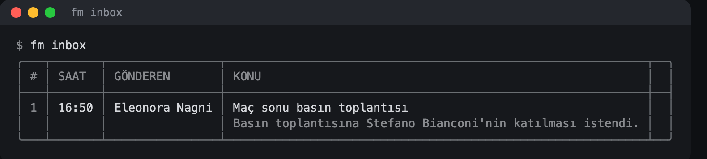

- Mavi nokta: okunmamış.
- **cevaplanabilir**: istersen cevap verirsin, vermezsen oyun devam eder.
- **cevap bekliyor**: cevaplamadan zaman ilerlemez.

Cevaplamak için mesajın numarasını ver. Mesajın tamamı ve cevapları çıkar, okla seçip Enter'a basarsın:

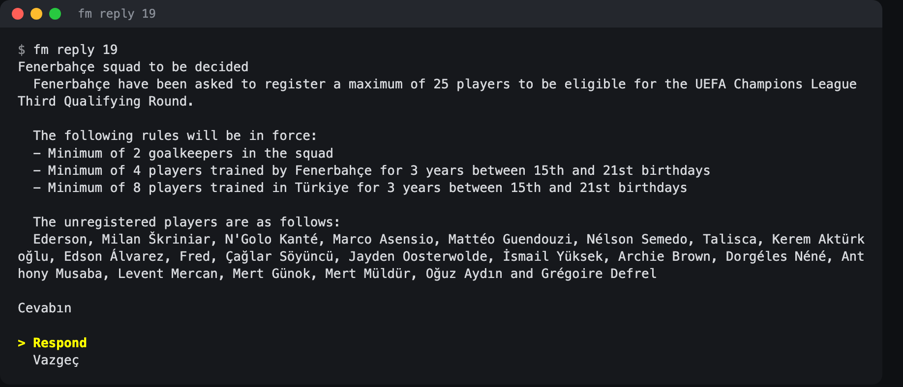

Seçince oyunun ne dediği altta yazar:

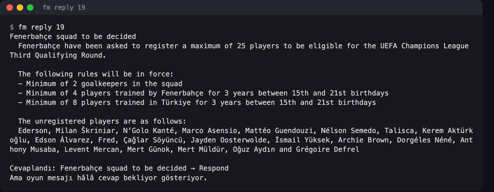

Burada mesaj cevaplandı ama oyun kadro listesini hâlâ bekliyor: listeyi göndermek ayrı bir
iş, onu `register` yapıyor (aşağıda).

Seçimi doğrudan da verebilirsin: `fm reply 4 2` ya da cevabın bir parçasıyla `fm reply 4 accept`.

### Kadro listesi — `register`, `numbers`

Sezon başında ve her Avrupa turundan önce oyun kayıtlı oyuncu listesi ister; gönderilmeden
zaman ilerlemez. `fm register` listeyi açar: kim listede (✓), kim yetişme kotasına sayılıyor
(**kulüpte** / **ülkede**), kim değiştirilemez (kiralıkta olanlar), ve turnuvanın kuralları.

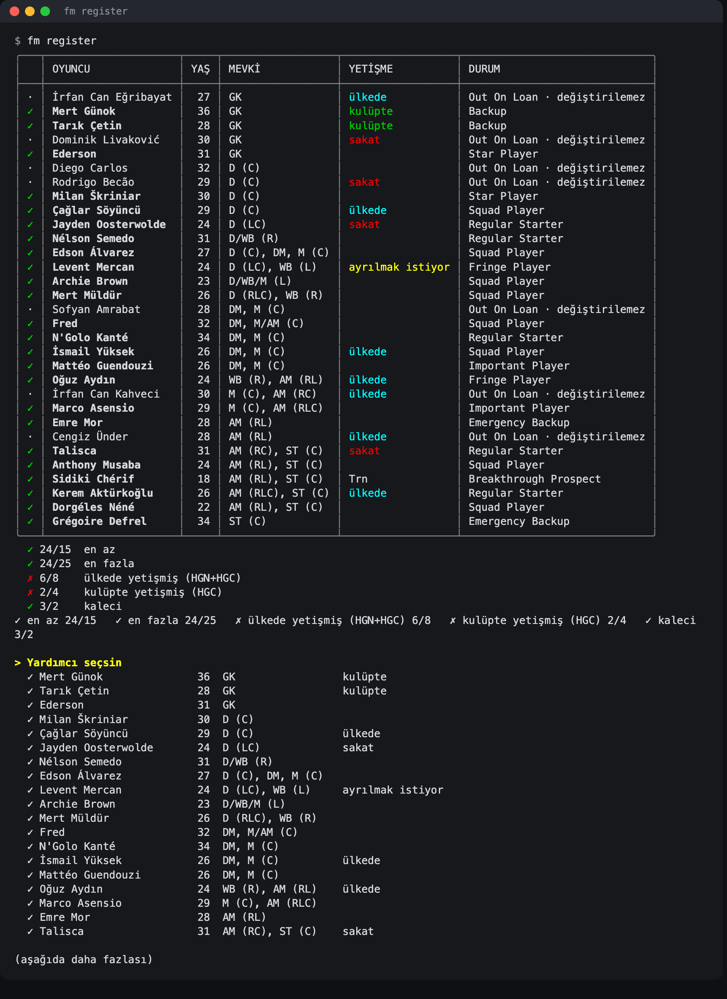

Altta menü var: oyuncunun üstüne gelip Enter'a basınca listeye girer ya da çıkar.
"Yardımcı seçsin" oyunun önerdiği listeyi kurar.

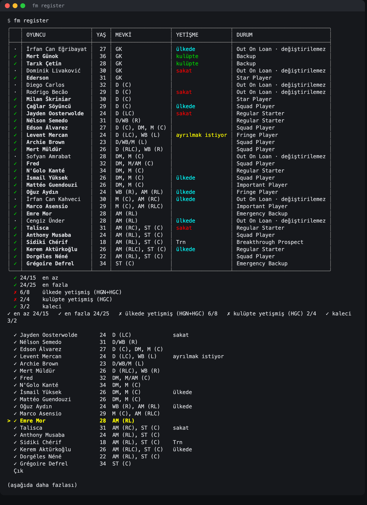

Menünün başlığı kuralların anlık halini gösterir. Hepsi ✓ olunca en üste **Listeyi gönder** gelir:

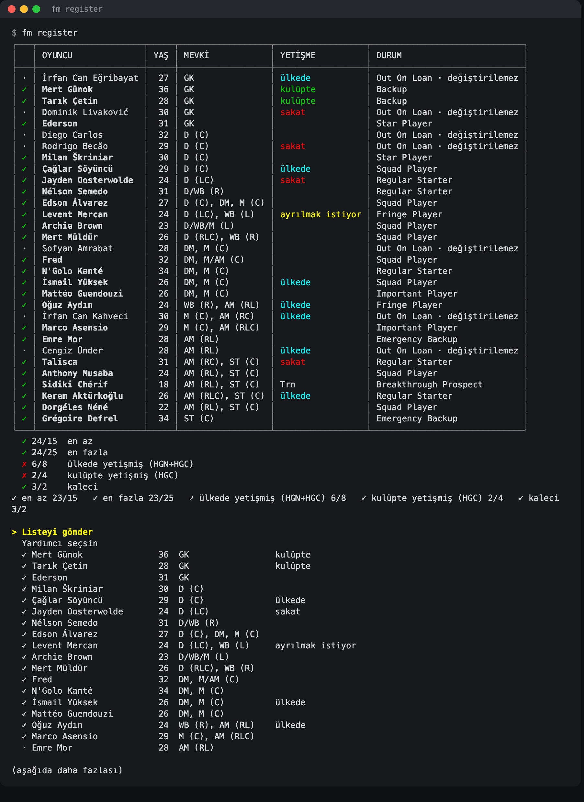

Gönderince ne değiştiği yazılır:

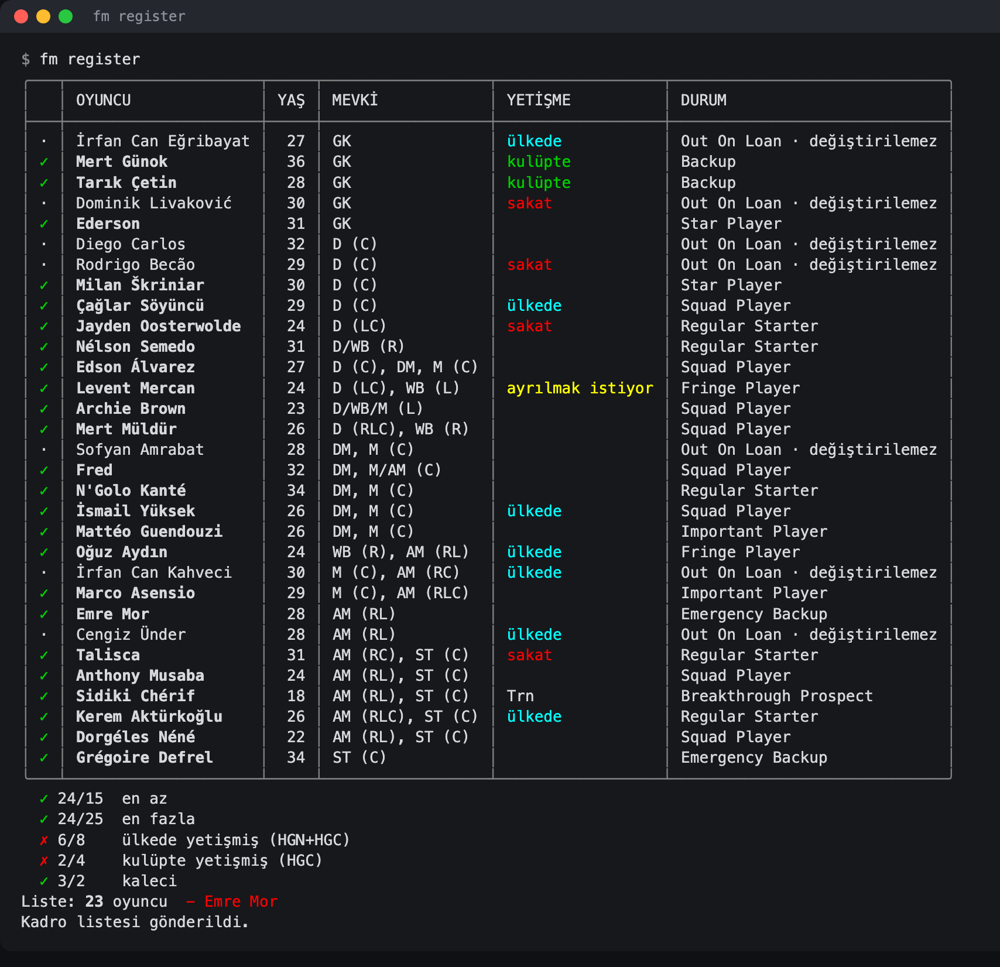

> **Yetişme kotası tutmuyorsa:** UEFA listesi 25 kişi, bunun 8'i yetişmiş oyunculara ayrılmış.
> Yetişmiş oyuncun eksikse o kadar yer boş kalır: yetişme bayrağı olmayan oyunculardan
> çıkarırsın, oyun kotayı ✓ sayar. Örnekte 6 yetişmiş oyuncu vardı (8'den 2 eksik), yani
> en fazla 23 kişi; Emre Mor çıkınca liste gönderilebildi.

Script'te ya da Claude'dan:

```
fm register                        listeyi ve kuralları yaz
fm register --out "Emre Mor"       listeden çıkar  (--in: listeye koy; ikisi de tekrarlanabilir)
fm register --auto                 önce yardımcı seçsin
fm register --send                 gönder (kurallar tutuyorsa)
```

`fm numbers` forma numaralarını yardımcıya verdirip gönderir. Script'te sormadan: `--auto`.

## 4. Zamanı ilerletmek — `next`

`next` oyunun "Continue" tuşudur. Oyun bir yerde durana kadar (yeni mesaj, maç günü,
basın toplantısı…) ilerler ve neden durduğunu söyler. `next 3` üç kez ilerler.

```
fm› next
Bloke: 5 mesaj cevap bekliyor.
  08:13  Club vision and expectations meeting
  ...
```

Toplantı ya da basın toplantısı gibi bir konuşma açılırsa `talk` ile yürütülür (bkz. §8).

## 5. Kadro — `squad`

Kadro; kondisyon ve maç formu çubuklu. Sakat oyuncular kırmızı.

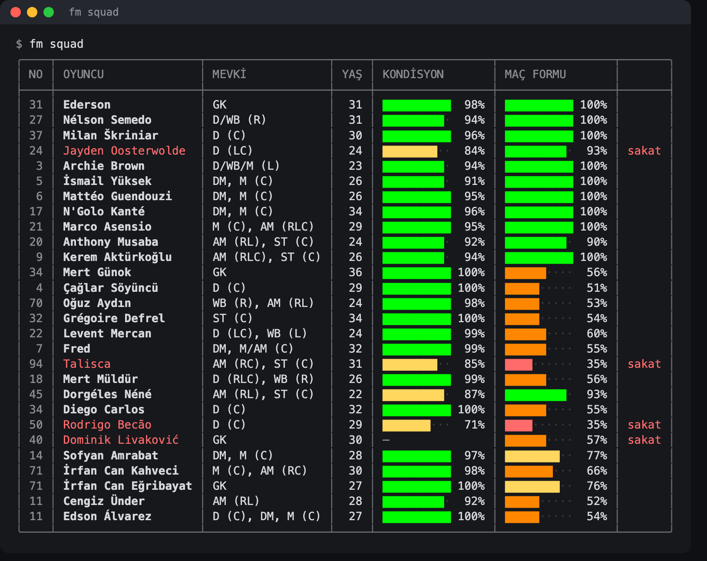

En yorgun önce sıralı kondisyon görünümü:


Moral, takım içi hiyerarşi ve sosyal grup:


Oyundaki kadro tablosunun başka görünümleri de var: `fm squad --views` listeler,
`fm squad --view "<ad>"` o görünümün kolonlarını gösterir.

### Sözleşme takvimi — `contracts`

Kadronun sözleşmeleri, en yakın biten önce; terminalde bir yıldan az kalan kırmızı, iki yıldan
az kalan sarı. Yenilemek için `contract <oyuncu>`.

```
$ fm contracts
OYUNCU            YAŞ  MEVKİ            BİTİŞ      KALAN
Grégoire Defrel   34   ST (C)           30/6/2026  9 ay
Fred              32   DM, M/AM (C)     30/6/2027  1 yıl 9 ay
```

### Kadro sağlığı — `health`

Sakatlar ve dönüş süreleri, kondisyonu düşük olanlar, maç formu düşük olanlar ve oyunun
sakatlık riski puanı en yüksek olanlar tek raporda:

```
$ fm health
Sakat
  N'Golo Kanté — A twisted ankle, 3 gün daha
Yorgun (kondisyon %85 altı)
  Kerem Aktürkoğlu 51%
Maç formu düşük (%60 altı)
  Çağlar Söyüncü 47%
Sakatlık riski en yüksek (oyunun puanı 385)
  Fred
```

### Kadro derinliği — `depth`

Her saha mevkisinde (GK'den ST'ye) kimlerin oynayabildiği, oyuncuların mevki bilgisinden; kiralıkta
olanlar ve U19 hariç. Hiç oyuncusu olmayan mevki kırmızı "YOK", tek oyunculu "tek". Altında yaş
profili.

```
fm depth
```

## 6. Oyuncu kartı — `player`, `search`

`fm player <isim>` oyuncunun kartını açar: kimlik, sözleşme, sahadaki mevkisi ve renkli
özellikleri. Kadronda olmayan bir oyuncuyu da arayıp bulur.

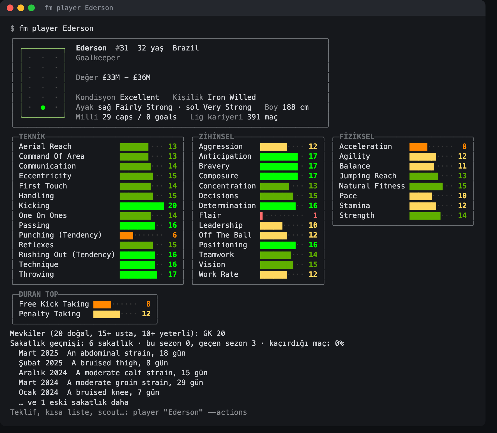

`--actions` o oyuncu için oyunun sunduğu işlemleri (teklif, kısa liste, scout…) listeler ve
okla seçtirir.

Oyunun genel araması — oyuncu, teknik adam, kulüp:


`player <isim> --career` sezon sezon kariyeri verir: kulüp, nasıl geldiği (bonservis, kiralık,
bedelsiz), lig, maç, gol, puan ve en altta toplamlar. Kalecide gol yerine gol yemeden maç.

```
$ fm player kerem --career
                          Kerem Aktürkoğlu — kariyer
│ Sezon   │ Takım          │ Geliş    │ Lig                         │ Maç │ Gol │
│ 2025/26 │ Fenerbahçe     │ £19.5M   │ Super League (Türkiye)      │   3 │   1 │
│         │ Benfica        │          │ Premier League (Portugal)   │   0 │   - │
│ 2024/25 │ Benfica        │ £10.25M  │ Premier League (Portugal)   │  30 │  11 │
│ 2020/21 │ Galatasaray    │ bedelsiz │ Super League (Türkiye)      │  27 │   6 │
│ 2016/17 │ Bodrum FK      │ kiralık  │ 3. League Group 2 (Türkiye) │  27 │   4 │
          Toplam 259 maç · 75 gol · ödenen bonservisler £29.75M
```

## 7. Taktik — `tactic`

Taktiği iki saha olarak çizer: topla oynarken ve topsuzken. Her mevkide oyuncu, mevki kısaltması
ve rolü var; rollerin açılımı altta.


Değiştirmek için:

| Komut | Ne yapar |
|---|---|
| `tactic mentality [<x>]` | mentaliteyi göster / değiştir |
| `tactic style [<x>]` | oyun stilini göster / değiştir |
| `tactic role <mevki> [<rol>]` | mevkinin rolünü göster / değiştir (`--oop`: topsuz rol) |
| `tactic player <mevki> <oyuncu>` | yedeklerden birini o mevkiye koy |
| `tactic pick` | ilk 11'i oyuna seçtir |
| `tactic new "<stil>" "<topla>" "<topsuz>"` | yeni taktik oluştur |
| `setpieces new` | duran top rutinlerini kur (altı soru, okla) |

### Diziliş değiştirmek — `tactic new`, `tactic slot`

Oyunda bir taktiğin dizilişi sonradan değişmiyor; yeni bir taktik kuruluyor. `fm tactic new`
sihirbazı açar (stil, topla diziliş, topsuz diziliş); takımın taktiği varsa yenisi yeni bir
yuvaya girer ve etkin olur. Takım en fazla üç taktik tutar:

```
fm tactic new Gegenpress "4-2-3-1 DM Wide" "4-4-1-1 2 DM"
fm tactic slot          yuvalar ve hangisi etkin
fm tactic slot 1        1. yuvadaki taktiğe geç
fm tactic copy          etkin taktiği yeni yuvaya kopyala ("Copy of: …"), kopya etkin olur
fm tactic clear 2       2. yuvayı boşaltmadan önce ne silineceğini söyler
fm tactic clear 2 --yes boşalt (oyunun "Are you sure…" sorusu onaylanır); tek taktik silinmez
```

### Takım talimatları — `tactic instructions`

```
fm tactic instructions                         evre evre bütün talimatlar
fm tactic instructions Tempo Higher            birini değiştir
fm tactic instructions "Final Third/Dribbling" Encourage
fm tactic instructions "Goal Kicks"            seçeneklerini göster (terminalde okla seçtirir)
```

Şimdilik yalnızca topla oynarken talimatlar var. Bitiş bölgesindeki ve ilerlemedeki "Dribbling"
oyunda tek ayar; biri değişince öteki de değişir.

### Oyuncu talimatları — `tactic pi`

```
fm tactic pi DR                          sağ bekin talimatları
fm tactic pi DR Shooting "Shoot Less"    birini değiştir
fm tactic pi AML "Forward Runs"          seçeneklerini göster
```

### Rakip talimatları — `opposition`

Sıradaki rakibin her oyuncusu için sıkı markaj, pres, sert giriş ve hangi ayağa yönlendirileceği:

```
fm opposition                                tablo
fm opposition --advice                       yardımcının önerisini uygula
fm opposition Kaku Pres=Always "Sert giriş=Hard"
fm opposition --clear                        hepsini temizle
```

### Bireysel antrenman — `training`

```
fm training                                    herkesin mevki/rol, topsuz rol ve odak eğitimi
fm training Kanté --focus Endurance            ek odak (None: kaldır)
fm training Kanté --position "Midfielder (Centre)>Central Midfielder"
fm training Kanté --position "Midfielder (Centre)"   o alt menüdeki rolleri listeler
fm training Fred --report                      raporu hazırlayabilecek antrenörler (terminalde okla seçtirir)
fm training Fred --report --coach zeki         antrenörden rapor iste ve göster
```

Rapor bir mesaj olarak gelir; komut onu açıp basar:

```
Fred — antrenman raporu (Zeki Murat Göle)
  Has shown early signs that he may be on the decline over the last three months.
  He is now training as a central midfielder.
  He has been below par in training lately.

  Gidişat: Player is showing signs of decline
  Strength 10 · Agility 16 · Pace 9 · Stamina 12
  Antrenman puanı 4.70 · yük Half · Def. Unit

Tavsiyeyi uygulamak ya da eleştirmek için: reply "Fred's training report"
```

Alışkanlık (oyuncu hareketi) öğretmek:

```
fm training "Archie Brown" --trait                     sahip oldukları ve öğrenebilecekleri
fm training "Archie Brown" --trait "one-twos"          öğretmeye başla
fm training "Archie Brown" --trait-remove "down left"  bir alışkanlığı bıraktır
fm training "Archie Brown" --trait-suggest             yardımcıya sor
fm training "Archie Brown" --trait-cancel              süren eğitimi durdur
```

Yardımcı karşıysa ("Really Unsuitable To Add", yaşlı oyuncuda "Too Old To Change Game") komut
itirazı gösterir ve durur; terminalde okla sorar, yine de yapmak için `--yes`.

### Antrenman programı — `schedule`

Bu haftanın ve gelecek haftanın antrenmanı, gün gün üç seans. Terminalde bugün `▶` ile, maç
günleri sarı; geçmiş günler ve dinlenme soluk.

```
$ fm schedule
GÜN           1. SEANS               2. SEANS               3. SEANS
Pzt 6 Ekim    yolculuk               Recovery               dinlenme
Sal 7 Ekim    Attacking Shadow Play  Defensive Shadow Play  dinlenme
Çar 8 Ekim    Match Tactics          Match Practice         Recovery
```

### Antrenman yoğunluğu — `intensity`

```
fm intensity                       her oyuncunun yoğunluğu
fm intensity Kanté yarım           otomatik · yarım · normal · çift
fm intensity Kanté "dinlen 3"      3 gün saha ve salon çalışması yok (7, 14: bir, iki hafta)
fm intensity Fred "tatil 1"        bir hafta tatil (oyun izin verirse)
fm intensity --auto                hepsini kondisyon hocasına bırak
```

## 8. Maç günü — `match`, `sub`, `talk`, `report`

`fm match` maç gününde önce sorar: **Maçı nasıl oynayalım?**

- **İzle**: kadro sahada çizilir, anlatım ve skor akar. Maç öncesi, devre arası ve maç sonu
  konuşmalarında söz sende: seçenekler çıkar, okla seçersin ya da konuşmayı geçersin.
- **Anında sonuç**: maçı yardımcılar yönetir, birkaç saniyede biter.

Script'te sormadan: `match --play` (izle) ya da `match --instant`. `--no-talk` konuşmaları geçer.

Maç sırasında:

| Komut | Ne yapar |
|---|---|
| `sub` / `sub <çıkan> <giren>` | sahadakiler ve kulübe / oyuncu değiştir |
| `tactic mentality [<x>]` | mentaliteyi göster / değiştir |
| `tactic role <oyuncu> [<rol>]` | oyuncunun rolü (`--oop`: topsuz rolü); rol yazmazsan okla seçtirir |
| `shout [<x>]` | kenardan bağır (Encourage, Focus, Fire Up…) |
| `dugout` | yardımcının tavsiyeleri; `dugout <no> uygula` / `dugout <no> kaldır` |

```
$ fm tactic role talisca poacher
Talisca: Centre Forward → Poacher
$ fm shout focus
Bağırış: Focus (oyun yeni bağırışı bir süre kapattı)
$ fm shout encourage
Oyuncular az önce bir bağırış duydu; oyun yeni bağırışa bir süre izin vermiyor.
$ fm dugout
  1   34'  Takım talimatı: Discourage Long Shots
  2   36'  Oyuncu talimatı (Talisca): Shoot Less Often
  3   48'  We must improve our game, especially in creating chances.
```

Bir oyuncu sakatlanınca maç durur: `match --play` yardımcının notunu yazar ("Kanté … twisted
ankle") ve terminalde kimin çıkıp kimin gireceğini sorar; script'te `sub <çıkan> <giren>` maçı da
sürdürür, değişiklik yapmadan sürdürmek için yeniden `match`.

Bağırıştan sonra oyun yeni bağırışa birkaç dakika izin vermiyor; `shout` bunu söyler. Yardımcının
tavsiyeleri `match --play` akışında da çıkar ("Yardımcı: …"). Dugout paneli pozisyon oynatılırken
gizleniyor; `dugout` o sırada çağrılırsa panel geri gelene kadar bekler.

Basın toplantısı, toplantı gibi açık bir konuşmayı `talk` baştan sona okla yürütür;
`talk leave` çıkar.

Maç bitince `report`:

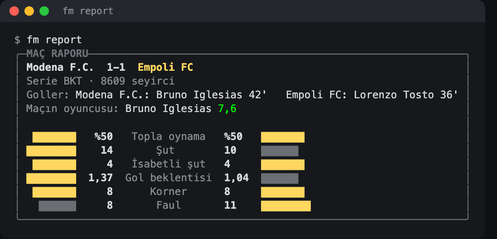

## 9. Lig ve fikstür — `table`, `fixtures`


Soldaki renkli şeritler bölgeleri gösterir (üstte Avrupa, altta küme düşme). Senin takımın sarı ve okla işaretli.


Oynanmış maçlar beyaz ve sonuçlu, oynanacaklar soluk.

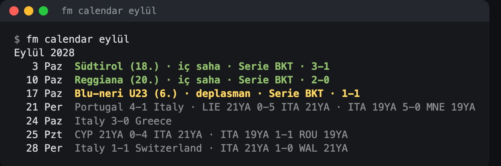

`fixtures --all` sezonun bütün fikstürünü verir (takvimden ay ay toplar, ~15 sn). `calendar [ay]`
bir ayı gün gün gösterir: maçlar, transfer döneminin açılıp kapandığı gün, kupa kuraları, milli
maçlar; `--u19` altyapı maçlarını da ekler.

```
$ fm calendar eylül
Eylül 2025
   5 Cum  World Cup Quals (EUR) · Bulgaria v Türkiye
  13 Cmt  Başakşehir FK (6th) · iç saha · Super League · 16:00
          Transfer window closes (midnight) · Super League
  20 Cmt  Gençlerbirliği (18th) · deplasman · Super League · 18:00
```

`league [turnuva]` turnuvanın liderlerini verir (varsayılan lig):

```
$ fm league
Super League — liderler
Takımlar
  En çok gol: Galatasaray (22)
Oyuncular
  En yüksek ortalama puan: Victor Osimhen (8.24)
  En çok gol: Victor Osimhen (13)
  En çok asist: Yusuf Özdemir (4)
```

## 10. Transfer ve sözleşme — `players`, `offer`, `contract`

`fm players` oyunun oyuncu veritabanını listeler: `--filter "<x>"` hazır süzgeçlerden birini
uygular, `--view "<x>"` kolonları değiştirir. *(Çıktısı şu an dar terminalde dağınık;
düzeltilince görüntüsü buraya gelecek.)*

### Teklif — `offer`

```
fm offer "<oyuncu>"                 teklif ekranını aç, kartı göster, okla düzenle
fm offer "<oyuncu>" 7.5M            bonservisi baştan yaz
fm offer "<oyuncu>" --loan          kiralık
fm offer "<oyuncu>" 7.5M --dry      hazırla, kartı göster, gönderme
```

Teklif terminalde bir kart olarak çizilir: temel şartlar (bonservis, transfer tarihi), ek
ödemeler, ek maddeler, bütçeden ne çıkacağı. Altında bir menü var: bir şartı seçip değerini
değiştirirsin, "+ Ek ödeme ekle" / "+ Madde ekle" ile yenisini koyarsın, bir şartı kaldırırsın.
Her değişiklikten sonra kart oyundan yeniden okunur, yani gördüğün şey oyunun ekranında
olanın kendisi. "Teklifi gönder" bir kez daha sorar, çünkü gönderilen teklif geri alınamaz.


Sonraki satıştan payı %25'ten %35'e çekince:


Script'ten (ya da menüye girmeden) şartlar `--term "Şart=değer"` ile verilir; oyunun kendi
adları ve seçenekleri kullanılır, Türkçe karşılıkları da olur. Ekranda olmayan bir ödeme ya
da madde önce eklenir. İki değeri olan şartta (kaç maç sonra, ne kadar) değerler virgülle
ayrılır. Göndermek için `--yes`:

```
fm offer "Robin Hack" 4M \
  --term "Percentage Of Next Sale=10%" \
  --term "After League Appearances=20 games,250K" \
  --term "Transfer Date=End Of Season" \
  --term "Cevap süresi=Tomorrow" --yes
```

Kiralıkta (`--loan`) kart başka şartlarla gelir: aylık ücret (oynarsa / oynamazsa), maaş
katkısı yüzdesi, süre; ardından kiralık maddeleri (forma süresi sözü, primler), evet / hayır
seçenekleri (kupa maçlarında oynayabilir, geri çağrılabilir…) ve kalıcı olursa satın alma
bedelleri. Oyunun gri gösterdiği (o teklifte verilmeyen) seçenekler menüde çıkmaz.

```
fm offer "Matteo Cancellieri" --loan --term "Maaş katkısı (oynarsa)=100%" \
  --term "Playing Monthly Fee=20K" --term "Opsiyonlu satın alma bedeli=kaldır" --yes
```

Kulübün cevabı gelen kutusuna düşer. "View Offer" ya da "Negotiate" ile açılan karşı teklif de
aynı komutla kart olarak görünür ve oradan düzenlenip geri gönderilir (`fm offer Hack`).
"Gösterilen" satırı kulübün teklifiyle senin önceki teklifin arasında geçiş yapar.

Oyun teklifi baştan reddederse (oyuncu başka kulüple anlaşmışsa, rakip kulüpse…) sebebini
olduğu gibi yazar: `Orkun Kökçü için teklif yapılamıyor. Oyun diyor ki: Cannot sign Orkun.
This player has already agreed to join his loan club.`

Her şartın bir de pazarlık kilidi var (oyundaki asma kilit): **Pazarlığa açık**, **Yarı
pazarlıklı**, **Pazarlıksız** ve ek ödeme ile maddelerde **Çıkar ve yasakla** (karşı taraf bunu
teklife geri koyamaz). Menüde şartı seçip "Pazarlık durumu"ndan değiştirilir; kartta açık
olmayanlar renkli yazar. Script'te değer olarak verilir:
`--term "Fee=Non-Negotiable"`, `--term "Instalments (12 monthly)=Remove & Exclude"`.


Kupa ya da ödül primi ve takasa oyuncu alt menülerde: menüde "›" ile biten bir seçeneğe girince
bir alt seviye açılır ("Turnuva başarısı primi › Turkish Cup › Bonus upon reaching the Semi Final…",
"Kadrodan bir oyuncu › A takım › Mert Müldür"); "Bir üst menü" geri çıkar. Script'te yol `>` ile
yazılır:

```
fm offer "Robin Hack" 4M \
  --term "Bonus After Competition Achievement>Turkish Cup>Bonus upon reaching the Semi Final of the Turkish Cup=100K" \
  --term "Oyuncu ödülü primi>World Golden Ball=250K" \
  --term "Players To Exchange" --term "Other Player From Squad>Senior Squad>Mert Müldür=6 Month Loan"
```

Takasa konan oyuncu "Takas oyuncuları" başlığı altında görünür; değeri transfer ya da kiralık
süresidir. Sözleşmede aynı yol primler için de geçerli:
`--term "Competition Bonuses>Turkish Super League>Winning the Super League=200K"`.

### Sözleşme — `contract`

```
fm contract "<oyuncu>"        kendi oyuncumuzla yeni sözleşme görüşmesini aç
fm contract                   açık görüşmeyi kart olarak göster, okla düzenle
```

Görüşme iki aşamalı, oyundaki gibi. Önce **vaatler**: kadro statüsü, başlangıç tarihi ve
menajerin istediği vaatler (kaptanlık, kulübün hedefi…). "+ Vaat ekle" ile sen de vaat
verirsin; bir vaadi değiştirince menü "Vaatleri menajere öner" olur, menajer kabul edince
"Vaatleri onayla, şartlara geç".

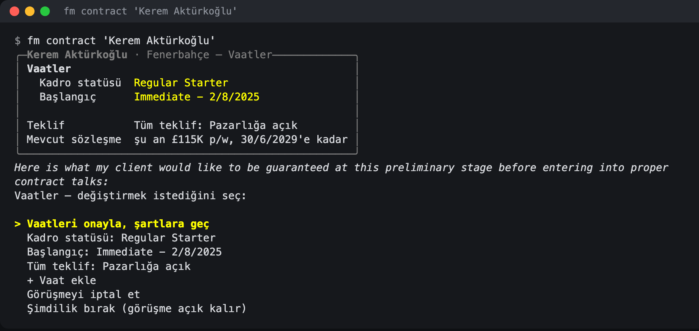

Sonra **şartlar**: ücret, süre, menajer ücreti, sadakat primi, primler ve maddeler. Kartın
altında maaş bütçesine etkisi ve oyuncunun şu anki sözleşmesi yazar.

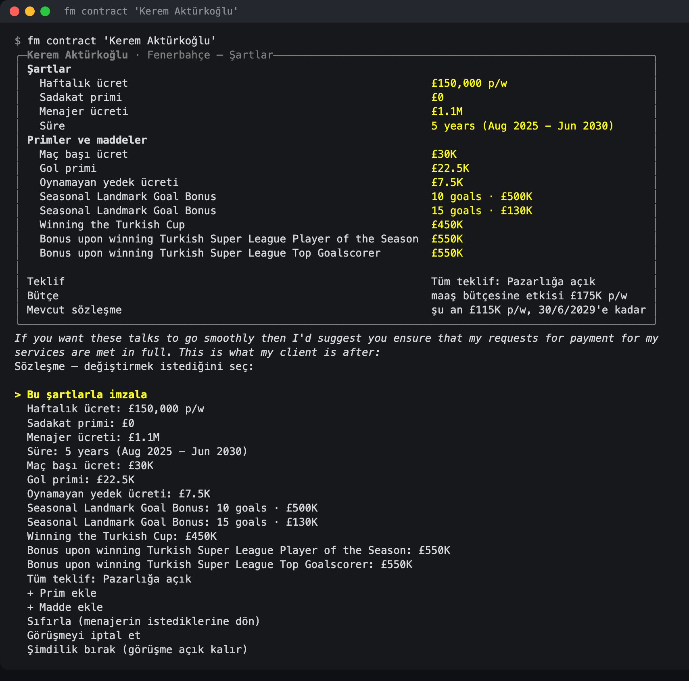

Bir şart oyunun kuralına uymazsa (ör. ücreti düşürünce menajer ücreti izin verilen oranı
aşar) satırın yanında kırmızıyla sebebi yazar — "Menajer ücreti: £1.1M (izin verilen oranın
üstünde)" — ve öneri gönderilemez; o şartı düzeltince geri gelir.

"Şartları menajere öner" deyince menajer ya kabul eder ya da kendi istediklerini karta geri
koyar; kart neyin değiştiğini söyler:

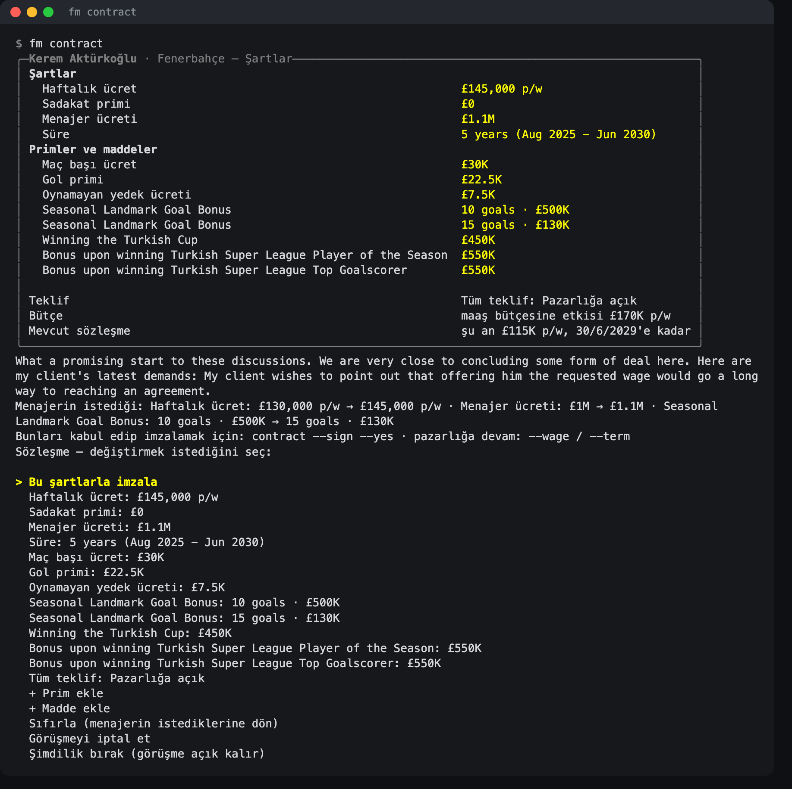

"Bu şartlarla imzala" bir kez daha sorar. Yenilemede oyuncu kararını hemen vermez: menajer
"kararı birkaç gün içinde bildireceğiz" der, cevap gelen kutusuna düşer. Transferde (teklif
kabul edildikten sonra gelen kutusundaki "Enter Contract Negotiations") imza o an olur.

Script'ten:

```
fm contract "Levent Mercan"                       görüşmeyi aç, vaatleri göster
fm contract --term "Kadro statüsü=Regular Starter" --term "Will appoint player as captain"
fm contract --next                                vaatleri onayla (ya da öner), şartlara geç
fm contract --wage 20K --term "Yıllık zam=10%" --term "Appearance Fee=kaldır"
fm contract --term "Haftalık ücret=Pazarlıksız"   bir şartın kilidi; "Tüm teklif=…" hepsinin
fm contract --sign --yes                          menajere sun / imzala
fm contract --cancel                              görüşmeyi iptal et
```

Değeri olmayan bir ad (`--term "Will appoint player as captain"`) vaadi ya da maddeyi ekler,
`=kaldır` kaldırır. Vaatler aşamasında olmayan bir şart, `--next` ile şartlara geçilince
uygulanır. Menajere sormadan görüşmeye girmek oyunda oyuncuyu ve menajeri üzebilir; oyun bunu
sorar, `contract` da terminalde sorar. İptal edilen görüşme bir süre yeniden açılamayabilir.

### Menajere sormak — `contract --agent`

`fm contract Kerem --agent` menajerine yenilemeye açık olup olmadığını sorar; ilgi derecesini
`talk <numara>` ile seçersin, cevabı görürsün.

### Serbest bırakma — `release`

```
fm release Fred                  iki yolu gösterir
fm release Fred --free           oyunun tazminat penceresini gösterir, onaylamaz
fm release Fred --free --yes     bedelsiz serbest bırak (tazminat transfer bütçesinden)
fm release Fred --mutual --yes   karşılıklı fesih teklif et
```

Karşılıklı fesih oyunda onay sormadan işler; bu yüzden komut `--yes` (ya da terminalde okla onay)
olmadan göndermez.

### Bütçe — `budget`


```
$ fm budget
Transfer bütçesi: £11.07M (bu sezon harcanan £4.9M, başta £11.25M)
Maaş bütçesi: £22K p/w boşta · ödenen £2.1M p/w
Scouting bütçesi: £360K
```

`budget ayarla` kurulun transfer ↔ maaş kaydırıcısını açar ve her adımı rakamıyla listeler;
terminalde okla seçersin, script'te `budget ayarla <adım>`. Seçmezsen hiçbir şey değişmez.

```
  14  Transfer £10,336,378    · Maaş £2,142,221 p/w
  15  Transfer £11,074,688    · Maaş £2,128,023 p/w  ← şu an
```

## 11. Kaydetmek ve oyun ayarları — `save`, `settings`

`fm save --yes` oyunu kaydeder. Mevcut kaydın üzerine yazar, o yüzden `--yes` ister.

`fm settings` oyunun ayarlarını gösterir: maçın ne kadarının gösterildiği ve hızı, otomatik
kayıt, dil, para birimi, birimler. Terminaldeysen ardından hangisini değiştirmek istediğini
okla sorar; "Hiçbiri" ile çıkarsın.

```
$ fm settings
Maç
  maç gösterimi: Önemli anlar        az gösterim maçı kısaltır
  dinamik mod: Kapalı                 gösterimi oyun seçer
  vurgu hızı: 1.5x                    pozisyon oynarken
  ara hızı: 30x                       pozisyonlar arası
Kayıt
  otomatik kayıt: Açık
  kayıt sıklığı: Her hafta
  kayıt türü: 3 dosya, sırayla
Bölge ve birimler
  dil: English                        İngilizce dışı komutları bozar
  para birimi: £ - UK Pound Sterling
  maaş: Haftalık
  tarih: dd/mm/yyyy
  sıcaklık: Santigrat · boy: Santimetre · kısa mesafe: Metre · uzun mesafe: Kilometre
```

Tek bir ayarı adıyla değiştirmek için değeri de yaz; değer yazmazsan seçenekleri okla sunar
(şu anki işaretli):

```
$ fm settings vurgu hızı 2x
vurgu hızı: 1.5x → 2x
$ fm settings kayıt sıklığı her gün
kayıt sıklığı: Her hafta → Her gün
$ fm settings para birimi euro
para birimi: £ - UK Pound Sterling → € - Euro
$ fm settings otomatik kayıt kapalı
```

Değer Türkçe ya da oyundaki İngilizce adıyla, baştan ya da içinden bir parçayla yazılabilir
("euro", "uk pound", "2" = 2x); birden çok seçeneğe uyarsa hangileri olduğunu söyler. Oyunda
ayarlar ancak "Confirm" ile işlenir; `settings` bunu kendisi yapar ve sayfayı yeniden açıp yeni
değeri okuyarak doğrular.

Maçı kısaltmanın iki yolu var: **maç gösterimi** "Yalnızca anlatım" ya da "Önemli anlar"
(daha az pozisyon) ve **hızlar** (vurgu sırasında en çok 10x, aradaki sürede en çok 40x).
Dili değiştirmek mümkün ama fm-cli oyunun İngilizce yazılarını okuduğu için çoğu komut çalışmaz
hale gelir; `settings` bunu sorar, script'te `--yes` ister.

## 12. Her şeye erişim — `pages`, `buttons`, `press`

Henüz komutu olmayan bir şey için oyunun ekranlarını doğrudan kullanabilirsin:

| Komut | Ne yapar |
|---|---|
| `pages` | oyunun bütün sayfaları |
| `open "<sayfa>"` | sayfayı aç |
| `buttons` | ekrandaki butonlar |
| `press "<etiket>"` | butona bas |
| `dropdowns` | ekrandaki açılır listeler |
| `select <liste> "<seçenek>"` | listeden seç |
| `dialog [cevap]` | açık onay penceresini göster / cevapla |
| `tour` | açık tanıtım turunu yürüt (`--skip`: atla) |

Değiştiren komutların çoğu `--dry` alır: yapmaz, ne yapacağını söyler. `--json` her yerde
ham veri verir.

## 13. Claude'dan oynamak — MCP

`fm mcp` bütün komutları MCP araçları olarak sunar; repo kökündeki `.mcp.json` bunu
tanımlıyor. Claude Code'da proje açıkken araçlar `fm_status`, `fm_squad`, `fm_match`… adıyla
gelir. İlk çağrılacak olan `fm_status`: oyunun neyi beklediğini ve hangi aracın onu çözdüğünü söyler.
