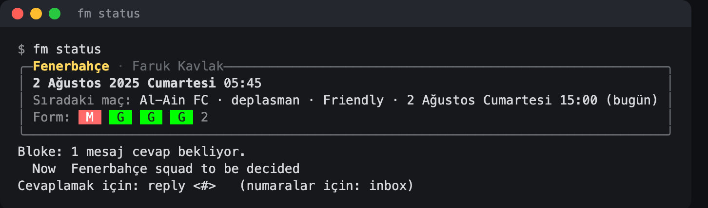
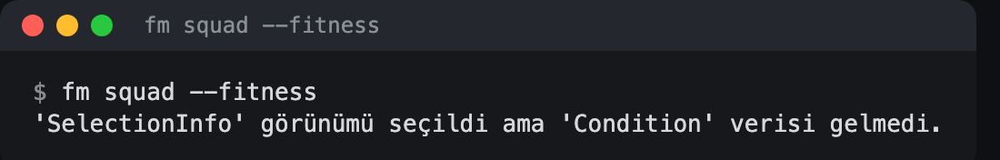
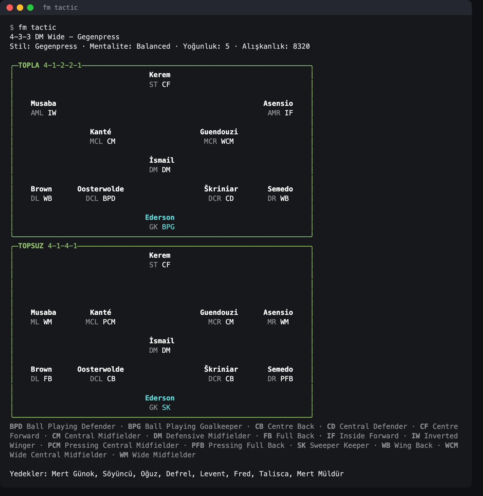
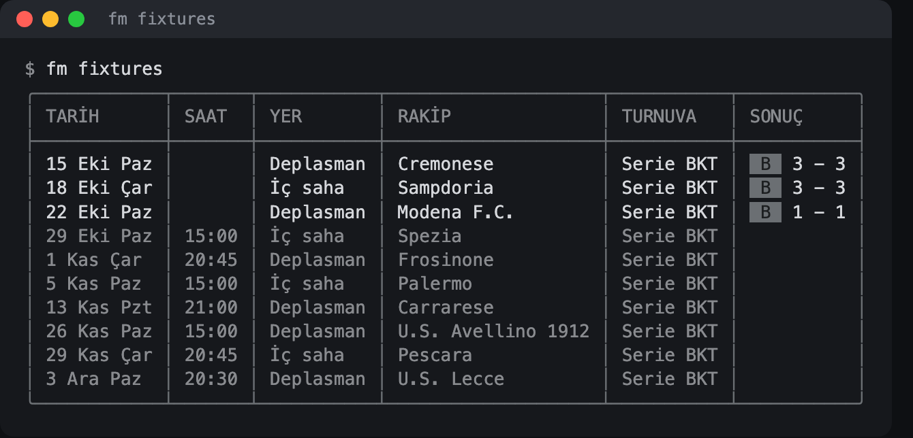
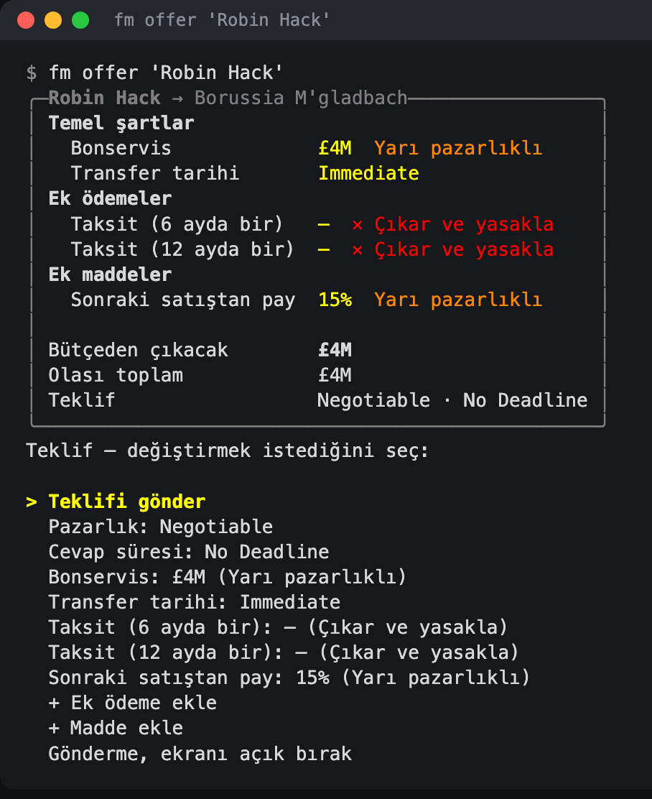

# fm — Kullanım Kılavuzu

Gerçek Football Manager 26'yı terminalden oynamak için. Oyun arka planda açık durur,
sen her şeyi `fm` komutlarıyla yaparsın.

> Ekran görüntüleri gerçek oyundan alınıyor. Yenilemek için oyun açıkken:
> `tools/manual/shots.sh` (hepsi) ya da `tools/manual/shots.sh squad` (adında "squad" geçenler).
> Okla seçilen, oyunu değiştiren komutlar (`reply`, `register`, `match`…) oynanarak çekilir:
> `uv run --with pyte tools/manual/drive.py docs/manual/img <sahne>` — sahneler `drive.py`'nin
> başında, hangi tuşa basılacağı ve ne zaman fotoğraf çekileceğiyle. Bunlar oyunu ilerletir.
> Bir komut eklenince ya da değişince: görüntüsünü ilgili listeye ekle, buraya bölümünü yaz.

**İçindekiler**
1. [Başlarken](#1-başlarken)
2. [Neredeyim? — `status`](#2-neredeyim--status)
3. [Gelen kutusu ve cevaplar — `inbox`, `reply`](#3-gelen-kutusu-ve-cevaplar--inbox-reply)
4. [Zamanı ilerletmek — `next`](#4-zamanı-ilerletmek--next)
5. [Kadro — `squad`](#5-kadro--squad)
6. [Oyuncu kartı — `player`, `search`](#6-oyuncu-kartı--player-search)
7. [Taktik — `tactic`](#7-taktik--tactic)
8. [Maç günü — `match`, `sub`, `talk`, `report`](#8-maç-günü--match-sub-talk-report)
9. [Lig ve fikstür — `table`, `fixtures`](#9-lig-ve-fikstür--table-fixtures)
10. [Transfer — `players`, `offer`](#10-transfer--players-offer)
11. [Kaydetmek — `save`](#11-kaydetmek--save)
12. [Her şeye erişim — `pages`, `buttons`, `press`](#12-her-şeye-erişim--pages-buttons-press)
13. [Claude'dan oynamak — MCP](#13-claudedan-oynamak--mcp)

---

## 1. Başlarken

```
$ fm start
FM başlatılıyor…
Son kayıt yükleniyor…
Hazır.
fm›
```

`fm start` oyunu açar, son kaydı yükler ve seni `fm›` oturumuna sokar. Oyun zaten açıksa
ona bağlanır. Oturumun içinde komutları `fm` yazmadan verirsin (`squad`, `next`…); oturum
dışında her komutun başına `fm` eklenir (`fm squad`). Bu kılavuz ikinci yazımı kullanıyor.

Oyun ekranda ve Dock'ta görünmez. Pencereyi görmek istersen: `fm start --debug`.

## 2. Neredeyim? — `status`

Kaybolduğunda ilk yazacağın komut. Tarihi, sıradaki maçı, son maçların formunu ve oyunun
şu an neyi beklediğini söyler.



Alttaki "Bloke" satırı önemli: oyun bir şey beklerken zaman ilerlemez. Neyi beklediğini ve
hangi komutla çözüleceğini burada yazar.

## 3. Gelen kutusu ve cevaplar — `inbox`, `reply`


- Mavi nokta: okunmamış.
- **cevaplanabilir**: istersen cevap verirsin, vermezsen oyun devam eder.
- **cevap bekliyor**: cevaplamadan zaman ilerlemez.

Cevaplamak için mesajın numarasını ver. Mesajın tamamı ve cevapları çıkar, okla seçip Enter'a basarsın:


Seçince oyunun ne dediği altta yazar:


Burada mesaj cevaplandı ama oyun kadro listesini hâlâ bekliyor: listeyi göndermek ayrı bir
iş, onu `register` yapıyor (aşağıda).

Seçimi doğrudan da verebilirsin: `fm reply 4 2` ya da cevabın bir parçasıyla `fm reply 4 accept`.

### Kadro listesi — `register`, `numbers`

Sezon başında ve her Avrupa turundan önce oyun kayıtlı oyuncu listesi ister; gönderilmeden
zaman ilerlemez. `fm register` listeyi açar: kim listede (✓), kim yetişme kotasına sayılıyor
(**kulüpte** / **ülkede**), kim değiştirilemez (kiralıkta olanlar), ve turnuvanın kuralları.


Altta menü var: oyuncunun üstüne gelip Enter'a basınca listeye girer ya da çıkar.
"Yardımcı seçsin" oyunun önerdiği listeyi kurar.


Menünün başlığı kuralların anlık halini gösterir. Hepsi ✓ olunca en üste **Listeyi gönder** gelir:


Gönderince ne değiştiği yazılır:


> **Yetişme kotası tutmuyorsa:** UEFA listesi 25 kişi, bunun 8'i yetişmiş oyunculara ayrılmış.
> Yetişmiş oyuncun eksikse o kadar yer boş kalır: yetişme bayrağı olmayan oyunculardan
> çıkarırsın, oyun kotayı ✓ sayar. Örnekte 6 yetişmiş oyuncu vardı (8'den 2 eksik), yani
> en fazla 23 kişi; Emre Mor çıkınca liste gönderilebildi.

Script'te ya da Claude'dan:

```
fm register                        listeyi ve kuralları yaz
fm register --out "Emre Mor"       listeden çıkar  (--in: listeye koy; ikisi de tekrarlanabilir)
fm register --auto                 önce yardımcı seçsin
fm register --send                 gönder (kurallar tutuyorsa)
```

`fm numbers` forma numaralarını yardımcıya verdirip gönderir. Script'te sormadan: `--auto`.

## 4. Zamanı ilerletmek — `next`

`next` oyunun "Continue" tuşudur. Oyun bir yerde durana kadar (yeni mesaj, maç günü,
basın toplantısı…) ilerler ve neden durduğunu söyler. `next 3` üç kez ilerler.

```
fm› next
Bloke: 5 mesaj cevap bekliyor.
  08:13  Club vision and expectations meeting
  ...
```

Toplantı ya da basın toplantısı gibi bir konuşma açılırsa `talk` ile yürütülür (bkz. §8).

## 5. Kadro — `squad`

Kadro; kondisyon ve maç formu çubuklu. Sakat oyuncular kırmızı.


En yorgun önce sıralı kondisyon görünümü:



Moral, takım içi hiyerarşi ve sosyal grup:


Oyundaki kadro tablosunun başka görünümleri de var: `fm squad --views` listeler,
`fm squad --view "<ad>"` o görünümün kolonlarını gösterir.

## 6. Oyuncu kartı — `player`, `search`

`fm player <isim>` oyuncunun kartını açar: kimlik, sözleşme, sahadaki mevkisi ve renkli
özellikleri. Kadronda olmayan bir oyuncuyu da arayıp bulur.


`--actions` o oyuncu için oyunun sunduğu işlemleri (teklif, kısa liste, scout…) listeler ve
okla seçtirir.

Oyunun genel araması — oyuncu, teknik adam, kulüp:


## 7. Taktik — `tactic`

Taktiği iki saha olarak çizer: topla oynarken ve topsuzken. Her mevkide oyuncu, mevki kısaltması
ve rolü var; rollerin açılımı altta.



Değiştirmek için:

| Komut | Ne yapar |
|---|---|
| `tactic mentality [<x>]` | mentaliteyi göster / değiştir |
| `tactic style [<x>]` | oyun stilini göster / değiştir |
| `tactic role <mevki> [<rol>]` | mevkinin rolünü göster / değiştir (`--oop`: topsuz rol) |
| `tactic player <mevki> <oyuncu>` | yedeklerden birini o mevkiye koy |
| `tactic pick` | ilk 11'i oyuna seçtir |
| `tactic new "<stil>" "<topla>" "<topsuz>"` | yeni taktik oluştur |
| `setpieces new` | duran top rutinlerini kur (altı soru, okla) |

## 8. Maç günü — `match`, `sub`, `talk`, `report`

`fm match` maç gününde önce sorar: **Maçı nasıl oynayalım?**

- **İzle**: kadro sahada çizilir, anlatım ve skor akar. Maç öncesi, devre arası ve maç sonu
  konuşmalarında söz sende: seçenekler çıkar, okla seçersin ya da konuşmayı geçersin.
- **Anında sonuç**: maçı yardımcılar yönetir, birkaç saniyede biter.

Script'te sormadan: `match --play` (izle) ya da `match --instant`. `--no-talk` konuşmaları geçer.

Maç sırasında oyuncu değişikliği: `sub` sahadakileri ve kulübeyi listeler,
`sub <çıkan> <giren>` değişikliği yapar.

Basın toplantısı, toplantı gibi açık bir konuşmayı `talk` baştan sona okla yürütür;
`talk leave` çıkar.

Maç bitince `report`:


## 9. Lig ve fikstür — `table`, `fixtures`


Soldaki renkli şeritler bölgeleri gösterir (üstte Avrupa, altta küme düşme). Senin takımın sarı ve okla işaretli.



Oynanmış maçlar beyaz ve sonuçlu, oynanacaklar soluk.

## 10. Transfer — `players`, `offer`

`fm players` oyunun oyuncu veritabanını listeler: `--filter "<x>"` hazır süzgeçlerden birini
uygular, `--view "<x>"` kolonları değiştirir. *(Çıktısı şu an dar terminalde dağınık;
düzeltilince görüntüsü buraya gelecek.)*

### Teklif — `offer`

```
fm offer "<oyuncu>"                 teklif ekranını aç, kartı göster, okla düzenle
fm offer "<oyuncu>" 7.5M            bonservisi baştan yaz
fm offer "<oyuncu>" --loan          kiralık
fm offer "<oyuncu>" 7.5M --dry      hazırla, kartı göster, gönderme
```

Teklif terminalde bir kart olarak çizilir: temel şartlar (bonservis, transfer tarihi), ek
ödemeler, ek maddeler, bütçeden ne çıkacağı. Altında bir menü var: bir şartı seçip değerini
değiştirirsin, "+ Ek ödeme ekle" / "+ Madde ekle" ile yenisini koyarsın, bir şartı kaldırırsın.
Her değişiklikten sonra kart oyundan yeniden okunur, yani gördüğün şey oyunun ekranında
olanın kendisi. "Teklifi gönder" bir kez daha sorar, çünkü gönderilen teklif geri alınamaz.


Sonraki satıştan payı %25'ten %35'e çekince:


Script'ten (ya da menüye girmeden) şartlar `--term "Şart=değer"` ile verilir; oyunun kendi
adları ve seçenekleri kullanılır, Türkçe karşılıkları da olur. Ekranda olmayan bir ödeme ya
da madde önce eklenir. İki değeri olan şartta (kaç maç sonra, ne kadar) değerler virgülle
ayrılır. Göndermek için `--yes`:

```
fm offer "Robin Hack" 4M \
  --term "Percentage Of Next Sale=10%" \
  --term "After League Appearances=20 games,250K" \
  --term "Transfer Date=End Of Season" \
  --term "Cevap süresi=Tomorrow" --yes
```

Kulübün cevabı gelen kutusuna düşer. "View Offer" ya da "Negotiate" ile açılan karşı teklif de
aynı komutla kart olarak görünür ve oradan düzenlenip geri gönderilir (`fm offer Hack`).
"Gösterilen" satırı kulübün teklifiyle senin önceki teklifin arasında geçiş yapar.

Oyun teklifi baştan reddederse (oyuncu başka kulüple anlaşmışsa, rakip kulüpse…) sebebini
olduğu gibi yazar: `Orkun Kökçü için teklif yapılamıyor. Oyun diyor ki: Cannot sign Orkun.
This player has already agreed to join his loan club.`

Her şartın bir de pazarlık kilidi var (oyundaki asma kilit): **Pazarlığa açık**, **Yarı
pazarlıklı**, **Pazarlıksız** ve ek ödeme ile maddelerde **Çıkar ve yasakla** (karşı taraf bunu
teklife geri koyamaz). Menüde şartı seçip "Pazarlık durumu"ndan değiştirilir; kartta açık
olmayanlar renkli yazar. Script'te değer olarak verilir:
`--term "Fee=Non-Negotiable"`, `--term "Instalments (12 monthly)=Remove & Exclude"`.



Henüz olmayan: alt menülü seçimler eklenemiyor. Bunlar bir kupa ya da ödül kazanınca ödenen
bonuslar ve takasa oyuncu koymak.

## 11. Kaydetmek — `save`

`fm save --yes` oyunu kaydeder. Mevcut kaydın üzerine yazar, o yüzden `--yes` ister.

## 12. Her şeye erişim — `pages`, `buttons`, `press`

Henüz komutu olmayan bir şey için oyunun ekranlarını doğrudan kullanabilirsin:

| Komut | Ne yapar |
|---|---|
| `pages` | oyunun bütün sayfaları |
| `open "<sayfa>"` | sayfayı aç |
| `buttons` | ekrandaki butonlar |
| `press "<etiket>"` | butona bas |
| `dropdowns` | ekrandaki açılır listeler |
| `select <liste> "<seçenek>"` | listeden seç |
| `dialog [cevap]` | açık onay penceresini göster / cevapla |
| `tour` | açık tanıtım turunu yürüt (`--skip`: atla) |

Değiştiren komutların çoğu `--dry` alır: yapmaz, ne yapacağını söyler. `--json` her yerde
ham veri verir.

## 13. Claude'dan oynamak — MCP

`fm mcp` bütün komutları MCP araçları olarak sunar; repo kökündeki `.mcp.json` bunu
tanımlıyor. Claude Code'da proje açıkken araçlar `fm_status`, `fm_squad`, `fm_match`… adıyla
gelir. İlk çağrılacak olan `fm_status`: oyunun neyi beklediğini ve hangi aracın onu çözdüğünü söyler.
